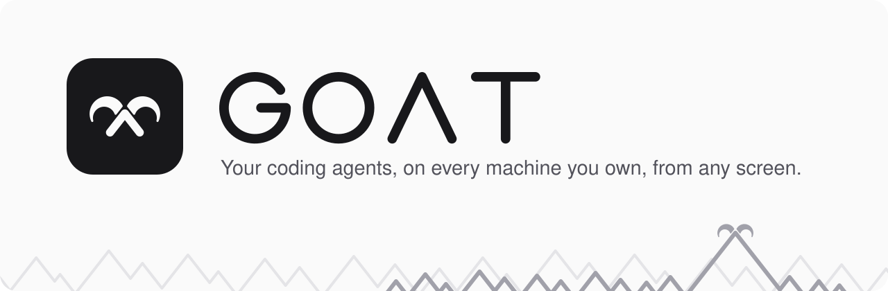
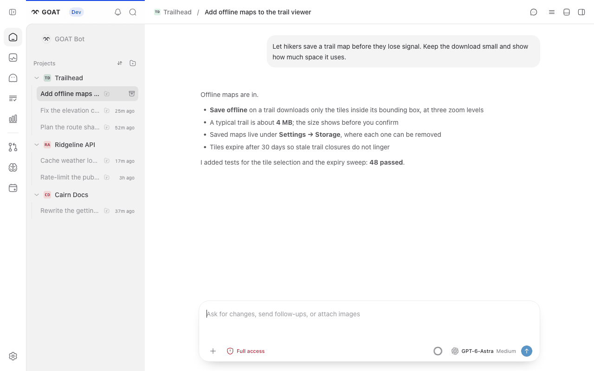
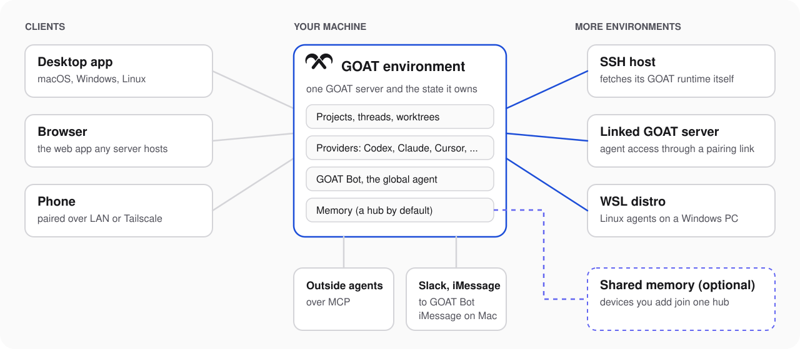

<p align="center">
  <picture>
    <source media="(prefers-color-scheme: dark)" srcset="./assets/readme/hero-dark.svg">
    
  </picture>
</p>

<p align="center">
  <a href="./docs/user/install.md">Install</a> ·
  <a href="https://github.com/goat-si/goat-releases/releases">Downloads</a> ·
  <a href="./docs/user">User guides</a> ·
  <a href="./structure/INDEX.md">How it is built</a>
</p>

GOAT runs the coding agents you already use, such as Claude Code, Codex and Cursor, on the machines you own: your laptop, a desktop at home, an SSH server or a cloud machine. You steer all of them from one place, whether that is the desktop app, a browser or your phone. Agents can start work on another machine, follow it, and hear back when it finishes, and **Fleet** shows you what is running and what needs you.

<p align="center">
  <picture>
    <source media="(prefers-color-scheme: dark)" srcset="./assets/readme/app-dark.png">
    
  </picture>
  <br>
  <sub>A synthetic demo project and conversation.</sub>
</p>

## Every machine is an environment

Each machine you work on runs a GOAT server. The server and the state it owns (projects, threads, provider sign-ins and memory) form an **environment**. Clients connect to as many environments as you like, and an environment can reach others: an SSH host gets its GOAT runtime on first use, a GOAT server you already run can be linked for agents with a pairing link, and on Windows a WSL distro runs its own environment.

<p align="center">
  <picture>
    <source media="(prefers-color-scheme: dark)" srcset="./assets/readme/map-dark.svg">
    
  </picture>
</p>

## What GOAT adds

GOAT began as a fork of [T3 Code](https://github.com/pingdotgg/t3code) and keeps its fast, event-sourced core. On top of it, GOAT adds:

- **GOAT Bot.** One standing conversation that is not tied to a project. Ask it for work and it starts a coding thread in the right project and machine, then reports the result. The same bot answers in Slack, and over iMessage when the server runs on a Mac.
- **Agents that cross machines.** An agent can browse folders on an SSH host, start a thread or worktree there, move a thread over with its uncommitted changes, and wait for the result. Hosts download their own GOAT runtime, and [Boat](https://boat.dev) cloud machines work like any other SSH host.
- **Fleet.** One view of every connected machine and the agents working on it, with counts of threads that are running or waiting for you.
- **Memory.** Finished conversations become memories scoped to all projects, one project or one thread. You can import memories from Codex, Claude and OMO, and share them across devices through a hub.
- **Orchestration tools.** The GOAT MCP server gives agents `goat_*` tools to launch threads, watch them, get notified when they end, and report results to the thread that started them. Outside agents such as Claude Code, Codex and ChatGPT can connect to the same server.
- **Cloud agents.** Claude Cloud, Cursor Cloud and Devin Cloud appear as providers next to the local ones.
- **Its own desktop app.** The GOAT desktop app has its own app ID, data folder and update feed, so it installs beside the T3 Code app without sharing state. Its command line is `goat`.

## Quick start

1. **Set up a provider** on the machine that will do the work. Claude Code, Codex, Cursor, Grok Build, OpenCode, Antigravity, Pi, Muse Code, ACP agents and the cloud providers are supported. The [provider table](./docs/user/install.md#providers) covers the command-line providers, [ACP providers](./docs/user/providers-acp.md) covers ACP agents, and cloud providers sign in from **Settings → Providers**.
2. **Install GOAT.** Download the desktop app for macOS, Windows or Linux from [goat-si/goat-releases](https://github.com/goat-si/goat-releases/releases), or install the `goat` command:

   ```bash
   curl -fsSL https://raw.githubusercontent.com/goat-si/goat-releases/main/install.sh | sh
   ```

   On Windows, run `irm https://raw.githubusercontent.com/goat-si/goat-releases/main/install.ps1 | iex` in PowerShell. Intel Macs have the desktop app but no `goat` executable; see [Intel Macs](./docs/user/install.md#intel-macs).

3. **Start GOAT.** Open the desktop app, or run `goat` if you installed the command; it starts the server and opens the web app. On macOS and Linux, `goat service install` keeps the server running in the background. `goat --help` lists the rest.
4. **Add your other screens and machines.** Pair a phone or another browser with [remote access](./docs/user/remote-access.md), and add SSH hosts under **Settings → Connections**.

GOAT is published to the public [goat-si/goat-releases](https://github.com/goat-si/goat-releases) repository, which the install scripts, the desktop updater and `goat update` all read. It publishes stable releases, starting with v0.1.1, and Nightly builds. The install scripts follow the Nightly train unless you set `GOAT_CHANNEL=stable`.

## Hubs

<!-- Hub extension point: describe hub features here as they land on dev. Keep every claim to what dev ships. -->

Every environment starts as its own memory hub. Add another device from the hub's **Settings → Memory**, and both save to and search the same memories. See [Memory](./docs/user/memory.md#share-between-devices).

## Documentation

| To                               | Read                                                                                                                                                                                                          |
| -------------------------------- | ------------------------------------------------------------------------------------------------------------------------------------------------------------------------------------------------------------- |
| Install, update and keep running | [Install](./docs/user/install.md) · [Updating](./docs/user/updating.md) · [Background service](./docs/user/background-service.md)                                                                             |
| Work in threads                  | [Threads and sidebar](./docs/user/thread-sidebar.md) · [Composer](./docs/user/composer.md) · [Permission modes](./docs/user/permission-modes.md) · [Keyboard shortcuts](./docs/user/keybindings.md)           |
| Work across machines             | [Remote access](./docs/user/remote-access.md) · [Move work to another machine](./docs/user/remote-access.md#let-an-agent-start-work-on-another-machine) · [Source control](./docs/user/source-control.md)     |
| Bring in agents and messages     | [Outside agents](./docs/user/outside-agents.md) · [Slack and iMessage](./docs/user/slack.md) · [Memory](./docs/user/memory.md)                                                                                |
| Set up providers                 | [Codex](./docs/user/providers-codex.md) · [Claude](./docs/user/providers-claude.md) · [OpenCode](./docs/user/providers-opencode.md) · [ACP](./docs/user/providers-acp.md) · [Pi](./docs/user/providers-pi.md) |
| Understand the code              | [Architecture overview](./docs/internals/overview.md) · [System map](./structure/INDEX.md) · [Contributing](./CONTRIBUTING.md)                                                                                |

Every user guide lives in [docs/user](./docs/user).

## Development

### Install vp

GOAT builds with Vite+. Install the global `vp` command first:

```bash
# macOS / Linux
curl -fsSL https://vite.plus | bash
```

```powershell
# Windows
irm https://vite.plus/ps1 | iex
```

Then run `vp i` to install dependencies and `vp run dev` to start the server and web app. [Development](./docs/operations/development.md) covers dev state and sharing, and [CONTRIBUTING.md](./CONTRIBUTING.md) comes before your first PR.

## Lineage

GOAT is a fork of [T3 Code](https://github.com/pingdotgg/t3code) by Ping and shares its git history. We merge upstream every cycle, and [devlog/_chase](./devlog/_chase/README.md) records how far GOAT has followed and where it deliberately differs. Thank you to the T3 Code team for the foundation.

## License

MIT. [LICENSE](./LICENSE) keeps the original T3 Code copyright notice. Icons: [Solar](https://www.figma.com/community/file/1166831539721848736) by 480 Design, [CC BY 4.0](https://creativecommons.org/licenses/by/4.0/).
