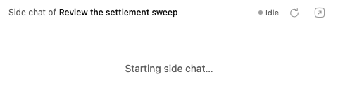
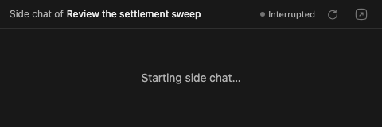
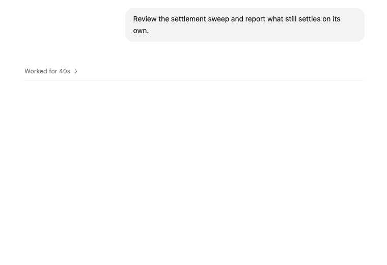
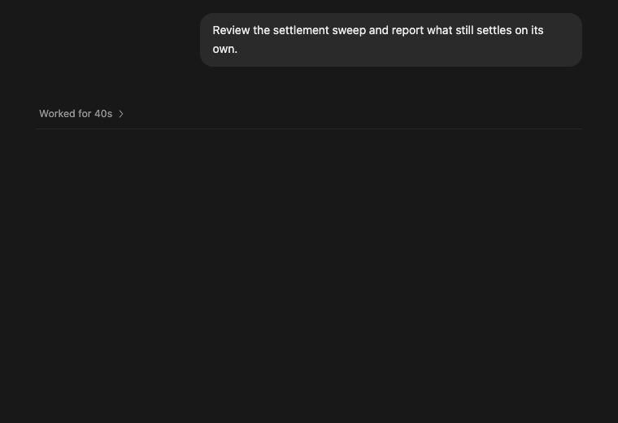
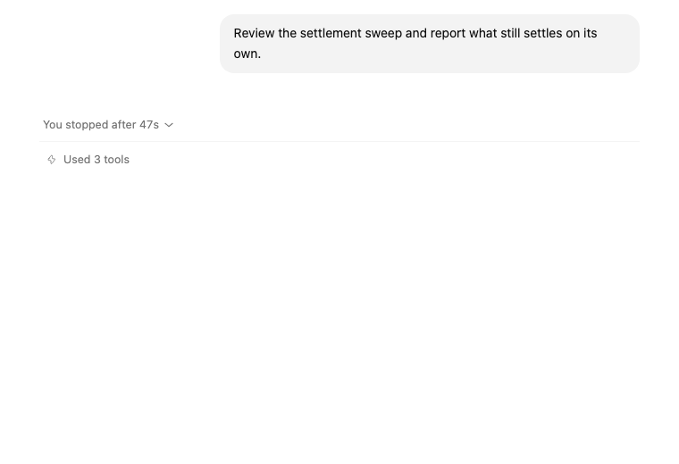
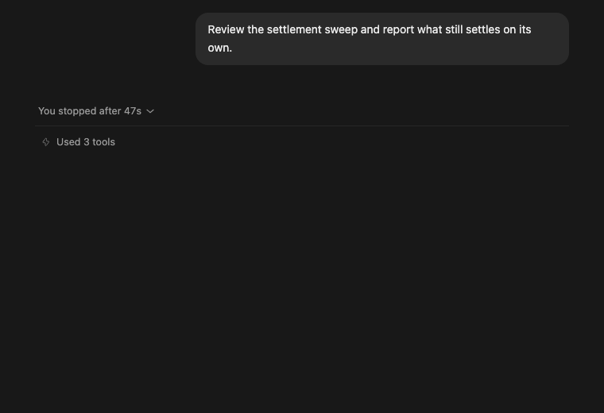

# L03 projection (chase/t3-261114-projection)

The closed #3361 body is this lane's record. This file adds only what changed after it (lane head dc640a984f at #3361, which no review covered).

## Decisions

28 decided: 24 ported (4 take, 20 adapt), 3 deferred (2 on a predecessor, 1 by decision), 1 skipped. Not attempted: 0.

Ported since the #3361 body:

- fix(server): subagent threads settle with their parent instead of sweeping on their own (#19665)
- fix(server): snooze no longer waits two minutes after a steered queued message (#35661)
- fix(server): CLI commands no longer migrate the database of a running server (#26763)
- perf(server): older history pages load without indexing the whole thread (#34573)
- test(server): windowed history pages are checked against the full index at the window edges (#35877)
- fix(server): long startup migrations log progress and resume after a restart (#35486)

Deferrals by kind:

- Missing predecessor (2): `5e2438ce94` and `591188471a` need code halves that earlier lanes deferred (their rows).
- Predecessor skipped by decision (1): `a25654c396`, coordinator decision of 2026-11-15.

Changed rows (they replace the #3361 rows with the same upstream id):

| upstream | decision | GOAT commit | reason |
|---|---|---|---|
| `20081ef95f` | adapt | af56701201 | Hybrid, per the coordinator decision of 2026-11-15. Only a provider-native subagent (`creationSource` "provider") waits until its parent is settled, archived or deleted, then settles without lookups even with automatic settlement off (apps/server/src/orchestration-v2/ProjectionStore.ts:6589 and :7738, ThreadSettlementService.ts:389); a parent's settle, archive or delete asks the coalescing `settlementAdmission.enqueueFull` for a full sweep (ThreadSettlementService.ts:829, :835). Task lanes keep DelegatedLaneSettlement: goat/DelegatedLaneSettlement.integration.test.ts:80-152 unchanged and passing. Settling a native child detaches no provider session: settle detaches only sessions bound to that thread (Orchestrator.ts:3149, ProjectionStore.ts:4627), a binding comes only from `provider-session.attached` for the thread whose turn opened or joined the session (ProjectionStore.ts:1667, ProviderSessionManager.ts:1694, :2753), and a native child's turns run on its parent's run under the parent's session (RunExecutionService.ts:108, Adapters/CodexAdapterV2.ts:2921); settling releases the child's devices (`threadCloseEffects`, goat/ThreadStopEffects.ts:43, queued at Orchestrator.ts:3969) and closes its terminals (`cleanUpSettledThread`, ThreadSettlementService.ts:769); it closes no previews or scheduled tasks. Un-settling the parent leaves its settled native children settled (Known limits). Dropped: upstream's `fullSweepPending` worker and its parent-worktree check (ThreadSettlementService.ts:786 already skips the settle script). Evidence: ThreadSettlementService.native-test-cases.ts:144, :219; ProjectionSettlement.test.ts:699; SubagentProjection.test.ts:138. Follow-up 747de36fd9: with automatic settlement off, the sweep reads only provider-native subagent candidates (`getSettlementCandidates(threadId, { providerNativeSubagentsOnly })`, SQL and in-memory; ProjectionSettlement.test.ts "%s: the provider-native read returns only provider-native subagents, still after their parent") |
| `d76e06679b` | adapt | c1c330cc35, 992328c5c9, aa666877c2, d01633d490, 96adc180fd, fd92bc1d91, e681c415b9 | Coordinator decision (2026-11-15): as upstream; after Stop with a queued completion wake the thread shows interrupted (was cancelled). A run cancelled before it started no longer presents as the thread's latest run when an earlier run that is not queued is still going or ended at or after the cancellation, in the presented-run join (apps/server/src/orchestration-v2/ProjectionShellThreadRows.ts:317) and `latestUnheldRun` (packages/shared/src/orchestrationV2ThreadError.ts:107). A steered thread presents the run that ran, Snooze is available as soon as it ends instead of up to two minutes later (packages/client-runtime/src/state/threadSettled.ts:39), and a queued message removed after a failure still shows `cancelled`. Ties, where one command ends the earlier run and cancels a never-started run at the same time (Orchestrator.ts unless named): Stop or `run.interrupt` ending a run before its provider turn (:11120) or after its session is gone (:10112) while cancelling a queued completion wake through `holdStoppedThread` (:10469 → :2430 → :1067) or a buffered notification (:10415, own `now` at :9315): the thread shows `interrupted`, was `cancelled`; `thread.archive` (:3815-3842), restart recovery (ProviderRuntimeRecoveryService.ts:407-425 with RecoveryUnstartedQueue.ts:99) and `thread.delete` (ThreadDeletion.ts:70-90) cancel every run involved, so the status stays `cancelled` and only `latestRunId` moves to the earlier run. No tie: `queued-run.cancel` (:12946, :9315), Steer (:9138, its target keeps running), settle (:3091, refuses running runs), pull request wake drops (:2768), delegated wake disposal (:2328); a failure holds the queue (:1295, :1482) or fails the queued run (:1203). For archived and deleted threads nothing acts on `latestRunId` (launch watches report them gone, launchWatchReads.ts:284); a restart tie moves `latestRunId` to the run that was working, so fork (apps/web/src/hooks/useForkThread.ts:64), the diff panel (apps/web/src/components/DiffPanel.tsx:216), plan lookup (apps/web/src/session-logic.ts:261) and `thread.status` (apps/server/src/mcp/threadStatus.ts:187) use that run, the better target, instead of the cancelled buffered wake. `goat_thread_read`'s thread and its result keep naming the newest run by ordinal (apps/server/src/mcp/threadListView.ts:259, HostThreadsMcpService.ts:529). The project's observed-check script now also runs after a steered turn completes (apps/server/src/threadResults/ObservedCheckService.ts:160); a check is evidence only and notifies nobody. GOAT follow-up to `d76e06679b` (upstream has no launch watch), 96adc180fd: an idle local launch watch read the runs only when the shell's latest run changed, so a person's queued message removed while an earlier run went on was never reported to the launcher; the look now gates on the newest run's ordinal as the remote look does (apps/server/src/mcp/launchWatchReads.ts:281-292), through one new store read, `getThreadNewestRun` (the thread's archived and deleted state and its newest run by the (thread_id, ordinal) index, SQL and in-memory, apps/server/src/orchestration-v2/goat/ThreadNewestRun.ts), in place of the shell row; a closed thread still ends the watch without a report. ProjectionRecoveryCandidates.ts:45 also uses `latestUnheldRun`, so a lane whose queued wake is cancelled while an earlier run is going no longer counts as terminal. Fixture only, no assertion changed, in ProjectionStore.shellReads.test.ts: :506 `payload: { ...original, status: "failed" }` becomes `payload: { ...original, status: "failed", completedAt: now }`; :575 `completedAt: now` becomes `completedAt: DateTime.add(now, { seconds: 1 })`; :578 still expects `cancelled`; :583-585 unchanged; runtimeLayer.test.ts:544 gets the same one-second fix in 992328c5c9. Dropped: the comment hunk and the `bounded-sql-history:steered-output` test edit, which belong to `b48b8ea2a0`'s window clause. Evidence: ProjectionStore.test.ts:4220, :4479; testkit/fixtures/queued_cancelled_while_active/codex_output.ts:37; DelegatedCompletionInterrupt.test.ts "the stopped thread presents its interrupted run with a completion wake cancelled at the same time" and "… with no queued wake"; OrchestratorMcpService.stoppedChildRead.test.ts; LaunchWatchService.follow.test.ts "tells the launcher once that a person's queued message was removed while an earlier run went on, when the shell …" and "ends the watch without a report once a look finds the thread's …"; ProjectionStore.shellReads.test.ts "%s newest run read names the newest run by ordinal and the thread's archived and deleted state". Follow-up fd92bc1d91: the presented-run check walks back from the nearest earlier run (scalar subquery, same filter, `ORDER BY earlier.ordinal DESC LIMIT 1`; steered case 7.05 ms → 0.016 ms on 20000 runs, a message removed after the run ended stays linear); this departs from upstream's text, and ProjectionStore.shellReads.test.ts "%s shell presents a run still going past two later runs cancelled before they started, as latestUnheldRun does" pins its agreement with `latestUnheldRun`. e681c415b9: the stopped-child read test waits for the run-update reactor's claim of the delivery before the read and then holds that the read acknowledges nothing (`claimed`, was `pending` read before the reactor ran) |
| `a25654c396` | deferred (predecessor skipped by decision) | - | Coordinator decision (2026-11-15): real deferral. Its predecessors were skipped by decision in earlier cycles: `f2943ee90e` (#26288, D-TRACK in cycle 261031) and `e805ce3712` (#3212; GOAT is on launcher protocol 3). Port all three together when GOAT moves to launcher protocol 4. That port must run or simulate `reconcileGoatMigrationIds` before the preflight check; unadapted, it would read GOAT's names at ids 80-89 on a database whose ids are not shifted yet as skipped migrations and block it. Until then an incompatible history still fails in the migrator (`assertV2MigrationsCanRun`, apps/server/src/persistence/Migrations.ts:448), and #3350 makes an older build refuse a shifted database with exit 79 |
| `5da53f87d9` | adapt | 7cf93b61bc | Coordinator ruling (2026-11-15): port now. CLI commands (auth, login, pair, connect, project, imessage) open the server's database through `layerCliConfig` / `layerCliFromPath` (apps/server/src/persistence/Sqlite.ts): with migrations pending they take the server's ownership lock first (`holdServerOwnershipLock`, apps/server/src/serverOwnership.ts) and refuse with `ServerOwnsDatabaseError`, database unchanged, while a server owns the home. `hasPendingMigrations` (apps/server/src/persistence/Migrations.ts) also counts GOAT's id shift through `goatMigrationIdsMove` (apps/server/src/persistence/reconcileGoatMigrationIds.ts), which the reconciliation now uses too; the memory ledger check only refuses and writes nothing, so it is not counted. GOAT adds the iMessage commands, which open the server database by derived paths; the project command's offline runtime keeps `layerConfig` because it runs after taking that lock itself. Host helpers move to `@goat/shared/hostClassification` as upstream did; without the move `Sqlite.ts` would import `startupAccess.ts`, which imports `EnvironmentAuth.ts` and `Sqlite.ts` again. Upstream's deferred-imports test edit taken. Evidence: reconcileGoatMigrationIds.upstream080.test.ts "hasPendingMigrations" (fresh, pre-shift max 147, GOAT rows above their ids), Sqlite.test.ts "layerCliConfig" (3 cases) |
| `5e2438ce94` | deferred (predecessor) | - | the index exists (orchestration_v2_projection_subagents_thread_idx, apps/server/src/persistence/Migrations/OrchestrationV2/Subagents.ts:24); needs the code halves of `a4d0a06e7f` and `b015ffd7c2`, which #3350 deferred; `a4d0a06e7f` waits on `9b352a04de`, which waits on `71646e031a` |
| `591188471a` | deferred (predecessor) | - | needs index 082 (orchestration_v2_projection_turn_items_conversation_idx, from #3350) and code from `a4d0a06e7f`, `5e2438ce94`, `9b352a04de`, `86c379d07a` (GOAT's decision inbox) and `2248ca8db9` (Cursor live steer), all deferred |
| `a909ea423c` | adapt | 32bab7600e | Coordinator ruling (2026-11-15): port now. Older history pages, timeline pages and agent reads read a local window near the page instead of the whole visible-row index; a jump to an entry, an attachment lookup and a run fork use the full index. Conflicts with 52da4e5098, 4fd40e1a16, 7d3635e572 and 17ddf292aa resolve to upstream's text after all four (17ddf292aa's cursor-row fix kept). Carries the windowed half of `59e64eef88` (`beforePosition` and `hasEarlier` on the window path). GOAT: a run fork reads the full index, side chats included (GOAT side chats, `sideChatOf`, show their source's rows; upstream's `lineage.sideChat` does not exist here); GOAT's `tail` read is a backward page on the window path too (a tail case joins the window-equivalence test and fails without it); `CONVERSATION_INDEX_EXCLUDED_TYPES` comes from the deferred code half of `b015ffd7c2`, for migration 082's index; identity keys keep GOAT's length-prefixed form; the hidden-row read keeps cancelled runs only (queued held input belongs to the deferred `9fb4492329`). New tests in ProjectionStore.historyPages.test.ts; upstream's edits of the bounded SQL history test and of threadHistoryPaging's notification test stay in place, after verbatim moves 6ae91ad381 and 10fc50d3c4 made room. ProjectionStore.ts is 66 lines under its entry; the window query stays in it to keep upstream's text |
| `4ca5b9cdb8` | adapt (C4; coordinator ruling option B, goat#3357) | 9b55b5c7e4, f6f553c473, 1969d806ca, e63f5e738b, 6a91b97f5d, f242ddb1c9 (fixtures 917e45e993) | runMigrations calls the migrator once per pending migration, each in its own transaction, and logs "Upgrading database" (migration, "i of n") before each on a database that has a ledger (apps/server/src/persistence/Migrations.ts:446-466). GOAT's id shift commits in steps (apps/server/src/persistence/reconcileGoatMigrationIds.ts:242-361): one transaction checks the memory ledger, refuses before any write when a GOAT row would land on another migration's id, moves GOAT's rows to their current ids and runs the first displaced upstream migration (080); each later displaced migration then runs in its own transaction, which reads the ledger again, runs the body and records the row. `displacedUpstreamMigrations` (:104) names what is left from the ledger alone (the unrecorded tail of upstream ids above the highest upstream id the ledger records below GOAT's block; a gap below the tail is a lost ledger row, refused as a skipped migration at ids 55 and up before any write, inside the move too, and ignored below 55; another name below 55 belongs to another history and starts with the divergence warning, as on origin/dev), so resuming does not rely on the migrator's "above the highest recorded" rule; `hasPendingMigrations` counts them (Migrations.ts:391). 080, which alters only `scheduled_tasks`, commits with the move: a moved ledger holding only GOAT names is one a pre-shift build would move back and start on; with 080 recorded it refuses as a newer database. Not taken: upstream's `NodeSqliteClient.layerWorker`; GOAT runs file-database opening and migration SQL on its writer worker already (Sqlite.test.ts "runs file database opening and migration SQL away from the server thread"). Upstream's own test makes 085 fail by creating its counts table, which GOAT's rerun-safe 085 accepts; the adapted Migrations.test.ts case makes 112_FleetHealth fail instead |
| `f5390209c2` | adapt | 5f42a78eee | The window-equivalence test's window-edge round, without `9fb4492329`'s held queued turn |
| `59e64eef88` | adapt | 34aec9c649, 32bab7600e | Its windowed half (`beforePosition` and `hasEarlier` on the local timeline path) lands with `a909ea423c` in 32bab7600e |

## Known limits (added)

- `d76e06679b`: when a person removes a queued message while an idle compaction runs, the client's `latestUnheldRun` counts the compaction run as an earlier run and the server's presented-run join skips it, so the two show different runs until the thread's next run.
- `d76e06679b`: the server's settlement candidate still takes the newest run by ordinal (`getSettlementCandidates`, apps/server/src/orchestration-v2/ProjectionStore.ts), so for a steered thread settlement can lag the sidebar by up to two minutes, and a steered failure does not end a snooze for settlement purposes.
- `20081ef95f`: a settled provider-native subagent stays settled when its parent is un-settled; nothing reopens it, as upstream, since it cannot receive messages. A person can un-settle it from its thread view and an agent with `goat_thread_manage` `unsettle`. The periodic and event full sweeps read settlement candidates while automatic settlement is off, only provider-native subagent threads since 747de36fd9.
- `d76e06679b`: `goat_thread_read` names a thread's newest run by ordinal, so after a Stop that cancelled a queued notice it reports `cancelled` while thread lists and `thread.status` report `interrupted`; aligning the read with `latestUnheldRun` changes what a read returns and acknowledges and is tracked in goat-si/goat#3378 for the L03 retry round.
- `d76e06679b`: after Stop with a queued completion wake the thread shows `interrupted` instead of `cancelled`, as without a wake. An older client keeps the old rule in its local projection until it updates, so after a steer its thread view can show the cancelled run while its sidebar, read from the server, shows the run that ran.

## Surfaces (changed)

- Web: `31eea883c7` offers conversation-only rewind for turns whose checkpoint has no git snapshot and disables "Revert files too" for them. `d76e06679b`: after a steer the thread presents the run that ran, and Snooze is available when it ends; after Stop with a queued completion wake it shows the interrupted run.
- Mobile: no mobile code changes. `31eea883c7` lets the shared client-runtime revert command rewind the conversation at a checkpoint without a snapshot; mobile has no rewind entry point. `d76e06679b` reaches mobile status through the shared `latestUnheldRun`.
- Providers: `70833b2f55` changes release cleanup for Claude and Muse sessions; other adapters keep their background work rules. `20081ef95f` applies to every adapter's provider-native subagents (`creationSource` "provider"); task lanes started with `task.create` are unchanged.
- Agents and scheduled tasks: `goat_thread_read` and thread status show the run that ran after a steer, and phase `interrupted` after Stop with a queued wake (`d76e06679b`; both phases are terminal, launch-watch outcomes map both to `cancelled`, and scheduled tasks report their own run). A parent's summary or tail read of a stopped task child still leaves its completion wake owed, because `goat_thread_read` names the child's newest run by ordinal, which for a Stop that cancelled a queued notice is the cancelled notice (`cancelled` there, `interrupted` in thread lists and status, goat-si/goat#3378). Agents' launch-watch notices are unchanged: an idle local watch now finds new runs by ordinal (96adc180fd), so a queued message removed while an earlier run went on is still reported once; scheduled-task threads settle their native subagents with them (`20081ef95f`).
- Docs: docs/user/thread-sidebar.md:363 says provider-started subagents settle with the thread that started them.

## Tests (added)

- `20081ef95f`: before the fix, both stores listed the native child while its parent was live (sql and memory: `expected Set{ …(3) } to deeply equal Set{ …(2) }`), the provider case of SubagentProjection.test.ts saw it at once, the drain test saw no commands (`expected [] to deeply equal [ 'empty', 'recent' ]`), and the manual-settle test hung at startup because the sweep returned before reading candidates with automatic settlement off (5 failed, 80 passed). With the store and sweep changes but without the parent event wakes, the manual-settle test failed on `expected [] to deeply equal [ ObjectContaining{…} ]`. After: 12 settlement files pass 314 of 314, DelegatedLaneSettlement.integration.test.ts included.
- `d76e06679b`: before the fix, the five `keeps the shell on the user's last turn only during …` cases, `only exposes interruptible runs through the shell activeRunId` and the Codex `queued_cancelled_while_active` replay failed (7). With the fix and the old fixture, both `fallback candidates preserve trigger and recovery policy` cases failed on `expected 'failed' to equal 'cancelled'`, as did two `runtimeLayer` cancelled-queue scenarios. After: 11 server files pass 201 of 201, `runtimeLayer.test.ts` 170 of 170, client-runtime 121 of 121, web `threadPendingBackgroundTasks` 6 of 6, contracts `orchestratorMcp` 18 of 18. Stop boundary (aa666877c2, DelegatedCompletionInterrupt.test.ts, real orchestrator, SQL and in-memory shells): with a completion wake cancelled at the same time as the interrupted run, the shell code before the port failed with `expected 'cancelled' to equal 'interrupted'` and the port passes; with no queued wake both pass; the file passes 5 of 5. Launch-watch follow-up (96adc180fd): with the shell presenting the run that ran and the old look, "tells the launcher once that a person's queued message was removed …" failed with `expected [ 'run-1' ] to deeply equal [ 'run-1', 'run-3' ]` (the launcher heard nothing after run-1), while the same case with the shell naming the newest run passed; after the fix both pass, the closed-thread looks pass before and after, and the store read passes against the SQL and in-memory stores; 16 affected files pass 261 of 261.

## Hand-over to chase/t3-261114-all

Lane head b168747f7e (was dc640a984f at #3361). Commits since: af56701201 (20081ef95f), 992328c5c9, c1c330cc35 (d76e06679b), aa666877c2, d01633d490, 96adc180fd (launch-watch follow-up), c98c1439be (merge of chase/t3-261114-all at 56421003ff), aa17a5a9c0 (verbatim move), 4fcce26fce (088 assertion), b168747f7e (merge of chase/t3-261114-all at ad86de82a5, which contains 2be9695078).

Conflicts in the first merge, and how they were resolved:

- `ProjectionStore.test.ts`, `ProjectionStore.testkit.ts`, `ProjectionStore.provenance.test.ts`: L03m's split files kept; this lane's provenance and testkit copies differed only in blank lines, and `ProjectionStore.serverActivity.test.ts` (the same seven tests as L03m's `ProjectionStore.activity.test.ts`) is deleted. The six shell read tests stay in this lane's `ProjectionStore.shellReads.test.ts`; L03m's copies were identical apart from this lane's two authorised fixture edits.
- `ProjectionStore.test.ts` then held 8189 lines against its 8041 entry: aa17a5a9c0 moves "SQL snapshot windows leave handoff bodies in SQLite without changing the wire", "lists only active subagent IDs without loading shell data" and "lists every thread in the shell snapshot past SQLite's bound variable limit" verbatim to `ProjectionStore.snapshotReads.test.ts` (7945 lines left).
- `ThreadFind.ts`: L17a's run id read and this lane's `empty_text` column, both kept.
- `ChatView.props.ts`: both lanes extracted the same props; one file, imported once by `ChatView.tsx` (4236 lines, entry 4239).
- `ProviderSessionManager.ts` and its test: this lane's released-work module and testkit, and L10's session-scoped artifact reads, both kept; L10's changes do not touch the moved code.
- After the merge, the 5f2bb934d8 plan check failed: L03m's migration 088 (`turn_items_thread_type_idx`) is now the plan for user-only ordinal reads. 4fcce26fce takes upstream's own edit of that assertion from b7a224c7dd (the commit that adds 088; its code half stays deferred): the read must stay on a type-bounded index.

The second merge (ad86de82a5) had no conflicts.

Test titles and assertion calls across `ProjectionStore*.test.ts`:

| file | lane at 96adc180fd | all at 56421003ff | merged |
|---|---|---|---|
| ProjectionStore.test.ts | 50 / 399 | 52 / 406 | 46 / 399 |
| ProjectionStore.shellReads.test.ts | 7 / 52 | - | 7 / 52 |
| ProjectionStore.snapshotReads.test.ts | - | - | 3 / 11 |
| ProjectionStore.serverActivity.test.ts | 7 / 38 | - | deleted |
| ProjectionStore.activity.test.ts | - | 7 / 38 | 7 / 38 |
| ProjectionStore.provenance.test.ts | 4 / 26 | 4 / 26 | 4 / 26 |
| ProjectionStore.notifications.test.ts | 6 / 23 | 6 / 23 | 6 / 23 |
| ProjectionStore.questionRecovery.test.ts | 4 / 15 | 4 / 15 | 4 / 15 |
| ProjectionStoreAttachments.test.ts | 1 / 1 | 1 / 1 | 1 / 1 |
| total | 79 / 554 | 74 / 509 | 78 / 565 |

79 - 7 (serverActivity duplicates) - 2 + 7 (activity) + 1 = 78: chase/t3-261114-all removes "limits turn-start history to the requested runs, including an empty selection" (L17a b6fc38987f, upstream 49013438a9) and "looks up shell stop requests through the interrupt request index" (L03m 74475b094f, upstream migration 085), and adds "reads shell runs and item counts without walking a thread's history" (74475b094f). No title appears twice across the `ProjectionStore*.test.ts` files.

Budgets: this lane changes no entry (`code-budgets.json` equals chase/t3-261114-all's). Real lengths on the merged tree (update-code-budgets.ts read only) against their entries: ProjectionStore.test.ts 7945 / 8041, ProjectionStore.ts 8119 / 8836, Orchestrator.ts 13848 / 13908, ThreadManagementService.ts 2155 / 2201, LaunchWatchService.ts 2048 / 2049, ProviderSessionManager.ts 3067 / 3128, ProviderSessionManager.test.ts 6096 / 6326, ChatView.tsx 4236 / 4239, ChatView.logic.ts 1660 / 1697.

`a909ea423c` is not ported (its row).

Combined-branch issue found by this lane's gate (not caused by it): at ad86de82a5, `apps/server` typecheck fails at `apps/server/src/provider/Drivers/AntigravityDriver.ts:480` (`Cannot find name 'processEnvironment'`). dev's #3207 (46565c8245) removed that variable from the driver's top level, and 18813a144cf (probe timeouts per provider) passes `environment: processEnvironment` to `makeAntigravityProvider`; the merge 2be9695078 kept both. The file is identical on chase/t3-261114-all; `apps/server` typechecked with 56421003ff.

## Gate

- check:changed on c98c1439be..4fcce26fce (merged with 56421003ff; `GIT_CONFIG_GLOBAL=/dev/null GIT_CONFIG_NOSYSTEM=1 VITEST_MAX_WORKERS=4`, pipefail, load 24-110 from other worktrees): unused patches, format, lint, knip 1/2 and 2/2, graphql (2), agent surface audit, agent context budget and typecheck (42 packages) pass; test: 1598 files, 1 failed | 1589 passed | 8 skipped, 24410 passed | 1 failed | 24 skipped; the failure is `packages/ssh/src/runtimeFactsScripts.test.ts` "reads a built runner in one call and parses only the lines before its end line" (`/bin/bash` 3.2, goat#3363).
- After the second merge (b168747f7e): `vp i`; typecheck passes for apps/web, packages/contracts, packages/shared, packages/client-runtime and packages/provider-core, and fails for apps/server only at AntigravityDriver.ts:480 (above); 29 focused files pass 751 of 751 (settlement, ProjectionStore*, launch watch, Stop boundary, stopped child read, ThreadFind, ProviderSessionManager, runtimeLayer, Codex replay); persistence suite alone: 1 failed | 212 passed (026_CanonicalizeModelSelectionOptions, goat#3355); lint clean on the lane's 91 changed TypeScript files.
- `node scripts/goat-rename.ts --check`: 0 lines with T3 residue in 0 files, 0 dropped paths.

NOT RUN: check:changed on b168747f7e itself (apps/server typecheck fails at AntigravityDriver.ts:480 on chase/t3-261114-all); real-client checks (a native subagent under a parent settled by hand with automatic settlement off, then the parent un-settled; a task.create lane under a live parent settling at once; a steered queued message on web and mobile; Stop a parent while a child's completion is queued, on web and mobile; a launch watch while a person removes a queued message); mobile client; real provider turns; ci:full.

## Follow-up after b168747f7e (review rulings of 2026-11-15)

Both final reviews of b168747f7e approved with nits. Lane head 630fd9e68e on chase/t3-261114-projection, fast-forwarded from b168747f7e after its gate: the delta since b168747f7e (not yet reviewed) plus the merge of chase/t3-261114-all at 83138ac3b6. Commits on top of b168747f7e:

| commit | what | first-failing evidence |
|---|---|---|
| 747de36fd9 | with automatic settlement off, the sweep reads only provider-native subagent candidates | the new store test failed in both stores (the read returned the lane, parent and root threads), then passed |
| fd92bc1d91 | the presented-run check walks back from the nearest earlier run (scalar subquery, same filter) | a form that checks only the nearest earlier run failed the new agreement test (`expected 'outlived-twice:3' to equal 'run:outlived-twice:rolled-back'`); the shipped form passes |
| 51cfdf5e16 | the 088 plan check requires `turn_items_thread_type_idx (thread_id=? AND type=?)` | a `(thread_id=?)` plan no longer passes the check; the real plan still does |
| 7cf93b61bc | `5da53f87d9` (its row) | with upstream's `hasPendingMigrations`, "GOAT rows recorded above their ids are pending although the newest id is past this build's" failed (`expected false to be true`); the three CLI tests failed before the code existed |
| 6ae91ad381 | moves "pages a whole thread without re-reading its full timeline for every page" verbatim to ProjectionStore.historyPages.test.ts (342 lines, byte-identical) | titles and assertion calls of the two files: 46 / 399 before and after |
| 10fc50d3c4 | moves threadHistoryPaging.test.ts's NOW, THREAD, makeRow and makeTurnStart to threadHistoryPaging.testkit.ts, unchanged but for `export` | 22 / 105 before and after |
| e681c415b9 | the stopped-child read test (d01633d490) waits for the run-update reactor (Orchestrator.ts, forked `runUpdateReactors`) to claim the task's completion delivery before the read, then holds that the read acknowledges nothing (`claimed`; it read `pending` only while the reactor had not yet run, and failed once a909ea423c's window reads let it run first) | passes 3 of 3 runs before and with a909ea423c |
| 32bab7600e | `a909ea423c` with the windowed half of `59e64eef88` (its row) | without the tail adaptation the window-equivalence test's tail case fails; upstream's equivalence test passes |
| 5f42a78eee | `f5390209c2` (its row) | passes |
| a13395e08e | the stopped-child read test also holds that the parent's wake is dispatched: with continuation requests queued (`layerTestWithContinuations`), it takes the request that offers the delivery's message, generation and parent run to the parent's active run | passes 3 of 3; no behaviour change made "pending" wrong, it was a race in the test (e681c415b9) |
| e66dce5c1e | the native-child drain case is now "drains provider-native children of a settled parent without PR lookups, one still working included": the working child has an active subagent row on its parent and no run, and settles with it | passes; known limit, goat-si/goat#3407 |

Still-working provider-native child: coordinator decision of 2026-11-15, option A, keep upstream's rule. A native child at work has no app run; its parent records it as an active subagent row. Closing the parent detaches its session and unloads an unattached native child (ProviderSessionManager.ts:3013-3033), but nothing ends that row: only Stop or interrupt (Orchestrator.ts:9948), a confirmed `subagent.stop` (:10588) and startup or shutdown recovery (ProviderRuntimeRecoveryService.ts:599) do. Excluding active rows would therefore strand such a child until the next restart. e66dce5c1e rewrites the drain case to what a native child really has, an active subagent row and no run, and holds that it settles with its parent. Options B (end the row when the parent's detach unloads the child, then exclude active rows) and C (exclude only while the child's session is live) are in goat-si/goat#3407.

Corrections to the rows above: the 20081ef95f settle effect (releases devices, closes terminals, closes no previews or scheduled tasks); 28 citations refreshed on the merged tree (Orchestrator.ts +6 lines; ProjectionStore.ts, ProjectionStore.test.ts, ProjectionShellThreadRows.ts, RunExecutionService.ts, Migrations.ts, CodexAdapterV2.ts, ThreadSettlementService.ts, ProviderSessionManager.ts, orchestrationV2ThreadError.ts as written). Adapted test edit not named before: ProjectionRecovery.test.ts:468 rewrites six existing lines into upstream's loop form, because GOAT lacked the loop that 156dcd8c7a assumes; the expected values are the same and plan checks were added. L03m's `b7a224c7dd` row: 4fcce26fce took one of its test hunks (the 088 plan assertion), now tightened by 51cfdf5e16.

Surfaces (changed): CLI commands that open the server's database (`goat auth`, `login`, `pair`, `connect`, `project`, `imessage`) refuse to migrate a database a running server owns and say which `goat` to use, as upstream's CLI does; they run as before when nothing is pending. Web, mobile and agents: history pages, timeline pages and thread reads return the same pages, now from a window near the page; tail reads included.

Test titles and assertion calls (titles of `it`, `it.effect`, `it.live` and their `.each` forms; assertion calls `assert…(` and `expect(`):

| file | b168747f7e | merged head |
|---|---|---|
| ProjectionStore.test.ts | 46 / 399 | 45 / 398 |
| ProjectionStore.historyPages.test.ts | - | 2 / 17 |
| ProjectionStore.shellReads.test.ts | 7 / 52 | 8 / 54 |
| ProjectionStore.snapshotReads.test.ts | 3 / 11 | 3 / 11 |
| ProjectionStore.activity.test.ts | 7 / 38 | 7 / 38 |
| ProjectionStore.provenance.test.ts | 4 / 26 | 4 / 26 |
| ProjectionStore.notifications.test.ts | 6 / 23 | 6 / 23 |
| ProjectionStore.questionRecovery.test.ts | 4 / 15 | 4 / 15 |
| ProjectionStoreAttachments.test.ts | 1 / 1 | 1 / 1 |
| ProjectionStore* total | 78 / 565 | 80 / 583 (was written 81 / 586; corrected) |
| threadHistoryPaging.test.ts | 22 / 105 | 22 / 108 |

No title appears twice across these files.

Merge: 750aa54c1e merges chase/t3-261114-all at 74ae8cc7b2 (which already merged this lane at b168747f7e, L17a's bb4ace3132 and dev 387e8c798f, #3377); no conflicts; `vp i` after its lockfile change. 630fd9e68e merges chase/t3-261114-all at 83138ac3b6 (L04 retry 41992d56ef; dev b719465f12 with #3208, #3401 and #3402); no conflicts, no manifest or lockfile change. On the merged tree: `apps/server` and `packages/shared` typecheck, and the focused tests with the persistence suite give the same 888 of 889 (only 026, goat#3355). The lane's own 29 files (since merge base 83138ac3b6) touch no ThreadFork.*.test.ts, goat/NativeForkRecovery.ts, mobile i18n or notice config, so the gate on 83138ac3b6 stands for tip 1f34e35e42.

Budgets: this lane changes no entry. Real lengths on the merged tree against their entries: ProjectionStore.ts 8770 / 8836, ProjectionStore.test.ts 7739 / 8041, threadHistoryPaging.test.ts 1083 / 1108, Orchestrator.ts 13848 / 13908, runtimeLayer.test.ts 10007 / 10007, core.test.ts 1691 / 1691, nodeSqliteClient.ts 1307 / 1307, orchestratorMcp.ts 1160 / 1161, HostThreadsMcpService.ts 997 / 1000 (default limit), ProviderTurnStartService.ts 1577 / 1587, ProjectionRecovery.test.ts 1360 / 1377, commands.ts 1202 / 1219, ThreadManagementService.ts 2155 / 2201, ProviderSessionManager.ts 3067 / 3128, ProviderSessionManager.test.ts 6096 / 6326, ChatView.tsx 4236 / 4239. (LaunchWatchService.ts and ChatView.logic.ts left the list: this lane does not change them.)

Captures (harness renders: browser-test harness with the app stylesheet, not a running app; the shell fixture is the Stop tie of DelegatedCompletionInterrupt.test.ts, whose latest run is the cancelled wake before the port and the interrupted run after it). The sidebar row and thread header do not show the difference: the row's status pill has no label for either a cancelled or an interrupted latest run (apps/web/src/components/Sidebar.logic.ts, `resolveThreadStatusPill`), its working label reads `runtime.status` (apps/web/src/components/sidebar/SidebarThreadRow.tsx:622), and `ChatHeader` takes no run status. The visible change is the side chat's status of its main thread (apps/web/src/components/sideChat/sideChat.logic.ts:61): "Idle" before, "Interrupted" after.

Before (cancelled), light and dark:

After (interrupted), light and dark:

Snooze after a steered queued message: not captured, because it needs a steered real turn and Replay (dev) cannot steer (`supportsActiveSteering: false`, packages/provider-acp/src/server/capabilities.ts:36; a steer becomes interrupt-and-restart, apps/server/src/orchestration-v2/CommandPolicy.ts:373-381). The rule is covered by ProjectionStore.test.ts "keeps the shell on the user's last turn only during %s" and "only exposes interruptible runs through the shell activeRunId", the Codex replay `queued_cancelled_while_active` (testkit/fixtures/queued_cancelled_while_active/codex_output.ts:37), and client-runtime threadSnoozed.test.ts "canSnooze"; threadSettled.ts has no test file of its own.

Gate: the coordinator's gate of 630fd9e68e on juns-MacBook-Pro.local (macOS 27.2, 18 cores, Node 26.12.1, load 7-10.4): PASS after triage. check:changed passes every static step (typecheck of 42 packages and the agent surface audit included). Tests: 1809 of 1819 files, 26546 of 26591 tests; the 3 failing files fail identically on base 428af27456 and the lane touches none of them: runtimeFactsScripts (goat#3363), GrokTextGeneration (goat#3425), and apps/server/src/cli/app.test.ts, whose 4 "resolves relative cwd/flag/env/bootstrap against the inaccessible original cwd" cases fail and hang in an unbounded spawnSync (evidence added to goat-si/goat#3238). Persistence suite alone: 218 of 219, only 026 (goat#3355). goat-rename: 0. An earlier gate of e66dce5c1e on pen-cc-04 ran under critical load and counts neither way. Run here on the merged heads: focused tests and the persistence suite in one run (120 files: 1 failed | 119 passed; 889 tests: 888 passed, 1 failed, 026, goat#3355), `packages/shared` and `apps/server` typecheck (pass), lint and format on the delta's changed files (warnings only, none on lines the delta changes), `node scripts/goat-rename.ts --check` (0 lines with T3 residue in 0 files, 0 dropped paths).

NOT RUN: real clients; real provider turns; ci:full.

## Second follow-up after 630fd9e68e (review rulings and 4ca5b9cdb8, 2026-11-15)

630fd9e68e was approved with nits by both final reviews and merged into chase/t3-261114-all as 13a4d955f0. This round has two parts, reviewed separately. Lane head e63f5e738b on chase/t3-261114-projection; both parts sit on 34c22ffd49 (630fd9e68e merged with chase/t3-261114-all at 1f34e35e42), and e63f5e738b merges chase/t3-261114-all at 3f9cb15cba (L19 48ea0bb5b0, this lane at 13a4d955f0, dev 6fa6fe39e6 with #3424 and #3429) without conflicts.

### Part 1: L03 nits (review of 630fd9e68e)

| commit | finding | what |
|---|---|---|
| 8c97a48fa7 | B P3-1 | ThreadSettlementService.native-test-cases.ts "drains provider-native children of a settled parent without PR lookups, one still working included, and retries one a person's run keeps busy": the runless working child (active subagent row on its parent) settles with the parent, and a third child with a running app run (a person messaged it) is held, then settled by the targeted read its run update triggers (`Queue.take(fixture.targetedReads)`, `service.drain`), upstream 20081ef95f's assertions. Settlement suite 60 of 60. |
| 44304e1d65 | B P3-5 | Sqlite.test.ts's `ownGoatHome` takes the lock through `acquireServerOwnership` (the server's own start path) with an empty home, as upstream's tests do; the four `layerCliConfig` cases pass (16 of 16 in the file). |
| record | B P2-1, B P3-2 to P3-4, A P3-1, A P3-2 | below |

Issues filed: goat-si/goat#3434 (a server, desktop or service start during a CLI migration exits 78 and is not retried; B P3-2) and goat-si/goat#3435 (`goat_thread_read`'s `hasMore` differs between the timeline window and the full index for degenerate paging inputs; A P3-2).

Corrections:

- 4ca5b9cdb8 is described once now: the coordinator ruled option B (2026-11-15) and it is ported in part 2 (row above, card and #3176 updated); goat#3357 has the comment (issuecomment-6896223178).
- Citations refreshed on e63f5e738b: the 21 Orchestrator.ts lines in the 20081ef95f and d76e06679b rows and the still-working child paragraph (:3875 → :3149, :3953 → :3969; tie paths :11095 → :11120, :10087 → :10112, :10444 → :10469, :2431 → :2430, :1066 → :1067, :10390 → :10415, :9290 → :9315, :3776-3803 → :3815-3842, :12921 → :12946, :9119 → :9138, :3092 → :3091, :2769 → :2768, :2329 → :2328, :1294 → :1295, :1483 → :1482, :1202 → :1203; :9923 → :9948, :10563 → :10588), RunExecutionService.ts:117 → :108, ThreadSettlementService.ts:767 → :769, Migrations.ts:443 → :448 (mapped through `git diff -U0` from 750aa54c1e; :3875 falls in a changed hunk and is found by its unique text).
- Replay (dev) cannot steer because its ACP capabilities set `supportsActiveSteering: false` (packages/provider-acp/src/server/capabilities.ts:36), so a steer on it becomes interrupt-and-restart (apps/server/src/orchestration-v2/CommandPolicy.ts:373-381) and cannot produce a steered queued message; packages/provider-acp-registry/src/server/adapter.ts:238 was Copilot's interrupt-restart override.
- The ProjectionStore* totals row reads 81 / 586 but its rows sum to 80 / 583, the count at 630fd9e68e and at e63f5e738b (no ProjectionStore*.test.ts changes since).
- Budgets on e63f5e738b (wc against entry): Orchestrator.ts 13873 / 13908, ProviderTurnStartService.ts 1581 / 1587, ThreadManagementService.ts 2004 / 2201, ProviderSessionManager.test.ts 6098 / 6326, ProjectionStore.shellReads.test.ts 968 / 1000 (default limit), ProjectionStore.ts 8770 / 8836, ProjectionStore.test.ts 7739 / 8041, LaunchWatchService.ts 2048 / 2049, ChatView.tsx 4236 / 4239, runtimeLayer.test.ts 10007 / 10007, nodeSqliteClient.ts 1307 / 1307. The only entry this round changes: reconcileGoatMigrationIds.ts `nonNull: 1` removed (0 left; update-code-budgets.ts on the merged tree writes no entry for it).
- Commit messages (A P3-1): in upstream, 52da4e5098, 7d3635e572 and 4fd40e1a16 are ancestors of a909ea423c; only 17ddf292aa comes after it, so 32bab7600e's "ported before this commit, though upstream wrote them after it" holds for 17ddf292aa alone, and the conflicts come from GOAT's adapted ports and b015ffd7c2's deferred code half. The count receipts in 6ae91ad381 ("43 and 399") and 10fc50d3c4 ("20 and 105") used another title regex; the record's 46 / 399 and 22 / 105 are the counts by this record's rule.
- 5da53f87d9 (row): the CLI tests take the lock as a server does since 44304e1d65; production code still holds it with `holdServerOwnershipLock` (apps/server/src/persistence/Sqlite.ts:62).

Known limits (added):

- `5da53f87d9`: a server, desktop or service start while a CLI command migrates the same home exits 78 and its supervisor does not retry (desktop shows "This GOAT home is unavailable" and quits; the service launcher idles), where it used to hit the busy timeout and be restarted; the 080-089 shift can take over 60 s on a large database. goat-si/goat#3434.
- `a909ea423c`: `goat_thread_read`'s `hasMore` can differ between the window and the full index for `beforePosition <= afterPosition + 1` or `itemId` with an explicit `beforePosition`, as upstream. goat-si/goat#3435.
- `4ca5b9cdb8`: a supervised SSH runtime upgrade restores its pre-upgrade backup when the new server misses the 60 s ready deadline (apps/server/src/cli/sshRuntimeSupervisor.ts:441, :487-495), discarding the steps it finished, so a database whose upgrade takes longer than 60 s cannot finish through that path; goat-si/goat#3357 stays open for it.

Surfaces (added): after Stop with a queued completion wake, the stopped run's work fold in the thread timeline reads "You stopped after X" instead of "Worked for X", on web and mobile, and on web it opens, because the presented run is the stopped run going from running to interrupted (apps/web/src/components/chat/MessagesTimeline.logic.ts:1195-1212, MessagesTimeline.tsx:540-548; apps/mobile/src/lib/threadActivity.ts:1106-1128; all from `latestUnheldRun`). After a steered turn ends, the web and desktop completion and failure notices now fire for it (apps/web/src/components/ThreadNotificationCoordinator.tsx:485-493, `thread.latestRun`), as for any other finished turn; not captured, for the same reason as Snooze (it needs a steered real turn, and Replay (dev) cannot steer).

Captures of the timeline fold (harness renders: browser-test harness with the app stylesheet, not a running app). The runs are the Stop tie of DelegatedCompletionInterrupt.test.ts: the stopped run interrupted and a completion wake cancelled at the same instant. The fold's `latestRun` comes from the newest run by ordinal before the port and from the real `latestUnheldRun` after it; each render starts with the run working, then stops it.

Before (the cancelled wake presents; "Worked for 40s", closed), light and dark:

After (the stopped run presents; "You stopped after 47s", open), light and dark:

Mobile: not captured: the mobile app has no browser-test harness for its screens, and a seeded projection in the dev client was not tried. Its fold uses the same rule from the same `latestUnheldRun` (apps/mobile/src/lib/threadActivity.ts:1106-1128).

### Part 2: `4ca5b9cdb8` option B (C4, migrations)

Coordinator ruling (2026-11-15): option B; its own fresh review. Commits: 917e45e993 (fixtures to the testkit), 9b55b5c7e4 (upstream's per-migration loop and progress log), f6f553c473 (the stepped, resumable id shift), 1969d806ca (the two rewritten interruption tests pin the whole contract), e63f5e738b (only unrecorded upstream ids count as displaced; found by the gate of 978975d31d: scripts/migrate-dev-db.test.ts "seeds from a source that recorded another migration below V2" and LegacyV1Cutover.integration.test.ts failed with DatabaseNewerThanBuildError on f6f553c473 and pass with the fix), 6a91b97f5d (the C4 review fix round below), 54512685ba (P3-5).

Authorised 2026-11-15: with per-migration transactions (4ca5b9cdb8, option B) the two tests that pinned a whole-run rollback now pin the new contract: a failure in migration N rolls back N alone, every migration before N stays committed with its ledger row, and a restart resumes at N and ends equal to a fresh database; for the id shift, the collision check, the ledger move and 080 commit together or not at all.

| file | old title and expectation | new title and expectation |
|---|---|---|
| reconcileGoatMigrationIds.upstream080.test.ts | "an upgrade interrupted in the last upstream step rolls back whole and resumes": 089 failing (its body replaced by a failing SELECT) leaves the ledger and schema exactly as before the upgrade; a restart runs all of 080-089 | "an id shift failing in 080 keeps the old ledger; failing in 089 rolls back 089 alone, keeps 080-088 and resumes at 089": 080 failing after its work leaves the old ledger and schema unchanged (collision check, move and 080 together); 089 failing after its work leaves 089's three indexes absent and every other row of the current manifest recorded; the restart runs 089 alone and ends equal to a fresh database (schema objects, column sets, ledger); user data kept |
| reconcileGoatMigrationIds.test.ts | "retries an interrupted relocation without changing the old schema or ledger": a 70-series ledger with 076 failing keeps the old ledger and schema; a restart finishes | "a relocation failing in 070 keeps the old ledger; failing in 076 rolls back 076 alone, keeps 070-075 and resumes at 076": 070 (the first displaced migration) failing after its work leaves the old ledger and schema; 076 failing after its work leaves `projection_projects` without 076's columns and 070-075 recorded with GOAT's rows moved; the restart runs 076-089 and ends equal to a fresh database |

On 630fd9e68e's production code both new tests fail at the second step ("keeps 080-088": 147 rows recorded, expected 156; "keeps 070-075": 137, expected 143) and pass the first. No other existing persistence test changed: `git diff --stat 630fd9e68e e63f5e738b` on apps/server/src/persistence tests shows Migrations.test.ts (+17, one added case), Sqlite.test.ts (one added case, and part 1's lock helper), reconcileGoatMigrationIds.resume.test.ts (new), reconcileGoatMigrationIds.testkit.ts (new: 917e45e993's verbatim move plus the snapshot helpers), and the two rewritten cases with their imports.

Its row is in the table above (it replaces the deferral).

Review guide (C4):

- Upgrade paths from every start state, through the real `runMigrations` on in-memory and file databases (reconcileGoatMigrationIds.resume.test.ts "upgrades a database %s to what a fresh database records"): fresh; old maximum 147, 140, 85, 79; a T3 ledger 1-89; old maximum 147 with upstream 080-089 bodies already applied; GOAT's rows moved with 080-089 unrecorded. Each asserts pending before, equal to a fresh database after, then nothing pending and nothing to run. Refused unchanged: "refuses a T3 ledger with a newer row at 90 and leaves it unchanged" (DatabaseNewerThanBuildError).
- Kill points (same file, both databases): inside the ledger move ("a kill inside the ledger move leaves the old ledger whole"); after the move with 080 ("... keeps the move with 080 and resumes with 081", user data kept); between two upstream migrations ("... between two upstream migrations keeps the ones that finished", 080-082); inside one ("a kill inside 085 rolls back its work and keeps 080-084": 085's table and triggers absent); in the later GOAT migrations ("... keeps those that finished", 112 failing keeps 080-089 and 090-111). Each asserts `hasPendingMigrations` true while stopped, then a restart that ends equal to a fresh database.
- Exit 79 for older builds: every kill case runs a simulated pre-shift build (this build's entries without 080-089, GOAT ten ids lower) whose reconcile refuses with a MigrationError on names it does not know, ledger and schema unchanged. Also run, not as a test: origin/dev 6fa6fe39e6's real `runMigrations` (pre-shift) on four stopped databases (after 080; inside 085; at 112 with 080-089 done; the 2.49 GB database killed during 082) failed with DatabaseNewerThanBuildError ("This database was upgraded by a newer GOAT build ...", exit code 79 via apps/server/src/persistence/Errors.ts:85), sha256 unchanged and no -wal or -shm left. A second server still exits 78 before opening the database (apps/server/src/server.ts:1169). CLI commands: Sqlite.test.ts "does not resume GOAT's id shift in a home a running server owns" (ServerOwnsDatabaseError, ledger unchanged).
- Ledger shapes found by the C4 review of e63f5e738b (same file, both databases): another name below 55 before the shift (41, 51) upgrades with the warning; a ledger from before the shift that lost 30 commits the move with 080; a shifted ledger that lost 61 and one from before the shift that lost 72 are refused before any write; a shifted ledger that lost 7 starts.
- Writer worker: unchanged; file databases migrate on GOAT's writer worker (Sqlite.test.ts above), so upstream's `layerWorker` is not ported.

Fail-first: on 630fd9e68e's production files the new and changed tests in reconcileGoatMigrationIds.resume.test.ts, Migrations.test.ts and Sqlite.test.ts fail 12 of 54 (the five resume cases on both databases; the CLI case got a MigrationError instead of ServerOwnsDatabaseError because nothing counted as pending; "keeps the migrations that finished before a later one failed" ended at 110, not 111); with the change 54 of 54.

Measured (juns-MacBook-Pro.local, 18 cores, load 8-9; the #3350 review's generator; ledger 1-147 written by origin/dev's real runMigrations): a 2.49 GB database (20,000 threads, 160,000 runs, 1,280,000 turn items, 320,000 messages, 640,000 nodes, 1,000,000 events).

| transaction | before (34c22ffd49) | after (f6f553c473) |
|---|---|---|
| ledger move + 080 | one 10.53 s transaction for all | about 10 ms |
| 081 ProjectionMessageSearchText | | 4.48 s (longest) |
| 082 TurnItemConversationIndex | | 4.18 s |
| 083-089 | | 0.60, 0.09, 0.19, 0.19, 0.03, 0.61, 0.13 s |
| total | 10.53 s | 10.49 s |

Both end with the same schema (tables by column set, indexes and triggers by SQL) and ledger. A SIGKILL by the spawned PID during 082 kept GOAT's moved rows plus 080 and 081 (quick_check ok, 082's index absent); the restart ran 082-089 in 2.1 s and ended identical to the uninterrupted run.

SSH hosts with the 60 s ready limit: a launch whose upgrade outlasts 60 s fails with "did not become ready" and the log tail, now with the "Upgrading database ... i of n" lines (packages/ssh/src/tunnel.ts:1089-1124), and the next connect continues after the last finished step, so it completes as long as each single step fits (longest measured 4.48 s here; a slower remote disk is not measured). A supervised runtime upgrade does not (Known limit above).

Release notes:

- The first start of this release on a database from an earlier GOAT build upgrades it in steps, also when its history records other migration names below the V2 migrations (a v1 cutover, site-local migrations); the log warns about those ids as before. A history that lost a V2 migration's row is refused before anything changes, as before. Each step is saved as it finishes, so a server stopped during the upgrade continues from the last finished step on its next start instead of starting over. The log shows "Upgrading database" with the step and its number while it runs.
- A database this release has started to upgrade, even partly, can no longer be opened by an earlier GOAT build: that build reports that the database was upgraded by a newer GOAT build (exit code 79) and leaves the file unchanged. Run this release or a later one.
- SSH hosts: connecting again after a launch that ran out of the 60 s ready time continues the upgrade. A runtime upgrade of an SSH host still restores its backup when the new server is not ready within 60 s, so on a very large database the host stays on its previous runtime (goat#3357).

### Fix round after the C4 review of e63f5e738b (2026-11-16)

The fresh C4 review of e63f5e738b blocked on one P1. Commits on top of e63f5e738b: 6a91b97f5d and 54512685ba. Lane head 54512685ba, which contains chase/t3-261114-all at 3f9cb15cba (unchanged since the last round).

| finding | commit | what |
|---|---|---|
| P1-1 | 6a91b97f5d | A database from an earlier GOAT build (GOAT's rows at 80-147) that records another name below id 55 (a v1 cutover's 41:ThreadSummaryTimeline, a site-local migration) was refused with exit 79 on its first start; 3f9cb15cba has the same check. The move's "recorded as X, expected Y" check now skips ids below 55, as the migrator and origin/dev do (apps/server/src/persistence/reconcileGoatMigrationIds.ts:295-307 at 54512685ba); ids 55 and up stay refused before any write. The upgrade succeeds, GOAT's rows move, the result equals a fresh database apart from that row, and the divergence warning names only that id. |
| P3-1, P3-2 (coordinator ruling) | 6a91b97f5d | Displaced upstream migrations are only the contiguous tail of upstream ids above the highest upstream id the ledger records below GOAT's block, computed from the moved history during the move (`displacedUpstreamMigrations`, :104). A gap below the tail is a lost ledger row and keeps the old rules: at ids 55 and up it is refused as a skipped migration before any write, now also inside the move (`skippedV2Migrations`, shared with `assertV2MigrationsCanRun`), and below 55 it is ignored. So the first transaction of a shift is always the move plus the block's first id (080), and the exit-79 sentence holds for every state a restart can find. |
| P3-4 | 6a91b97f5d | The resume tests remove each file database's temporary directory once its connection closes (none left after a run; it was 14). |
| P3-5 | 54512685ba | The native-child drain case repeats the two "no PR lookups" expects after the final drain, as upstream 20081ef95f does. |
| P3-3 | record | After the move, a wrong name hand-edited at an upstream id 80-89 is refused (exit 79, "would skip required schema migrations") only after the other steps commit. No build writes such a ledger. |
| P3-6 | record | Card :245 lists every commit; the mobile capture reason is corrected above. |

Coordinator ruling (2026-11-15/16), as given: "displaced" upstream migrations are only the contiguous tail of upstream ids above the highest upstream id the ledger records below GOAT's block (after the move: computed from the moved history). A hole below that tail is not displaced and keeps the old rules: refused at ids >= 55 before any write ("would skip required schema migrations"), ignored below 55 as on the tip.

New tests (reconcileGoatMigrationIds.resume.test.ts, in-memory and file databases, through the real `runMigrations`): "upgrades a ledger from before the shift that records %s under another name below 55, warning about that id only" (41 ThreadSummaryTimeline, 51 SiteLocalMigration); "a ledger from before the shift that lost row 30 commits the move with 080"; "refuses %s before writing anything, as a skipped migration" (a shifted ledger that lost 61, as 3f9cb15cba does; a ledger from before the shift that lost 72, before moving anything); "starts a shifted ledger that lost row 7 and leaves the gap, as before".

Fail-first: on e63f5e738b these fail 12 of 40 (all six cases on both databases): 41 and 51 with DatabaseNewerThanBuildError ("Unknown migrations: ThreadSummaryTimeline" / "SiteLocalMigration"); lost 30 recorded 030 in the move's transaction instead of 080; lost 61 and 72 started (the gap was filled) instead of being refused; lost 7 failed every start ("Migration 7_ProjectionThreadMessageAttachments failed"). With 6a91b97f5d: 40 of 40. The existing refusals keep their messages (reconcileGoatMigrationIds.upstream080.test.ts:123, Migrations.databaseAhead.test.ts:77). No other existing persistence test changed.

goat#3357: the comment (issuecomment-6896223178) is edited to list this round's commits; its sentence that an older build refuses every intermediate state now holds without exception.

### Follow-up after the review of 54512685ba (2026-11-16)

The fresh review of 54512685ba approved with P3 nits; the lane merged into #3397 as d1a1f8ee50. Commit on top of chase/t3-261114-all at 32829035a8 (which contains the lane, so that merge was a fast-forward): f242ddb1c9. Lane head 6a8dbf3791 merges chase/t3-261114-all at 17af62cba1 without conflicts; the lane's diff against it is reconcileGoatMigrationIds.ts and its resume test only.

| finding | commit | what |
|---|---|---|
| P3-1 (coordinator: fix in code) | f242ddb1c9 | A ledger from before the shift that lost the row directly below GOAT's old block (79, or 78 and 79) took it as part of the displaced tail: the first transaction was the move plus 079, and once it had committed a pre-shift build moved GOAT's rows back and started. The move now refuses missing rows up to the lowest GOAT id recorded before the move, minus one (55-79; 55-69 for the 70-series layout), as a skipped migration before any write, as origin/dev does (apps/server/src/persistence/reconcileGoatMigrationIds.ts:309-320). A ledger with 1-54 and GOAT's rows at 80-147 is refused the same way instead of failing every start at "Migration 55_OrchestrationV2 failed". The first transaction of a shift is now the move plus 080 without exception, and the release note's "refused before anything changes" holds for these ledgers. |
| P3-2 | f242ddb1c9 | The move's refusal names the ledger's highest recorded id (147), where it said 79; `assertV2MigrationsCanRun` is unchanged. |
| P3-4 | f242ddb1c9 | The lost-30 test compares its end state with a fresh database minus row 30. |
| P3-3 | record | Row `4ca5b9cdb8` cites the head's lines. |

Tests (reconcileGoatMigrationIds.resume.test.ts, both databases, real `runMigrations`): "refuses %s before writing anything, as a skipped migration" now covers a shifted ledger that lost 61 (message names 157), a ledger from before the shift that lost 72, 79, or 78 and 79, and a ledger with 1-54 and GOAT's rows at 80-147 (each names 147); every case asserts the message, the skipped id and an unchanged ledger and schema.

Fail-first: on 32829035a8 these fail 8 of 46: lost 72 named "(79)"; lost 79, and lost 78 and 79, started; the 1-54 ledger failed at "Migration 55_OrchestrationV2". With f242ddb1c9: 46 of 46.

### Gate

- check:changed on 6a8dbf3791 (f242ddb1c9 merged with chase/t3-261114-all at 17af62cba1; `GIT_CONFIG_GLOBAL=/dev/null GIT_CONFIG_NOSYSTEM=1 VITEST_MAX_WORKERS=4`, pipefail; juns-MacBook-Pro.local, 18 cores, load 11.5 at the start): every static step passes (unused patches, format, lint, knip 1/2 and 2/2, graphql (2), agent surface audit, agent context budget, typecheck of 42 packages). Tests: 1908 files, 4 failed | 1897 passed | 7 skipped; 27585 tests, 22 failed | 27530 passed | 33 skipped. The failing files, none touched by the lane: apps/server/src/cli/app.test.ts (4, goat-si/goat#3238; its relative flag, env and bootstrap fixtures hung and were stopped after about 90 s each, SIGTERM then SIGKILL, only after confirming they descended from this gate's own command), GrokTextGeneration.test.ts (16, goat#3425), packages/ssh/src/runtimeFactsScripts.test.ts (goat#3363), and apps/web/src/components/chat/TimelineMinimapNavigation.browser.test.tsx "disables the minimap's next turn button at the bottom of the thread" (goat-si/goat#3369, flaky: 2 of 3 runs alone pass).
- The same gate on f242ddb1c9 before the merge (32829035a8): the same static passes; 1866 files, 3 failed (app.test.ts, GrokTextGeneration, runtimeFactsScripts) | 1856 passed; 27146 tests, 21 failed | 27092 passed.
- Persistence suite alone on 6a8dbf3791: 266 of 267, only 026 (goat#3355). `node scripts/goat-rename.ts --check`: 0 lines.
- Budgets: `git diff origin/chase/t3-261114-all -- oxlint-plugin-goat/code-budgets.json` is empty; the lane changes no entry this round.

Earlier gate (54512685ba):

- check:changed on 54512685ba, which contains 3f9cb15cba (`GIT_CONFIG_GLOBAL=/dev/null GIT_CONFIG_NOSYSTEM=1 VITEST_MAX_WORKERS=4`, pipefail; juns-MacBook-Pro.local, 18 cores, load 5.7 at the start, no other heavy job): every static step passes (unused patches, format, lint, knip 1/2 and 2/2, graphql (2), agent surface audit, agent context budget, typecheck of 42 packages). Tests: 1866 files, 3 failed | 1856 passed | 7 skipped; 27138 tests, 21 failed | 27084 passed | 33 skipped. The 3 failing files are the known ones, none touched by the lane: apps/server/src/cli/app.test.ts (4, goat-si/goat#3238), GrokTextGeneration.test.ts (16, goat#3425), packages/ssh/src/runtimeFactsScripts.test.ts (goat#3363). app.test.ts's serverCwd fixture hung in its unbounded spawnSync (goat-si/goat#3238) for the relative flag, env and bootstrap cases; each was stopped after a minute or more (SIGTERM ignored, then SIGKILL), only after confirming it descended from this gate's own command.
- Persistence suite alone on 54512685ba: 260 of 261, only 026 (goat#3355). `node scripts/goat-rename.ts --check`: 0 lines. Focused before the gate: settlement suite, persistence, migrate-dev-db and LegacyV1Cutover 344 of 345 (only 026); apps/server typecheck exit 0.
- Budgets: `git diff origin/chase/t3-261114-all -- oxlint-plugin-goat/code-budgets.json` lists only reconcileGoatMigrationIds.ts (`nonNull: 1` removed), a file this lane changes; no other entry differs from the tip.

Earlier gate (e63f5e738b):

- check:changed on e63f5e738b, which contains 3f9cb15cba (`GIT_CONFIG_GLOBAL=/dev/null GIT_CONFIG_NOSYSTEM=1 VITEST_MAX_WORKERS=4`, pipefail; juns-MacBook-Pro.local, 18 cores, load 7-14 at the start; another lane's gate ran on the same Mac part of the time): every static step passes (unused patches, format, lint, knip 1/2 and 2/2, graphql (2), agent surface audit, agent context budget, typecheck of 42 packages). Tests: 1866 files, 3 failed | 1856 passed | 7 skipped; 27126 tests, 21 failed | 27072 passed | 33 skipped. The 3 failing files are the known ones, none touched by the lane: packages/ssh/src/runtimeFactsScripts.test.ts (goat#3363), apps/server/src/textGeneration/GrokTextGeneration.test.ts (16 tests, goat#3425), apps/server/src/cli/app.test.ts (the 4 "resolves relative … against the inaccessible original cwd" cases, goat-si/goat#3238).
- The first gate, on 978975d31d (before e63f5e738b), also failed apps/server/scripts/migrate-dev-db.test.ts and LegacyV1Cutover.integration.test.ts (the regression of f6f553c473 that e63f5e738b fixes) and ProviderSessionManager.lifecycle.test.ts "a reopen fails after the bound while the old close never finishes" (a 120 s timeout under load; 6 of 6 when run alone; the lane does not touch that file).
- Persistence suite alone on e63f5e738b: 248 of 249, only 026 (goat#3355). Settlement suite 60 of 60. `node scripts/goat-rename.ts --check`: 0 lines.
- Budget entries: the one this round changes (reconcileGoatMigrationIds.ts `nonNull` removed) re-checked with update-code-budgets.ts on the merged tree, which writes no entry for the file; `vp lint` passes there.

NOT RUN: real clients (the timeline fold after Stop with a queued wake on web and mobile, and a seeded projection in the mobile dev client; a steered queued message and its notices); a real SSH launch and a supervised runtime upgrade against a large database; timing on a slower remote disk or Linux; a released v0.1.x binary on a stopped database (origin/dev's real code stood in); Windows; ci:full.

## Third follow-up: the L03 chain (2026-11-16)

Coordinator order (2026-11-16): one delta on chase/t3-261114-projection, merged with chase/t3-261114-all first (db7310246f): port the code halves #3350 deferred, in upstream order, one commit per upstream row, failing tests first; `b7a224c7dd` stays out. These three rows were L03m's partial ports (schema only); their code halves land here. The chain was built on db7310246f.

| commit | upstream | what |
|---|---|---|
| e088e3743a | - | Room in ProjectionStore.ts (37 lines left; the chain adds about 200): layerMemory's record selection, its settled-leaf helpers and the replay twin of the server-activity blockers query move unchanged (indentation and exports aside) to goat/ProjectionStoreMemoryReads.ts, which imports only types. ProjectionStore.ts 8799 to 8582 lines; entry unchanged. |
| 673b3a5af2 | `b015ffd7c2` code half | See its row. |
| 3d66f77942 | - | Verbatim test moves, so 9fb4492329's assertions fit the two files at their entries: "queues a plain send behind the stopped queue and releases its hold" to SteeringCompletion.stoppedQueue.integration.test.ts (6 assertion calls before and after) and "starts a scheduled fresh run while the previous run's session still has background work" to testkit/ProviderSwitchBackground.integration.test.ts (3 and 3). Titles unchanged, bodies equal apart from one indentation level, neither title left in its old file. |
| 5df3a749dc | `9fb4492329` code half | See its row. |
| 4da4c07cfe | `2d8a843e6b` run/status hunk | See its row. |
| 2f17c02b5c | - | knip flagged `isSettledLeafNode`, exported by e088e3743a though only its module calls it; the export is dropped. |

Rows (they replace L03m's rows for the same upstream ids, and L03's row for `5e2438ce94`):

| upstream | decision | GOAT commit | reason |
|---|---|---|---|
| `b015ffd7c2` | adapt (code half; schema 082 in 82f2b9fd0d) | 673b3a5af2 | The window's tail search walked every row of the newest turn; it now reads conversation rows through 082's partial index and the running run's newest rows through its run index, and pages from inside a newest turn longer than a turn page (apps/server/src/orchestration-v2/ProjectionStore.ts:5677, :5775). Todo lists and plans of settled runs no longer count as live work beside a window (:2785, :2803). The window's messages are read by key and the live runs' by run (:3083), and the last finished turn's checkpoint stays in reach while a long run works (:3154). GOAT keeps its `deferWork` binding and the anchors fallback; the conversation index's type list came with a909ea423c. The settled-leaf test takes whether a store keeps only live work beside a window: the SQL store does, the replay store returns every record. |
| `9fb4492329` | adapt (code half; schema 086 in 9c55037aff) | 5df3a749dc | A steer that falls back to the queue keeps its queued-turn user item; it read as delivered while its run waited. Queued input of a queued run is now hidden like that of a cancelled run in the window (ProjectionStore.ts:2229), the hidden-row read (:5646), the shell item counts (:6511), the full read, the client projection (packages/client-runtime/src/state/orchestrationV2Projection.ts:259) and the shared visibility rule (packages/shared/src/orchestrationV2Timeline.ts:56), until its run starts. Forks keep rolled-back source history and still never inherit undelivered input, also when a cancelled run is rolled back later (apps/server/src/orchestration-v2/threadShellProjection.ts:140). A queued run that fails before it starts (an unsupported provider handoff) republishes its retained user item as failed before the failure (Orchestrator.ts:1139, helper in goat/RetainedQueuedInput.ts for Orchestrator.ts's entry). Client-runtime, shared, SteeringCompletion and ProviderSwitch edits are upstream's text; upstream's fork test is ProjectionStore.heldInput.test.ts; the window-equivalence test gains upstream's held queued turn kind (the part f5390209c2's row left out). |
| `2d8a843e6b` | adapt (run/status hunk; the rest in 13c7c8b621) | 4da4c07cfe | The shell's per-run and per-thread item counts read each run's status through 089's `runs_run_status_idx` instead of loading the run row by primary key (ProjectionStore.ts:6519, :6567); the count plan test gains upstream's covering-index assertion. |
| `5e2438ce94` | deferred (predecessor) | - | The index exists (Subagents.ts:24) and `b015ffd7c2`'s code half is in (673b3a5af2); still needs `a4d0a06e7f`'s code half, which waits on `9b352a04de`. |

What blocks `71646e031a` today: nothing. It is in GOAT since #2533 (350d99869a, "perf(server): narrow task cancellation reads", trailer "Upstream: 71646e031a (#29652)"): `listAppOwnedChildThreadIds` (apps/server/src/orchestration-v2/ProjectionStore.ts:5108, ThreadManagementService.ts:1941) serves task cancellation (apps/server/src/mcp/OrchestratorMcpService.ts:3004), and task progress reads with `omitSettledSubagents` (OrchestratorMcpService.ts:1469). The link "`9b352a04de` needs `71646e031a`" (card row of `9b352a04de`, L07a; #3176) is stale. `9b352a04de` itself is not yet in GOAT: callers still load the caller's broad records (OrchestratorMcpService.ts:1016, `loadProjection(scope.thread.threadId, false)`) and `taskResultTransfer` still reads the parent's transfers (:658); it brings its own `ACTIVE_RUN_STATUSES`, and the `runStatuses` filter it uses exists (ProjectionStore.ts:457). No missing predecessor was found for it; whether its child-transfer read fits GOAT's acknowledgement path (card row of `85b160658f`) was not tried. So `b7a224c7dd` waits on `a4d0a06e7f`, which waits on `9b352a04de` alone (its other predecessor, `5f2bb934d8`, is in GOAT as 40b4ed2991).

Surfaces: web, desktop and mobile no longer show a steer that fell back to the queue as delivered while its run waits; if that run fails before it starts, the prompt shows as failed beside the error. A fork never shows another thread's undelivered queued input. The shell's item count leaves held input out. Long running threads open with fewer rows read; a window no longer carries settled runs' todo lists and plans. Agents read the same windows and counts (goat_thread_read, timeline pages). Older clients (C4 older-peer case): a client from before 5df3a749dc keeps its own projection rule, so it can still show a fallen-back steer as delivered until it is updated.

Tests and evidence (scratch receipts under /tmp/goat-chase-261114/chain and /followup):

- Fail-first, `b015ffd7c2`, on the pre-chain store code: ProjectionStore.test.ts 2 of 51 fail: "reads a fixed SQL turn-item window for long histories and repeated clients" (the full window read took 263002 VM steps against a bound of 1.1 times the live read, 188162) and "command reads skip finished leaf nodes of finished runs" (settled runs' todo nodes came back). With 673b3a5af2: 5 files, 98 of 98.
- Fail-first, `9fb4492329`, on the pre-port code: server 4 of 117 fail ("keeps undelivered queued input out of forks taken after a later run", "reads a fixed SQL turn-item window for long histories and repeated clients", "delivers steering when completion wins during delivery", "fails an unsupported queued handoff and advances to the next queued provider"); client-runtime 1 of 20 ("hides a steer that fell back to the queue until its run starts"); shared 4 of 90 ("keeps the correct transcript rows for queued runs" twice, "uses the last duplicate run status in [rolled_back, queued]" and "[cancelled, queued]"). With 5df3a749dc: all pass; the wider server selection, 109 files in batches of 20, 2594 of 2594; client-runtime 307 files, 3891 tests; shared 174 files, 2275 tests.
- Fail-first, `2d8a843e6b`: "reads shell runs and item counts without walking a thread's history" fails on 5df3a749dc ("SEARCH run USING INDEX sqlite_autoindex_orchestration_v2_projection_runs_1 (run_id=?)" lacks COVERING INDEX); passes with 4da4c07cfe.
- Equivalence with the existing read path: ProjectionStore.liveWindow.test.ts "a deferred window of a running turn holds the same rows as the full read" compares the deferred window, from the tail and from an anchor deep in the running turn, with getThreadSnapshot's full read for running turns of 120, 480, 900 and 1600 rows, one with another thread's rows under the same run id; it passes on the pre-chain code too, as an equivalence check should (the VM-step test carries the fail-first). "a page read from a window equals the page read from the full index" now has held queued turns; the held-input fork test compares the timeline page, the bounded window and both shell counts with the full projection.
- EXPLAIN: every SQL statement the ten ProjectionStore*.test.ts files run was recorded on the chain head and on the pre-chain store code (a temporary tracer in the test kit, not committed); the 17 statements new on the head were planned on a migrated database. Every table access in them is an index or primary-key SEARCH; the only SCANs are json_each lists, CTEs and subqueries (two "SCAN item" lines read the work_segments CTE, and are in the pre-chain plans too). New searches: run_attempts_run_ordinal_idx for 9fb4492329's cancelled-attempt check, turn_items_queued_input_idx for held input, runs_run_status_idx (COVERING) for both count queries, and conversation_idx, run_ordinal_idx, runs_recovery_idx, messages_run_idx, plans_thread_idx, checkpoints_thread_idx, nodes_live_idx and nodes_settled_leaf_idx for b015ffd7c2's reads. No test asserts query text; the plan tests assert indexes.
- Focused on the chain head: the ten ProjectionStore*.test.ts files, SteeringCompletion and ProviderSwitch, 12 files, 159 of 159. Typecheck: apps/server, packages/shared, packages/client-runtime, 0 errors. Lint on the changed files: warnings only, on lines the chain does not change.
- Budgets (no entry changed; `git diff origin/chase/t3-261114-all -- oxlint-plugin-goat/code-budgets.json` is empty): ProjectionStore.ts 8720 of 8836, ProjectionStore.test.ts 7916 of 8041, Orchestrator.ts 13903 of 13908, SteeringCompletion.integration.test.ts 1213 of 1273, testkit/ProviderSwitch.integration.test.ts 2886 of 2963; new files under 800 lines.

Merges: d9e443eaf8 merges chase/t3-261114-all at 679d576158 (L09 follow-up 731b575aeb, dev f35aadbad5 with #3451) and 49e609887c merges it at ec6e96aa34 (L06 fb1ee53a97, dev 8b1a00bbb6 with #3453); no conflicts, no manifest or lockfile change, none of the chain's files touched. After each: apps/server, packages/shared, packages/client-runtime (and packages/contracts after the second) typecheck with 0 errors; the focused tests give 14 files, 166 of 166 (client-runtime 20 of 20, shared 90 of 90 after the first). Lane head 49e609887c, on chase/t3-261114-projection and the candidate branch.

### Gate

- check:changed on 49e609887c, which contains ec6e96aa34 (`GIT_CONFIG_GLOBAL=/dev/null GIT_CONFIG_NOSYSTEM=1 VITEST_MAX_WORKERS=4`, pipefail; juns-MacBook-Pro.local, 18 cores, load 6.9 at the start, no other heavy job): every static step passes (unused patches, format, lint, knip 1/2 and 2/2, graphql (2), agent surface audit, agent context budget, typecheck of 42 packages). Tests: 2024 files, 4 failed | 2013 passed | 7 skipped; 28874 tests, 22 failed | 28819 passed | 33 skipped. Failing files, none touched by the chain: apps/server/src/cli/app.test.ts (4, goat-si/goat#3238; its relative flag, env and bootstrap fixtures hung and were stopped after about 90 s each, only after confirming they descended from this gate's own command), GrokTextGeneration.test.ts (16, goat#3425), packages/ssh/src/runtimeFactsScripts.test.ts (goat#3363), and apps/server/src/channels/ChannelUnlinkedAccess.test.ts "never shows them the owner's other threads" (1; passes 15 of 15 in 5 runs alone; the test takes the last "what is running?" prompt as the guest's, and the titles it received are the owner's, so it fails when the owner's input finishes after the guest's; goat-si/goat#3460).
- Earlier gates of this chain were stopped and do not count: one on 4da4c07cfe and one on d9e443eaf8 when the tip moved (the second also failed knip, fixed in 2f17c02b5c), one on 2f17c02b5c when the host load jumped to 196 from other work.
- Persistence suite alone on 49e609887c: 266 of 267, only 026 (goat#3355). `node scripts/goat-rename.ts --check`: 0 lines.
- Budgets: `git diff origin/chase/t3-261114-all -- oxlint-plugin-goat/code-budgets.json` is empty on the merged tree; the chain changes no entry (lengths in the list above, unchanged by the merges).

NOT RUN: real clients (a steer that falls back to the queue on web, desktop and mobile; a long running thread opened in a client); a real provider handoff failure; Replay (dev) turns; ci:full.

Model: anthropic/claude-opus-5-5 via Codex in GOAT on pen-mac-studio, coordinated by anthropic/claude-opus-5-5.
