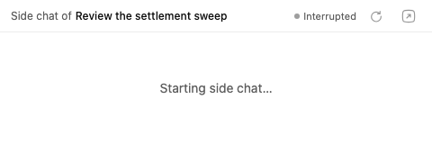

# L03 projection (chase/t3-261114-projection)

The closed #3361 body is this lane's record. This file adds only what changed after it (lane head dc640a984f at #3361, which no review covered).

## Decisions

28 decided: 23 ported (4 take, 19 adapt), 4 deferred (3 on a predecessor or design, 1 by decision), 1 skipped. Not attempted: 0.

Ported since the #3361 body:

- fix(server): subagent threads settle with their parent instead of sweeping on their own (#19665)
- fix(server): snooze no longer waits two minutes after a steered queued message (#35661)
- fix(server): CLI commands no longer migrate the database of a running server (#26763)
- perf(server): older history pages load without indexing the whole thread (#34573)
- test(server): windowed history pages are checked against the full index at the window edges (#35877)

Deferrals by kind:

- Missing predecessor or design (3): `5e2438ce94` and `591188471a` need code halves that earlier lanes deferred (their rows); `4ca5b9cdb8` needs a decision on goat#3357 (its row).
- Predecessor skipped by decision (1): `a25654c396`, coordinator decision of 2026-11-15.

Changed rows (they replace the #3361 rows with the same upstream id):

| upstream | decision | GOAT commit | reason |
|---|---|---|---|
| `20081ef95f` | adapt | af56701201 | Hybrid, per the coordinator decision of 2026-11-15. Only a provider-native subagent (`creationSource` "provider") waits until its parent is settled, archived or deleted, then settles without lookups even with automatic settlement off (apps/server/src/orchestration-v2/ProjectionStore.ts:6589 and :7738, ThreadSettlementService.ts:389); a parent's settle, archive or delete asks the coalescing `settlementAdmission.enqueueFull` for a full sweep (ThreadSettlementService.ts:829, :835). Task lanes keep DelegatedLaneSettlement: goat/DelegatedLaneSettlement.integration.test.ts:80-152 unchanged and passing. Settling a native child detaches no provider session: settle detaches only sessions bound to that thread (Orchestrator.ts:3875, ProjectionStore.ts:4627), a binding comes only from `provider-session.attached` for the thread whose turn opened or joined the session (ProjectionStore.ts:1667, ProviderSessionManager.ts:1694, :2753), and a native child's turns run on its parent's run under the parent's session (RunExecutionService.ts:117, Adapters/CodexAdapterV2.ts:2921); settling releases the child's devices (`threadCloseEffects`, goat/ThreadStopEffects.ts:43, queued at Orchestrator.ts:3953) and closes its terminals (`cleanUpSettledThread`, ThreadSettlementService.ts:767); it closes no previews or scheduled tasks. Un-settling the parent leaves its settled native children settled (Known limits). Dropped: upstream's `fullSweepPending` worker and its parent-worktree check (ThreadSettlementService.ts:786 already skips the settle script). Evidence: ThreadSettlementService.native-test-cases.ts:144, :219; ProjectionSettlement.test.ts:699; SubagentProjection.test.ts:138. Follow-up 747de36fd9: with automatic settlement off, the sweep reads only provider-native subagent candidates (`getSettlementCandidates(threadId, { providerNativeSubagentsOnly })`, SQL and in-memory; ProjectionSettlement.test.ts "%s: the provider-native read returns only provider-native subagents, still after their parent") |
| `d76e06679b` | adapt | c1c330cc35, 992328c5c9, aa666877c2, d01633d490, 96adc180fd, fd92bc1d91, e681c415b9 | Coordinator decision (2026-11-15): as upstream; after Stop with a queued completion wake the thread shows interrupted (was cancelled). A run cancelled before it started no longer presents as the thread's latest run when an earlier run that is not queued is still going or ended at or after the cancellation, in the presented-run join (apps/server/src/orchestration-v2/ProjectionShellThreadRows.ts:317) and `latestUnheldRun` (packages/shared/src/orchestrationV2ThreadError.ts:107). A steered thread presents the run that ran, Snooze is available as soon as it ends instead of up to two minutes later (packages/client-runtime/src/state/threadSettled.ts:39), and a queued message removed after a failure still shows `cancelled`. Ties, where one command ends the earlier run and cancels a never-started run at the same time (Orchestrator.ts unless named): Stop or `run.interrupt` ending a run before its provider turn (:11095) or after its session is gone (:10087) while cancelling a queued completion wake through `holdStoppedThread` (:10444 → :2431 → :1066) or a buffered notification (:10390, own `now` at :9290): the thread shows `interrupted`, was `cancelled`; `thread.archive` (:3776-3803), restart recovery (ProviderRuntimeRecoveryService.ts:407-425 with RecoveryUnstartedQueue.ts:99) and `thread.delete` (ThreadDeletion.ts:70-90) cancel every run involved, so the status stays `cancelled` and only `latestRunId` moves to the earlier run. No tie: `queued-run.cancel` (:12921, :9290), Steer (:9119, its target keeps running), settle (:3092, refuses running runs), pull request wake drops (:2769), delegated wake disposal (:2329); a failure holds the queue (:1294, :1483) or fails the queued run (:1202). For archived and deleted threads nothing acts on `latestRunId` (launch watches report them gone, launchWatchReads.ts:284); a restart tie moves `latestRunId` to the run that was working, so fork (apps/web/src/hooks/useForkThread.ts:64), the diff panel (apps/web/src/components/DiffPanel.tsx:216), plan lookup (apps/web/src/session-logic.ts:261) and `thread.status` (apps/server/src/mcp/threadStatus.ts:187) use that run, the better target, instead of the cancelled buffered wake. `goat_thread_read`'s thread and its result keep naming the newest run by ordinal (apps/server/src/mcp/threadListView.ts:259, HostThreadsMcpService.ts:529). The project's observed-check script now also runs after a steered turn completes (apps/server/src/threadResults/ObservedCheckService.ts:160); a check is evidence only and notifies nobody. GOAT follow-up to `d76e06679b` (upstream has no launch watch), 96adc180fd: an idle local launch watch read the runs only when the shell's latest run changed, so a person's queued message removed while an earlier run went on was never reported to the launcher; the look now gates on the newest run's ordinal as the remote look does (apps/server/src/mcp/launchWatchReads.ts:281-292), through one new store read, `getThreadNewestRun` (the thread's archived and deleted state and its newest run by the (thread_id, ordinal) index, SQL and in-memory, apps/server/src/orchestration-v2/goat/ThreadNewestRun.ts), in place of the shell row; a closed thread still ends the watch without a report. ProjectionRecoveryCandidates.ts:45 also uses `latestUnheldRun`, so a lane whose queued wake is cancelled while an earlier run is going no longer counts as terminal. Fixture only, no assertion changed, in ProjectionStore.shellReads.test.ts: :506 `payload: { ...original, status: "failed" }` becomes `payload: { ...original, status: "failed", completedAt: now }`; :575 `completedAt: now` becomes `completedAt: DateTime.add(now, { seconds: 1 })`; :578 still expects `cancelled`; :583-585 unchanged; runtimeLayer.test.ts:544 gets the same one-second fix in 992328c5c9. Dropped: the comment hunk and the `bounded-sql-history:steered-output` test edit, which belong to `b48b8ea2a0`'s window clause. Evidence: ProjectionStore.test.ts:4220, :4479; testkit/fixtures/queued_cancelled_while_active/codex_output.ts:37; DelegatedCompletionInterrupt.test.ts "the stopped thread presents its interrupted run with a completion wake cancelled at the same time" and "… with no queued wake"; OrchestratorMcpService.stoppedChildRead.test.ts; LaunchWatchService.follow.test.ts "tells the launcher once that a person's queued message was removed while an earlier run went on, when the shell …" and "ends the watch without a report once a look finds the thread's …"; ProjectionStore.shellReads.test.ts "%s newest run read names the newest run by ordinal and the thread's archived and deleted state". Follow-up fd92bc1d91: the presented-run check walks back from the nearest earlier run (scalar subquery, same filter, `ORDER BY earlier.ordinal DESC LIMIT 1`; steered case 7.05 ms → 0.016 ms on 20000 runs, a message removed after the run ended stays linear); this departs from upstream's text, and ProjectionStore.shellReads.test.ts "%s shell presents a run still going past two later runs cancelled before they started, as latestUnheldRun does" pins its agreement with `latestUnheldRun`. e681c415b9: the stopped-child read test waits for the run-update reactor's claim of the delivery before the read and then holds that the read acknowledges nothing (`claimed`, was `pending` read before the reactor ran) |
| `a25654c396` | deferred (predecessor skipped by decision) | - | Coordinator decision (2026-11-15): real deferral. Its predecessors were skipped by decision in earlier cycles: `f2943ee90e` (#26288, D-TRACK in cycle 261031) and `e805ce3712` (#3212; GOAT is on launcher protocol 3). Port all three together when GOAT moves to launcher protocol 4. That port must run or simulate `reconcileGoatMigrationIds` before the preflight check; unadapted, it would read GOAT's names at ids 80-89 on a database whose ids are not shifted yet as skipped migrations and block it. Until then an incompatible history still fails in the migrator (`assertV2MigrationsCanRun`, apps/server/src/persistence/Migrations.ts:443), and #3350 makes an older build refuse a shifted database with exit 79 |
| `5da53f87d9` | adapt | 7cf93b61bc | Coordinator ruling (2026-11-15): port now. CLI commands (auth, login, pair, connect, project, imessage) open the server's database through `layerCliConfig` / `layerCliFromPath` (apps/server/src/persistence/Sqlite.ts): with migrations pending they take the server's ownership lock first (`holdServerOwnershipLock`, apps/server/src/serverOwnership.ts) and refuse with `ServerOwnsDatabaseError`, database unchanged, while a server owns the home. `hasPendingMigrations` (apps/server/src/persistence/Migrations.ts) also counts GOAT's id shift through `goatMigrationIdsMove` (apps/server/src/persistence/reconcileGoatMigrationIds.ts), which the reconciliation now uses too; the memory ledger check only refuses and writes nothing, so it is not counted. GOAT adds the iMessage commands, which open the server database by derived paths; the project command's offline runtime keeps `layerConfig` because it runs after taking that lock itself. Host helpers move to `@goat/shared/hostClassification` as upstream did; without the move `Sqlite.ts` would import `startupAccess.ts`, which imports `EnvironmentAuth.ts` and `Sqlite.ts` again. Upstream's deferred-imports test edit taken. Evidence: reconcileGoatMigrationIds.upstream080.test.ts "hasPendingMigrations" (fresh, pre-shift max 147, GOAT rows above their ids), Sqlite.test.ts "layerCliConfig" (3 cases) |
| `5e2438ce94` | deferred (predecessor) | - | the index exists (orchestration_v2_projection_subagents_thread_idx, apps/server/src/persistence/Migrations/OrchestrationV2/Subagents.ts:24); needs the code halves of `a4d0a06e7f` and `b015ffd7c2`, which #3350 deferred; `a4d0a06e7f` waits on `9b352a04de`, which waits on `71646e031a` |
| `591188471a` | deferred (predecessor) | - | needs index 082 (orchestration_v2_projection_turn_items_conversation_idx, from #3350) and code from `a4d0a06e7f`, `5e2438ce94`, `9b352a04de`, `86c379d07a` (GOAT's decision inbox) and `2248ca8db9` (Cursor live steer), all deferred |
| `a909ea423c` | adapt | 32bab7600e | Coordinator ruling (2026-11-15): port now. Older history pages, timeline pages and agent reads read a local window near the page instead of the whole visible-row index; a jump to an entry, an attachment lookup and a run fork use the full index. Conflicts with 52da4e5098, 4fd40e1a16, 7d3635e572 and 17ddf292aa resolve to upstream's text after all four (17ddf292aa's cursor-row fix kept). Carries the windowed half of `59e64eef88` (`beforePosition` and `hasEarlier` on the window path). GOAT: a run fork reads the full index, side chats included (GOAT side chats, `sideChatOf`, show their source's rows; upstream's `lineage.sideChat` does not exist here); GOAT's `tail` read is a backward page on the window path too (a tail case joins the window-equivalence test and fails without it); `CONVERSATION_INDEX_EXCLUDED_TYPES` comes from the deferred code half of `b015ffd7c2`, for migration 082's index; identity keys keep GOAT's length-prefixed form; the hidden-row read keeps cancelled runs only (queued held input belongs to the deferred `9fb4492329`). New tests in ProjectionStore.historyPages.test.ts; upstream's edits of the bounded SQL history test and of threadHistoryPaging's notification test stay in place, after verbatim moves 6ae91ad381 and 10fc50d3c4 made room. ProjectionStore.ts is 66 lines under its entry; the window query stays in it to keep upstream's text |
| `4ca5b9cdb8` | deferred (design, goat#3357) | - | Coordinator ruling (2026-11-15): option B, as its own later L03 delta with its own READY. `5da53f87d9` is ported; what remains is a decision on goat#3357, because GOAT runs its id shift plus upstream 080-089 as one transaction (apps/server/src/persistence/reconcileGoatMigrationIds.ts). Option A: take upstream's per-migration loop and progress log for the migrator only and keep the shift one transaction; small and safe (an interrupted shift rolls back whole, reconcileGoatMigrationIds.upstream080.test.ts "an upgrade interrupted in the last upstream step rolls back whole and resumes"), but the long 080-089 work stays one transaction, so goat#3357's SSH 60 s case needs the launcher to read the progress line or a longer ready timeout. Option B: split the shift into a short ledger move and one transaction per displaced upstream migration with progress, resuming the rest after a restart; this fixes goat#3357 for these ids, but the resume gate must count missing displaced ids (`hasPendingMigrations` and the reconciliation, not only GOAT rows off their ids) and the window between steps must stay refused by `assertV2MigrationsCanRun` and by older builds (exit 79); tests: a failure injected after each displaced migration resumes with the rest and keeps the data, and a ledger with GOAT rows moved and 080-089 missing. Either way upstream's off-main-thread runner (`NodeSqliteClient.layerWorker`) must fit GOAT's writer worker |
| `f5390209c2` | adapt | 5f42a78eee | The window-equivalence test's window-edge round, without `9fb4492329`'s held queued turn |
| `59e64eef88` | adapt | 34aec9c649, 32bab7600e | Its windowed half (`beforePosition` and `hasEarlier` on the local timeline path) lands with `a909ea423c` in 32bab7600e |

## Known limits (added)

- `d76e06679b`: when a person removes a queued message while an idle compaction runs, the client's `latestUnheldRun` counts the compaction run as an earlier run and the server's presented-run join skips it, so the two show different runs until the thread's next run.
- `d76e06679b`: the server's settlement candidate still takes the newest run by ordinal (`getSettlementCandidates`, apps/server/src/orchestration-v2/ProjectionStore.ts), so for a steered thread settlement can lag the sidebar by up to two minutes, and a steered failure does not end a snooze for settlement purposes.
- `20081ef95f`: a settled provider-native subagent stays settled when its parent is un-settled; nothing reopens it, as upstream, since it cannot receive messages. A person can un-settle it from its thread view and an agent with `goat_thread_manage` `unsettle`. The periodic and event full sweeps read settlement candidates while automatic settlement is off, only provider-native subagent threads since 747de36fd9.
- `d76e06679b`: `goat_thread_read` names a thread's newest run by ordinal, so after a Stop that cancelled a queued notice it reports `cancelled` while thread lists and `thread.status` report `interrupted`; aligning the read with `latestUnheldRun` changes what a read returns and acknowledges and is tracked in goat-si/goat#3378 for the L03 retry round.
- `d76e06679b`: after Stop with a queued completion wake the thread shows `interrupted` instead of `cancelled`, as without a wake. An older client keeps the old rule in its local projection until it updates, so after a steer its thread view can show the cancelled run while its sidebar, read from the server, shows the run that ran.

## Surfaces (changed)

- Web: `31eea883c7` offers conversation-only rewind for turns whose checkpoint has no git snapshot and disables "Revert files too" for them. `d76e06679b`: after a steer the thread presents the run that ran, and Snooze is available when it ends; after Stop with a queued completion wake it shows the interrupted run.
- Mobile: no mobile code changes. `31eea883c7` lets the shared client-runtime revert command rewind the conversation at a checkpoint without a snapshot; mobile has no rewind entry point. `d76e06679b` reaches mobile status through the shared `latestUnheldRun`.
- Providers: `70833b2f55` changes release cleanup for Claude and Muse sessions; other adapters keep their background work rules. `20081ef95f` applies to every adapter's provider-native subagents (`creationSource` "provider"); task lanes started with `task.create` are unchanged.
- Agents and scheduled tasks: `goat_thread_read` and thread status show the run that ran after a steer, and phase `interrupted` after Stop with a queued wake (`d76e06679b`; both phases are terminal, launch-watch outcomes map both to `cancelled`, and scheduled tasks report their own run). A parent's summary or tail read of a stopped task child still leaves its completion wake owed, because `goat_thread_read` names the child's newest run by ordinal, which for a Stop that cancelled a queued notice is the cancelled notice (`cancelled` there, `interrupted` in thread lists and status, goat-si/goat#3378). Agents' launch-watch notices are unchanged: an idle local watch now finds new runs by ordinal (96adc180fd), so a queued message removed while an earlier run went on is still reported once; scheduled-task threads settle their native subagents with them (`20081ef95f`).
- Docs: docs/user/thread-sidebar.md:363 says provider-started subagents settle with the thread that started them.

## Tests (added)

- `20081ef95f`: before the fix, both stores listed the native child while its parent was live (sql and memory: `expected Set{ …(3) } to deeply equal Set{ …(2) }`), the provider case of SubagentProjection.test.ts saw it at once, the drain test saw no commands (`expected [] to deeply equal [ 'empty', 'recent' ]`), and the manual-settle test hung at startup because the sweep returned before reading candidates with automatic settlement off (5 failed, 80 passed). With the store and sweep changes but without the parent event wakes, the manual-settle test failed on `expected [] to deeply equal [ ObjectContaining{…} ]`. After: 12 settlement files pass 314 of 314, DelegatedLaneSettlement.integration.test.ts included.
- `d76e06679b`: before the fix, the five `keeps the shell on the user's last turn only during …` cases, `only exposes interruptible runs through the shell activeRunId` and the Codex `queued_cancelled_while_active` replay failed (7). With the fix and the old fixture, both `fallback candidates preserve trigger and recovery policy` cases failed on `expected 'failed' to equal 'cancelled'`, as did two `runtimeLayer` cancelled-queue scenarios. After: 11 server files pass 201 of 201, `runtimeLayer.test.ts` 170 of 170, client-runtime 121 of 121, web `threadPendingBackgroundTasks` 6 of 6, contracts `orchestratorMcp` 18 of 18. Stop boundary (aa666877c2, DelegatedCompletionInterrupt.test.ts, real orchestrator, SQL and in-memory shells): with a completion wake cancelled at the same time as the interrupted run, the shell code before the port failed with `expected 'cancelled' to equal 'interrupted'` and the port passes; with no queued wake both pass; the file passes 5 of 5. Launch-watch follow-up (96adc180fd): with the shell presenting the run that ran and the old look, "tells the launcher once that a person's queued message was removed …" failed with `expected [ 'run-1' ] to deeply equal [ 'run-1', 'run-3' ]` (the launcher heard nothing after run-1), while the same case with the shell naming the newest run passed; after the fix both pass, the closed-thread looks pass before and after, and the store read passes against the SQL and in-memory stores; 16 affected files pass 261 of 261.

## Hand-over to chase/t3-261114-all

Lane head b168747f7e (was dc640a984f at #3361). Commits since: af56701201 (20081ef95f), 992328c5c9, c1c330cc35 (d76e06679b), aa666877c2, d01633d490, 96adc180fd (launch-watch follow-up), c98c1439be (merge of chase/t3-261114-all at 56421003ff), aa17a5a9c0 (verbatim move), 4fcce26fce (088 assertion), b168747f7e (merge of chase/t3-261114-all at ad86de82a5, which contains 2be9695078).

Conflicts in the first merge, and how they were resolved:

- `ProjectionStore.test.ts`, `ProjectionStore.testkit.ts`, `ProjectionStore.provenance.test.ts`: L03m's split files kept; this lane's provenance and testkit copies differed only in blank lines, and `ProjectionStore.serverActivity.test.ts` (the same seven tests as L03m's `ProjectionStore.activity.test.ts`) is deleted. The six shell read tests stay in this lane's `ProjectionStore.shellReads.test.ts`; L03m's copies were identical apart from this lane's two authorised fixture edits.
- `ProjectionStore.test.ts` then held 8189 lines against its 8041 entry: aa17a5a9c0 moves "SQL snapshot windows leave handoff bodies in SQLite without changing the wire", "lists only active subagent IDs without loading shell data" and "lists every thread in the shell snapshot past SQLite's bound variable limit" verbatim to `ProjectionStore.snapshotReads.test.ts` (7945 lines left).
- `ThreadFind.ts`: L17a's run id read and this lane's `empty_text` column, both kept.
- `ChatView.props.ts`: both lanes extracted the same props; one file, imported once by `ChatView.tsx` (4236 lines, entry 4239).
- `ProviderSessionManager.ts` and its test: this lane's released-work module and testkit, and L10's session-scoped artifact reads, both kept; L10's changes do not touch the moved code.
- After the merge, the 5f2bb934d8 plan check failed: L03m's migration 088 (`turn_items_thread_type_idx`) is now the plan for user-only ordinal reads. 4fcce26fce takes upstream's own edit of that assertion from b7a224c7dd (the commit that adds 088; its code half stays deferred): the read must stay on a type-bounded index.

The second merge (ad86de82a5) had no conflicts.

Test titles and assertion calls across `ProjectionStore*.test.ts`:

| file | lane at 96adc180fd | all at 56421003ff | merged |
|---|---|---|---|
| ProjectionStore.test.ts | 50 / 399 | 52 / 406 | 46 / 399 |
| ProjectionStore.shellReads.test.ts | 7 / 52 | - | 7 / 52 |
| ProjectionStore.snapshotReads.test.ts | - | - | 3 / 11 |
| ProjectionStore.serverActivity.test.ts | 7 / 38 | - | deleted |
| ProjectionStore.activity.test.ts | - | 7 / 38 | 7 / 38 |
| ProjectionStore.provenance.test.ts | 4 / 26 | 4 / 26 | 4 / 26 |
| ProjectionStore.notifications.test.ts | 6 / 23 | 6 / 23 | 6 / 23 |
| ProjectionStore.questionRecovery.test.ts | 4 / 15 | 4 / 15 | 4 / 15 |
| ProjectionStoreAttachments.test.ts | 1 / 1 | 1 / 1 | 1 / 1 |
| total | 79 / 554 | 74 / 509 | 78 / 565 |

79 - 7 (serverActivity duplicates) - 2 + 7 (activity) + 1 = 78: chase/t3-261114-all removes "limits turn-start history to the requested runs, including an empty selection" (L17a b6fc38987f, upstream 49013438a9) and "looks up shell stop requests through the interrupt request index" (L03m 74475b094f, upstream migration 085), and adds "reads shell runs and item counts without walking a thread's history" (74475b094f). No title appears twice across the `ProjectionStore*.test.ts` files.

Budgets: this lane changes no entry (`code-budgets.json` equals chase/t3-261114-all's). Real lengths on the merged tree (update-code-budgets.ts read only) against their entries: ProjectionStore.test.ts 7945 / 8041, ProjectionStore.ts 8119 / 8836, Orchestrator.ts 13848 / 13908, ThreadManagementService.ts 2155 / 2201, LaunchWatchService.ts 2048 / 2049, ProviderSessionManager.ts 3067 / 3128, ProviderSessionManager.test.ts 6096 / 6326, ChatView.tsx 4236 / 4239, ChatView.logic.ts 1660 / 1697.

`a909ea423c` is not ported (its row).

Combined-branch issue found by this lane's gate (not caused by it): at ad86de82a5, `apps/server` typecheck fails at `apps/server/src/provider/Drivers/AntigravityDriver.ts:480` (`Cannot find name 'processEnvironment'`). dev's #3207 (46565c8245) removed that variable from the driver's top level, and 18813a144cf (probe timeouts per provider) passes `environment: processEnvironment` to `makeAntigravityProvider`; the merge 2be9695078 kept both. The file is identical on chase/t3-261114-all; `apps/server` typechecked with 56421003ff.

## Gate

- check:changed on c98c1439be..4fcce26fce (merged with 56421003ff; `GIT_CONFIG_GLOBAL=/dev/null GIT_CONFIG_NOSYSTEM=1 VITEST_MAX_WORKERS=4`, pipefail, load 24-110 from other worktrees): unused patches, format, lint, knip 1/2 and 2/2, graphql (2), agent surface audit, agent context budget and typecheck (42 packages) pass; test: 1598 files, 1 failed | 1589 passed | 8 skipped, 24410 passed | 1 failed | 24 skipped; the failure is `packages/ssh/src/runtimeFactsScripts.test.ts` "reads a built runner in one call and parses only the lines before its end line" (`/bin/bash` 3.2, goat#3363).
- After the second merge (b168747f7e): `vp i`; typecheck passes for apps/web, packages/contracts, packages/shared, packages/client-runtime and packages/provider-core, and fails for apps/server only at AntigravityDriver.ts:480 (above); 29 focused files pass 751 of 751 (settlement, ProjectionStore*, launch watch, Stop boundary, stopped child read, ThreadFind, ProviderSessionManager, runtimeLayer, Codex replay); persistence suite alone: 1 failed | 212 passed (026_CanonicalizeModelSelectionOptions, goat#3355); lint clean on the lane's 91 changed TypeScript files.
- `node scripts/goat-rename.ts --check`: 0 lines with T3 residue in 0 files, 0 dropped paths.

NOT RUN: check:changed on b168747f7e itself (apps/server typecheck fails at AntigravityDriver.ts:480 on chase/t3-261114-all); real-client checks (a native subagent under a parent settled by hand with automatic settlement off, then the parent un-settled; a task.create lane under a live parent settling at once; a steered queued message on web and mobile; Stop a parent while a child's completion is queued, on web and mobile; a launch watch while a person removes a queued message); mobile client; real provider turns; ci:full.

## Follow-up after b168747f7e (review rulings of 2026-11-15)

Both final reviews of b168747f7e approved with nits. Lane head 630fd9e68e on chase/t3-261114-projection, fast-forwarded from b168747f7e after its gate: the delta since b168747f7e (not yet reviewed) plus the merge of chase/t3-261114-all at 83138ac3b6. Commits on top of b168747f7e:

| commit | what | first-failing evidence |
|---|---|---|
| 747de36fd9 | with automatic settlement off, the sweep reads only provider-native subagent candidates | the new store test failed in both stores (the read returned the lane, parent and root threads), then passed |
| fd92bc1d91 | the presented-run check walks back from the nearest earlier run (scalar subquery, same filter) | a form that checks only the nearest earlier run failed the new agreement test (`expected 'outlived-twice:3' to equal 'run:outlived-twice:rolled-back'`); the shipped form passes |
| 51cfdf5e16 | the 088 plan check requires `turn_items_thread_type_idx (thread_id=? AND type=?)` | a `(thread_id=?)` plan no longer passes the check; the real plan still does |
| 7cf93b61bc | `5da53f87d9` (its row) | with upstream's `hasPendingMigrations`, "GOAT rows recorded above their ids are pending although the newest id is past this build's" failed (`expected false to be true`); the three CLI tests failed before the code existed |
| 6ae91ad381 | moves "pages a whole thread without re-reading its full timeline for every page" verbatim to ProjectionStore.historyPages.test.ts (342 lines, byte-identical) | titles and assertion calls of the two files: 46 / 399 before and after |
| 10fc50d3c4 | moves threadHistoryPaging.test.ts's NOW, THREAD, makeRow and makeTurnStart to threadHistoryPaging.testkit.ts, unchanged but for `export` | 22 / 105 before and after |
| e681c415b9 | the stopped-child read test (d01633d490) waits for the run-update reactor (Orchestrator.ts, forked `runUpdateReactors`) to claim the task's completion delivery before the read, then holds that the read acknowledges nothing (`claimed`; it read `pending` only while the reactor had not yet run, and failed once a909ea423c's window reads let it run first) | passes 3 of 3 runs before and with a909ea423c |
| 32bab7600e | `a909ea423c` with the windowed half of `59e64eef88` (its row) | without the tail adaptation the window-equivalence test's tail case fails; upstream's equivalence test passes |
| 5f42a78eee | `f5390209c2` (its row) | passes |
| a13395e08e | the stopped-child read test also holds that the parent's wake is dispatched: with continuation requests queued (`layerTestWithContinuations`), it takes the request that offers the delivery's message, generation and parent run to the parent's active run | passes 3 of 3; no behaviour change made "pending" wrong, it was a race in the test (e681c415b9) |
| e66dce5c1e | the native-child drain case is now "drains provider-native children of a settled parent without PR lookups, one still working included": the working child has an active subagent row on its parent and no run, and settles with it | passes; known limit, goat-si/goat#3407 |

Still-working provider-native child: coordinator decision of 2026-11-15, option A, keep upstream's rule. A native child at work has no app run; its parent records it as an active subagent row. Closing the parent detaches its session and unloads an unattached native child (ProviderSessionManager.ts:3013-3033), but nothing ends that row: only Stop or interrupt (Orchestrator.ts:9923), a confirmed `subagent.stop` (:10563) and startup or shutdown recovery (ProviderRuntimeRecoveryService.ts:599) do. Excluding active rows would therefore strand such a child until the next restart. e66dce5c1e rewrites the drain case to what a native child really has, an active subagent row and no run, and holds that it settles with its parent. Options B (end the row when the parent's detach unloads the child, then exclude active rows) and C (exclude only while the child's session is live) are in goat-si/goat#3407.

Corrections to the rows above: the 20081ef95f settle effect (releases devices, closes terminals, closes no previews or scheduled tasks); 28 citations refreshed on the merged tree (Orchestrator.ts +6 lines; ProjectionStore.ts, ProjectionStore.test.ts, ProjectionShellThreadRows.ts, RunExecutionService.ts, Migrations.ts, CodexAdapterV2.ts, ThreadSettlementService.ts, ProviderSessionManager.ts, orchestrationV2ThreadError.ts as written). Adapted test edit not named before: ProjectionRecovery.test.ts:468 rewrites six existing lines into upstream's loop form, because GOAT lacked the loop that 156dcd8c7a assumes; the expected values are the same and plan checks were added. L03m's `b7a224c7dd` row: 4fcce26fce took one of its test hunks (the 088 plan assertion), now tightened by 51cfdf5e16.

Surfaces (changed): CLI commands that open the server's database (`goat auth`, `login`, `pair`, `connect`, `project`, `imessage`) refuse to migrate a database a running server owns and say which `goat` to use, as upstream's CLI does; they run as before when nothing is pending. Web, mobile and agents: history pages, timeline pages and thread reads return the same pages, now from a window near the page; tail reads included.

Test titles and assertion calls (titles of `it`, `it.effect`, `it.live` and their `.each` forms; assertion calls `assert…(` and `expect(`):

| file | b168747f7e | merged head |
|---|---|---|
| ProjectionStore.test.ts | 46 / 399 | 45 / 398 |
| ProjectionStore.historyPages.test.ts | - | 2 / 17 |
| ProjectionStore.shellReads.test.ts | 7 / 52 | 8 / 54 |
| ProjectionStore.snapshotReads.test.ts | 3 / 11 | 3 / 11 |
| ProjectionStore.activity.test.ts | 7 / 38 | 7 / 38 |
| ProjectionStore.provenance.test.ts | 4 / 26 | 4 / 26 |
| ProjectionStore.notifications.test.ts | 6 / 23 | 6 / 23 |
| ProjectionStore.questionRecovery.test.ts | 4 / 15 | 4 / 15 |
| ProjectionStoreAttachments.test.ts | 1 / 1 | 1 / 1 |
| ProjectionStore* total | 78 / 565 | 81 / 586 |
| threadHistoryPaging.test.ts | 22 / 105 | 22 / 108 |

No title appears twice across these files.

Merge: 750aa54c1e merges chase/t3-261114-all at 74ae8cc7b2 (which already merged this lane at b168747f7e, L17a's bb4ace3132 and dev 387e8c798f, #3377); no conflicts; `vp i` after its lockfile change. 630fd9e68e merges chase/t3-261114-all at 83138ac3b6 (L04 retry 41992d56ef; dev b719465f12 with #3208, #3401 and #3402); no conflicts, no manifest or lockfile change. On the merged tree: `apps/server` and `packages/shared` typecheck, and the focused tests with the persistence suite give the same 888 of 889 (only 026, goat#3355). The lane's own 29 files (since merge base 83138ac3b6) touch no ThreadFork.*.test.ts, goat/NativeForkRecovery.ts, mobile i18n or notice config, so the gate on 83138ac3b6 stands for tip 1f34e35e42.

Budgets: this lane changes no entry. Real lengths on the merged tree against their entries: ProjectionStore.ts 8770 / 8836, ProjectionStore.test.ts 7739 / 8041, threadHistoryPaging.test.ts 1083 / 1108, Orchestrator.ts 13848 / 13908, runtimeLayer.test.ts 10007 / 10007, core.test.ts 1691 / 1691, nodeSqliteClient.ts 1307 / 1307, orchestratorMcp.ts 1160 / 1161, HostThreadsMcpService.ts 997 / 1000 (default limit), ProviderTurnStartService.ts 1577 / 1587, ProjectionRecovery.test.ts 1360 / 1377, commands.ts 1202 / 1219, ThreadManagementService.ts 2155 / 2201, ProviderSessionManager.ts 3067 / 3128, ProviderSessionManager.test.ts 6096 / 6326, ChatView.tsx 4236 / 4239. (LaunchWatchService.ts and ChatView.logic.ts left the list: this lane does not change them.)

Captures (harness renders: browser-test harness with the app stylesheet, not a running app; the shell fixture is the Stop tie of DelegatedCompletionInterrupt.test.ts, whose latest run is the cancelled wake before the port and the interrupted run after it). The sidebar row and thread header do not show the difference: the row's status pill has no label for either a cancelled or an interrupted latest run (apps/web/src/components/Sidebar.logic.ts, `resolveThreadStatusPill`), its working label reads `runtime.status` (apps/web/src/components/sidebar/SidebarThreadRow.tsx:622), and `ChatHeader` takes no run status. The visible change is the side chat's status of its main thread (apps/web/src/components/sideChat/sideChat.logic.ts:61): "Idle" before, "Interrupted" after.

Before (cancelled), light and dark:

After (interrupted), light and dark:

Snooze after a steered queued message: not captured, because it needs a steered real turn and Replay (dev)'s driver cannot steer (packages/provider-acp-registry/src/server/adapter.ts:238). The rule is covered by ProjectionStore.test.ts "keeps the shell on the user's last turn only during %s" and "only exposes interruptible runs through the shell activeRunId", the Codex replay `queued_cancelled_while_active` (testkit/fixtures/queued_cancelled_while_active/codex_output.ts:37), and client-runtime threadSnoozed.test.ts "canSnooze"; threadSettled.ts has no test file of its own.

Gate: the coordinator's gate of 630fd9e68e on juns-MacBook-Pro.local (macOS 27.2, 18 cores, Node 26.12.1, load 7-10.4): PASS after triage. check:changed passes every static step (typecheck of 42 packages and the agent surface audit included). Tests: 1809 of 1819 files, 26546 of 26591 tests; the 3 failing files fail identically on base 428af27456 and the lane touches none of them: runtimeFactsScripts (goat#3363), GrokTextGeneration (goat#3425), and apps/server/src/cli/app.test.ts, whose 4 "resolves relative cwd/flag/env/bootstrap against the inaccessible original cwd" cases fail and hang in an unbounded spawnSync (evidence added to goat-si/goat#3238). Persistence suite alone: 218 of 219, only 026 (goat#3355). goat-rename: 0. An earlier gate of e66dce5c1e on pen-cc-04 ran under critical load and counts neither way. Run here on the merged heads: focused tests and the persistence suite in one run (120 files: 1 failed | 119 passed; 889 tests: 888 passed, 1 failed, 026, goat#3355), `packages/shared` and `apps/server` typecheck (pass), lint and format on the delta's changed files (warnings only, none on lines the delta changes), `node scripts/goat-rename.ts --check` (0 lines with T3 residue in 0 files, 0 dropped paths).

NOT RUN: real clients; real provider turns; ci:full.

Model: anthropic/claude-opus-5-5 via Codex in GOAT on pen-mac-studio, coordinated by anthropic/claude-opus-5-5.
