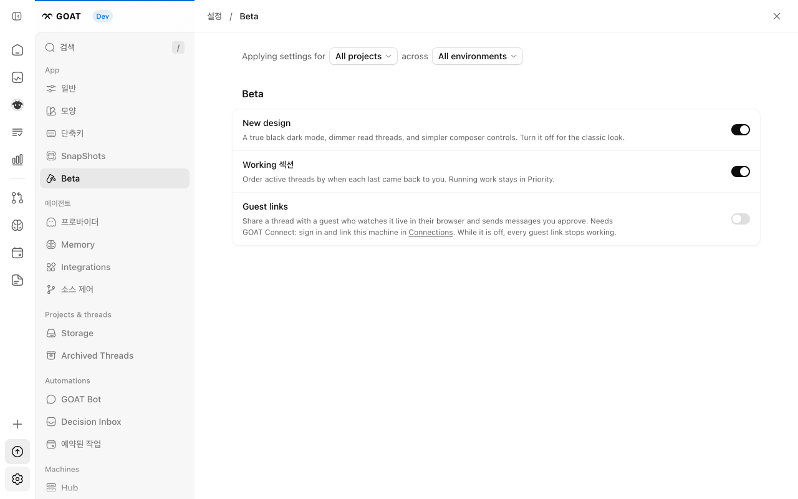

# L14a i18n: lane record

Lane branch `chase/t3-261114-i18n`. The closed PR #3382 body is the base record (decision table, owner decision, C4 notes, surfaces, screenshots, fail-first evidence). This file adds only what changed after the review at `fb042848c1f2885d74406ea792f5ec06554b06c2` (APPROVE WITH NITS).

## Fix round after review fb042848c1

| Finding                                    | Outcome                                                   | Commit         |
| ------------------------------------------ | --------------------------------------------------------- | -------------- |
| P2-1 missing third-party notice            | fixed: package override with the package's own notices    | `b3cbc856ad21` |
| P3-2 Working section half translated       | fixed: row title and switch label translated, as upstream | `c3808a018d0c` |
| P3-1 `language` has no length limit        | decided (coordinator 2026-11-15): no limit, as upstream   | none           |
| P3-3 Settings search lookups per keystroke | follow-up goat#3386, no change                            | none           |
| P3-4 base record inaccuracies              | corrected below                                           | none           |
| P3-5 card and #3176 rows                   | marked "ported in #3397" after the merge at `295a0d7c66`  | none           |

### P2-1: @generaltranslation/icu notices

`@generaltranslation/icu@0.1.2` adapts code from FormatJS (MIT) and intl-messageformat (BSD-3-Clause, Oath Inc.) and lists both in `THIRD_PARTY_NOTICES.md`. The notice collector only reads `license*`, `copying*` and `notice*` files (scripts/lib/third-party-licenses.ts:114), so builds listed the package under General Translation's MIT licence alone.

The fix is a `packageOverrides` entry in third-party-licenses.config.json, matched by name and version, with licence `MIT AND BSD-3-Clause` and `noticeFile` `apps/web/src/i18n/GENERALTRANSLATION-ICU-NOTICES`. That file is the package's `LICENSE.md` followed by its `THIRD_PARTY_NOTICES.md`, copied unchanged from the published 0.1.2 tarball.

- An override keeps one entry for the package and corrects its licence field. A `customNotices` entry would add a second entry and leave the package entry saying MIT.
- Matching by name and version: the package's repository is the whole `generaltranslation/gt` monorepo, so a repository match would hit every GT package.
- A copied file instead of `generatedNotices`: the SPDX BSD-3-Clause template's third clause says "the copyright holder", while intl-messageformat's text names Oath Inc. BSD-3 asks binary releases to reproduce that list of conditions, so the original wording ships.
- Bundles come from the dependency walk: the entry lists `web`, and the desktop app shows the same web-build manifest.

Fail-first evidence: `generateThirdPartyLicenseManifest` (the function the web build and the dev server's `/third-party-licenses.json` call) with the web, server and desktop package manifests, then `scripts/render-third-party-notices.ts`:

- Config at `fb042848c1`: 511 entries; `@generaltranslation/icu 0.1.2` shows `License: MIT`, 1077 characters of notice text, no FormatJS or Oath text.
- Config after the fix: 511 entries; only `@generaltranslation/icu@0.1.2` changed. Its rendered entry:

```
## @generaltranslation/icu 0.1.2

License: MIT AND BSD-3-Clause

Source: https://generaltranslation.com/

@generaltranslation/icu 0.1.2: LICENSE.md and THIRD_PARTY_NOTICES.md, copied unchanged from the published package.
MIT License
Copyright 2025 General Translation, Inc.
...
## FormatJS ICU parsers (MIT)
Copyright (c) 2023 FormatJS
...
## intl-messageformat (BSD-3-Clause)
Copyright (c) 2023, Oath Inc.
...
- Neither the name of Oath Inc. nor the names of its contributors may be used
  to endorse or promote products derived from this software without specific
  prior written permission of Oath Inc.
```

### P3-2: Working section row

Upstream translates this row: at `13eb5c95a6`, apps/web/src/components/settings/SettingsPanels.tsx renders it with the translated title helper and `aria-label={gt("Working section")}`, and all nine catalogs carry key `bdf39fd139a04325` ("Working 섹션" in Korean). GOAT's row lives in BetaSettingsPanel.tsx, so it now takes its title through `useMessages` and its switch label through `useGT`, both from that entry. `msg()` in settingsSearchBetaItems.ts stays. GOAT's description ("Order active threads by when each last came back to you...") differs from upstream's and stays English; the reset button label stays English, as upstream.

### P3-1: no length limit, decided

`language` is `Schema.String` with no maximum length (packages/contracts/src/settings.ts, both the schema and the patch), exactly as upstream. GOAT bounds its other client-setting strings (`FontFamilyPreference` 200, `DefaultThemePreference` 64), and the review suggested `Schema.isMaxLength(64)`. The coordinator decided on 2026-11-15: no limit, as upstream. What a later limit would cost is under Known limits.

### P3-3: follow-up

Each Settings search keystroke makes about 500 translation lookups (two per item for about 250 items; apps/web/src/components/settings/settingsSearch.ts:1337 and :1338), each parsing ICU and, outside English, hashing with SHA-256. Upstream is identical. Follow-up: compute translated titles once per locale. Not measured.

### P3-4: corrections to the base record

1. Lockfile: "changes no existing ones" holds for the `packages` section only. In the snapshots section `split2@4.2.0` lost `optional: true`, because `pino-abstract-transport@3.0.0`, pulled in by the `gt` CLI, now requires it.
2. Licences: 88 MIT, 2 ISC and 2 BSD counts package licence fields only. `@generaltranslation/icu@0.1.2` also embeds FormatJS (MIT) and intl-messageformat (BSD-3-Clause, Oath Inc.) code; the generated notice list now carries both through the P2-1 override, as `MIT AND BSD-3-Clause`.
3. Network: the chosen locale does leave the client, as a cookie. gt-react's browser store writes `generaltranslation.locale` and `generaltranslation.enable-i18n` cookies on the app's origin (`path=/`, session cookies, no domain; gt-react 11.4.18 dist/index.client.mjs:83 and :163), so the browser sends the chosen supported locale (the resolved locale, never the raw stored setting) to the GOAT server on every same-origin request. Nothing in GOAT reads them. Cookies are scoped by host, so GOAT servers on different localhost ports share them.

### P3-5: card rows

After the coordinator merged this lane into `chase/t3-261114-all` as `295a0d7c66`, the seven commits in devlog/_chase/_fin/10/10.025_t3_chase_cycle_261114.md (rows #442-#448) and in #3176 (body lines 363-369, ticked) read "ported in #3397 (lane L14a, 0c342fe266); Owner decision 2026-11-15: as upstream".

## Known limits

- Settings search re-translates every item on each keystroke (P3-3): goat#3386.
- `language` has no length limit, as upstream (P3-1, decided 2026-11-15). A limit added later needs a settings migration, because the desktop store rejects the whole file on one bad field (apps/desktop/src/settings/DesktopClientSettings.ts:22).
- A version-pinned notice override that stops matching is not reported: goat#3400. The `packageOverrides` entry for `@generaltranslation/icu` stays pinned to 0.1.2, so that once that check exists a bump forces someone to look at the notices again.
- The locale cookie is shared but does not decide what renders. gt-react writes the chosen locale to the `generaltranslation.locale` cookie (path-wide session cookie, P3-4 item 3), so GOAT servers on the same host and different ports share it. GOAT passes its own locale, resolved from the `language` setting (apps/web/src/i18n/runtime.ts:54), as GTProvider's `locale` prop (apps/web/src/i18n/I18nProvider.tsx:11), and in gt-react 11.4.18 `useGT`, `useMessages` and `<T>` take `context.locale` first. The cookie is read first only by the condition store's `getLocale`, which serves module-level `t()`, GT hooks with no provider and `conditionStore.reload`; GOAT uses none of them (on `chase/t3-261114-all` it imports only `GTProvider`, `useGT`, `useMessages`, `T`, `msg`, `initializeGTSPA` and `getTranslationsSnapshot`). So another GOAT on the same host and a different port can overwrite the cookie's value but cannot change what this GOAT renders. Latent trap: a future module-level `t()` or a GT hook outside `I18nProvider` would read the shared cookie. The gt-react behaviour is the reviewer's reading of 11.4.18; the paths and lines are checked on `chase/t3-261114-all` at `295a0d7c66`.

## Hand-over

- Branch `chase/t3-261114-i18n`, head `0c342fe266fcb748e8a6559a82cc5dd1ad3960f7`.
- Merged into `chase/t3-261114-all` as `295a0d7c66` after review APPROVE WITH NITS at `0c342fe266`.
- Delta since `fb042848c1`: `b3cbc856ad2191d0966ecf90c5d5b20df045dab3` (P2-1), `c3808a018d0c96cd6d45de604768068a8bea001c` (P3-2), and merge `0c342fe266` of `origin/chase/t3-261114-all` at `56421003ff190ab09fee4d58165f01c13a0b2985`. The merge had no conflicts.
- Code budgets on the merged tree (`update-code-budgets.ts` run only to read lengths, table restored): SettingsPanels.tsx 1537/1713, settingsSearch.ts 1389/1404, packages/contracts/src/settings.ts 2050/2053. The lane changes no budget entry.
- Focused tests: locales.test.ts, I18nProvider.browser.test.tsx, settingsSearch.test.ts and SettingsPanels.restore.browser.test.tsx: 4 files, 73 passed, exit 0.
- Gate on the merged head `0c342fe266fcb748e8a6559a82cc5dd1ad3960f7` (`GIT_CONFIG_GLOBAL=/dev/null GIT_CONFIG_NOSYSTEM=1 VITEST_MAX_WORKERS=4 vp run check:changed`, pipefail, started at 1-minute load 14.0): unused patches, format, lint, knip 1/2 and 2/2, graphql (2), agent surface audit, agent context budget and typecheck (42 packages) pass. Tests: 1485 files, 1474 passed, 3 failed, 8 skipped; 23074 tests, 23046 passed, 4 failed, 24 skipped; exit 1. The failures: `packages/ssh/src/runtimeFactsScripts.test.ts` (goat#3363), two tests in `packages/ssh/src/tunnel.reconnect-probe-changes.test.ts` (goat#3390, a stray `sh: child setpgid … Operation not permitted` line; reproduced alone), and a 120 s timeout in `apps/server/src/orchestration-v2/ProviderSessionManager.lifecycle.test.ts` (goat#3275, the reopen case at :342, load-sensitive) while load ran at 60-77, which passes alone (6/6). The lane changes nothing under `packages/ssh` or `apps/server`; check:changed ran the lifecycle test because the integration side merged in at `0c342fe266` changed ProviderSessionManager.ts in `e8ec81df5f`.
- `node scripts/goat-rename.ts --check`: 0 lines with T3 residue, exit 0.
- Real client (GOAT Browser panel, 1280x800, worktree dev data, language chosen through Settings → General → Language): with 한국어, the Beta panel's row heading and switch name read "Working 섹션" and GOAT's description stays English.



NOT RUN: `vp build` and the notice list from a real build's `generateBundle` (the proof above calls the same generator without the bundled-module pass); the desktop app; mobile; the before capture of the Working row (the review's description of the untranslated row stands); a timing of the search keystroke cost; an independent review of this round; CI (runs once on #3397).

Model: anthropic/claude-opus-5-5 via Codex in GOAT on juns-MacBook-Pro
