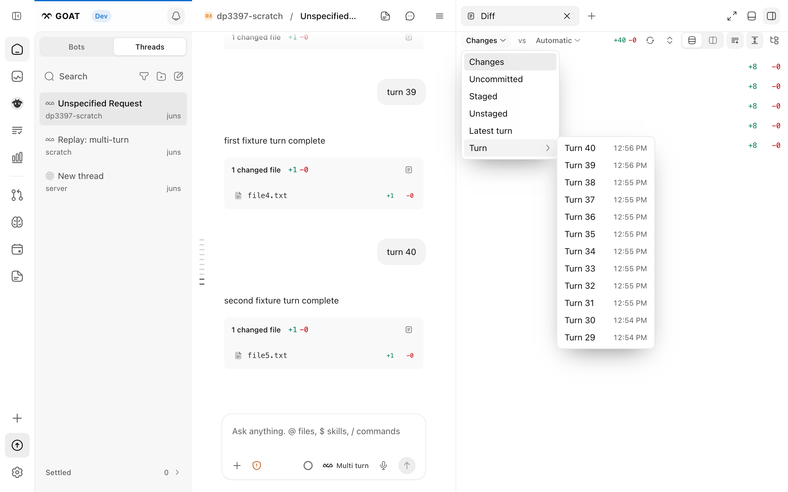
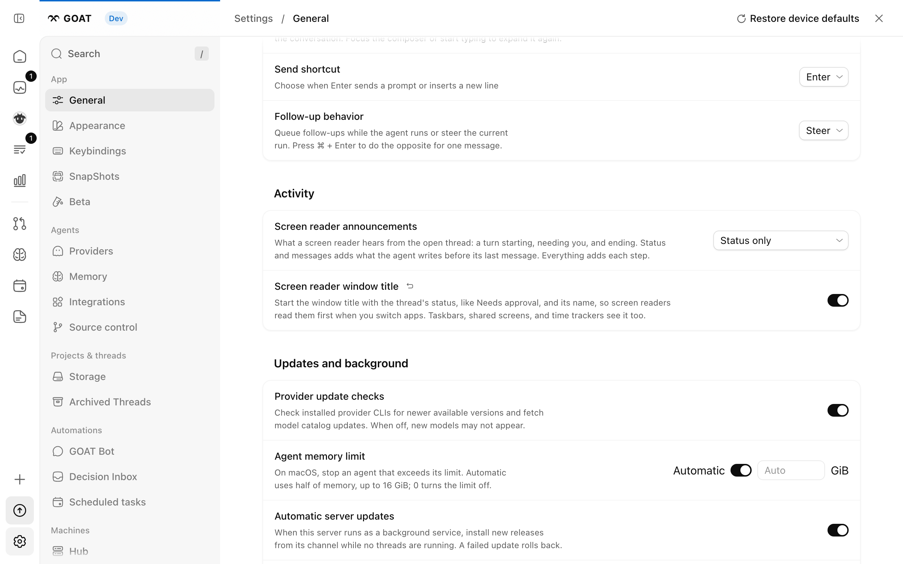
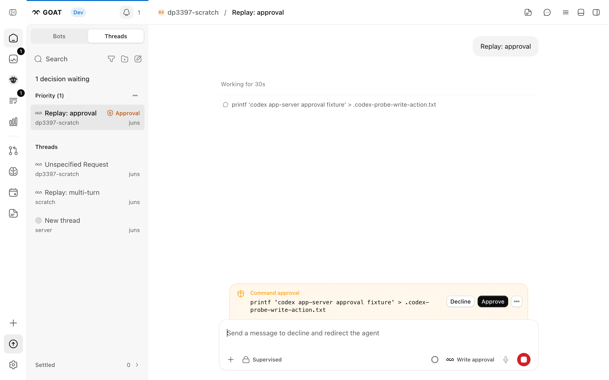

# Device pass, PR #3397 (cycle 261114)

The one integrated real-client pass of goat-si/goat#3397, run 2026-11-16 (KST).

## Tested head and environment

- Head: `590cee0efb3c00df899ddeb4207859a711d86fdc` (origin/chase/t3-261114-all at the time of the pass), checked out in a GOAT-managed worktree with a clean tree.
- Host: jun's Mac Studio, Apple M4 Max, 64 GiB, macOS 26.6.2 (25G83). Xcode is not installed (`xcode-select -p` is /Library/Developer/CommandLineTools, no `simctl`) and there is no Android SDK, so no simulator or emulator exists on this host.
- Web: `vp run dev` in the worktree (server 15188, web 7148), GOAT's headless browser panel. State in the worktree's `.goat`, seeded with `vp run migrate-dev-db --source ~/.goat/desktop-nightly/userdata/statev2.sqlite` (read-only snapshot; the 21.7 GB `~/.goat/userdata` database is over the seed limit and was not copied). GOAT_DEV_SSH off.
- Turns: Replay (dev) only (`multi-turn` and `approval` scenarios); no paid provider turn ran. Test project: a scratch git repo in /tmp with one file edited before each turn, so every checkpoint carries a one-file diff.

## Results

| Item                                                                   | Result                                | Evidence or reason                                                                                                                                                                                                                                                                                                                                                                                                                                                                                                                                                                                                                                                                                                                                                    |
| ---------------------------------------------------------------------- | ------------------------------------- | --------------------------------------------------------------------------------------------------------------------------------------------------------------------------------------------------------------------------------------------------------------------------------------------------------------------------------------------------------------------------------------------------------------------------------------------------------------------------------------------------------------------------------------------------------------------------------------------------------------------------------------------------------------------------------------------------------------------------------------------------------------------- |
| a.1 Mobile language switch survives relaunch                           | NOT RUN                               | Agent device access is off for this thread (`device.list`: "Only a person can turn it on, in Settings → Integrations → Devices → Agent device access"), and this host has no Xcode, so `vp run mobile:install ios` cannot run here. Asked the origin (needs_input) at the start; no answer during the pass.                                                                                                                                                                                                                                                                                                                                                                                                                                                           |
| a.2 L17a Home search text, Settings search keeps query                 | NOT RUN                               | Same blocker as a.1.                                                                                                                                                                                                                                                                                                                                                                                                                                                                                                                                                                                                                                                                                                                                                  |
| a.3 L17b draft ownership across a reconnect                            | NOT RUN                               | Same blocker as a.1.                                                                                                                                                                                                                                                                                                                                                                                                                                                                                                                                                                                                                                                                                                                                                  |
| a.4 Mobile interrupted badge on a steer-cut reply                      | NOT RUN                               | Same blocker as a.1.                                                                                                                                                                                                                                                                                                                                                                                                                                                                                                                                                                                                                                                                                                                                                  |
| b.1 Diff panel Turn list on a thread longer than its window            | PASS (behaves as goat#3467 documents) | 40-turn Replay thread, 41 ready checkpoints in the database. A cold open in a fresh isolated tab lists Turn 29 to Turn 40 only: . A tab that watched the turns live and was then reloaded listed all 40 (the client's cached snapshot). Before/after against dev NOT RUN: the before case differs only for turns that wrote a todo list, which Replay's `multi-turn` scenario never does, so a dev run would show the same list.                                                                                                                                                                                            |
| b.2 Failed queued-handoff prompt beside its error                      | NOT RUN                               | Only providers that refuse handoff summaries reach this path: Claude Cloud, Cursor Cloud, Devin Cloud (`canConsumeHandoffSummaries: false`; CommandPolicy.ts:451). None is configured on the dev server and the Replay thread's model picker offers only Replay scenarios. Enabling one needs the real credentials and risks a billed cloud run.                                                                                                                                                                                                                                                                                                                                                                                                                      |
| b.3 Window-title setting (Settings → General → Activity)               | PASS                                  | Switch: . On a Replay `approval` thread waiting for approval, `document.title` with the switch off: `dp3397-scratch / Replay: approval - GOAT (Dev)` (); on: `Needs approval: Replay: approval - dp3397-scratch - GOAT (Dev)` (); a settled thread with it on: `Unspecified Request - dp3397-scratch - GOAT (Dev)`; switched off again, the first title returns. |
| b.4 goat_thread_read of a long child result through an agent turn      | NOT RUN                               | Replay (dev) replays recorded ACP session updates and only permission and elicitation requests (apps/server/scripts/dev-replay-agent.ts, REPLAYED_UPDATES and REPLAYED_REQUESTS); it never calls GOAT's MCP tools, so no turn can issue goat_thread_read without a paid provider.                                                                                                                                                                                                                                                                                                                                                                                                                                                                                     |
| b.5 Codex "Not responding to Stop" banner, forced child's timeline row | NOT RUN                               | The banner comes from the Codex adapter's Stop timeout; Replay runs through the ACP adapter, so it cannot be reached without a real Codex turn. The lane's harness captures stand.                                                                                                                                                                                                                                                                                                                                                                                                                                                                                                                                                                                    |
| c. Desktop                                                             | NOT RUN                               | No desktop-only item is in scope beyond the two excluded ones (goat#3470's database-upgrade wait and the native dialogs); the desktop app renders the same web panel covered by b.1 and b.3.                                                                                                                                                                                                                                                                                                                                                                                                                                                                                                                                                                          |

## Issues filed

None. Nothing seen in this pass looks like a new defect of #3397. b.1 reproduces the known limit goat#3467 on a real client.
