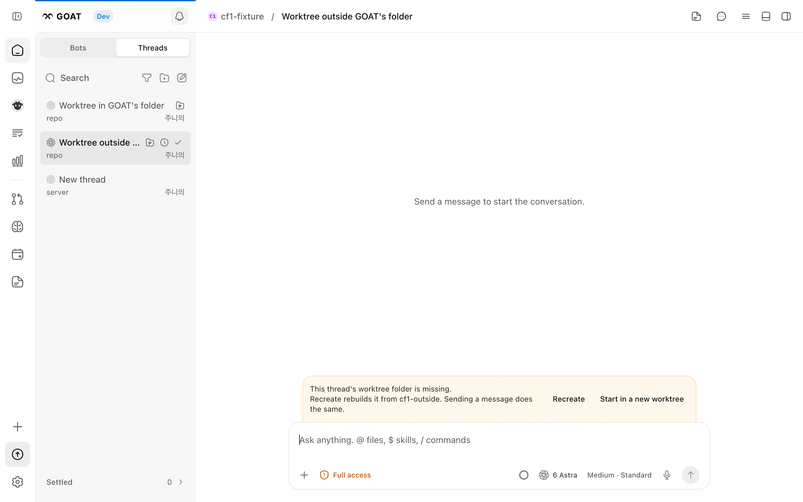
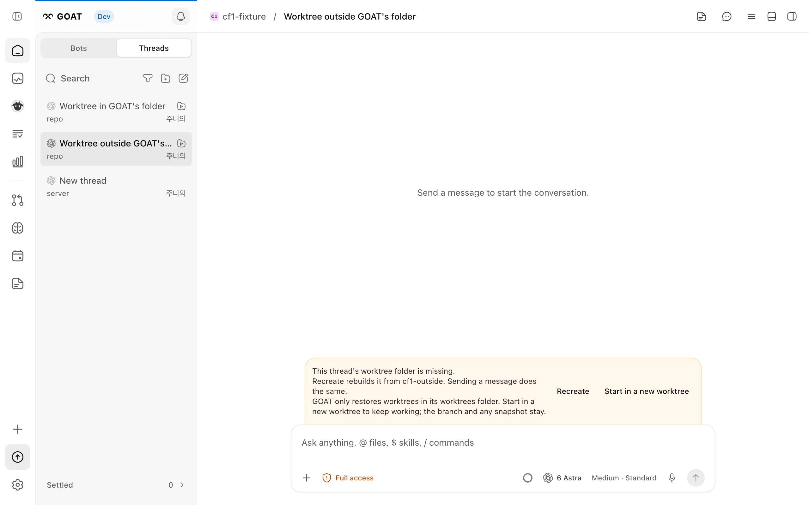
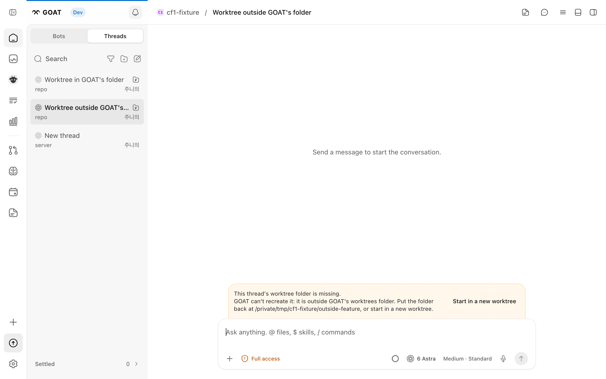

# CF1 clients (lane record)

Lane branch: `chase/t3-261114-next2-cf1-clients`, head `fdfda95783cd5e3b61a1eed50b6224574b967a1f`, cut from the integration branch `chase/t3-261114-next2` at `ed4268897e3183341694f27e488232572d5c5151` (draft PR #3660). Host pen-macmini. Plain push, no force. One commit per row.

## Rows and commits

| row | class | GOAT commit | proof |
| --- | --- | --- | --- |
| goat#3513 (web Office: CJK fonts against the worker call limit) | C2 | `7a18414c62250319a72d3e5ecb220a6e904f3dee` | failing tests first (below); real-client open of a Japanese and Korean docx |
| goat#3514 (web Word: SVG decode unbounded) | C2 | `adf39bb67c9948e5bab55fdfea4dca7d24e74821` | failing tests first (below) |
| goat#3658 (web and mobile: missing-worktree banner) | C4 | `76bbeb82f9d9d1a5dacb8f298ad7cda9a2b49e55` | failing server tests first; web before/after captures; phone captures owed |
| goat#3652 (mobile Usage dimming) | C2, visual | `2fb3043722475043c4e67b7425383fadacacc294` | visual: phone before/after captures owed, no UI test |
| goat#3557 (mobile Create worktree during a turn) | C4 | `b325b38538b52b0e3f662dfd669badeed742c2d7` | failing tests first (below); phone capture owed |
| goat#3654 (mobile failed Git action hidden under the sheet) | C2 | `fdfda95783cd5e3b61a1eed50b6224574b967a1f` | failing test first (below); phone captures owed |

## Coordinator answers (verbatim)

> Coordinator to lane coordinator, 2026-11-17 08:53:31 UTC, for CF1 (quote verbatim in next2-pr-plan.md under "Coordinator answers" and in CF1's record).
> goat#3658, the C4 plan: YES, with these conditions.
> 1. The field as planned: ThreadWorkspaceStatus.recreatable, Schema.optionalKey(Schema.Boolean), set by ThreadWorkspaceService.status from the same isManagedWorktreePath the restore and the send check use, on "missing" and "cleaned" only; absent means "as today". No other contract change.
> 2. "cleaned": show that recreatable=false there matches what the server refuses. Name with path:line what Restore (the snapshot path) does for a cleaned worktree outside the worktrees folder, and whether such a state can exist at all (cleanup of an unmanaged worktree; a worktreesDirectory setting changed after the cleanup, which previousWorktreesDirectories should cover). If Restore would SUCCEED for a case where recreatable is false, the banner must not hide Restore for it: the rule is that the banner offers exactly what the server will do. One server test per state.
> 3. The sentence under "cleaned" and "missing" that says a send restores or recreates it ("Sending a message restores it too." / "Sending a message does the same.") is dropped when recreatable is false; when it is true or absent the text is today's, unchanged.
> 4. Agents: say whether any agent tool or thread read returns ThreadWorkspaceStatus (worktree.status, thread.read, the agent surface contracts). If it does, the field reaches agents too: update the tool's description only if it lists fields, run the agent surface audit and say whether its counts move. If no agent path returns it, say so in the record.
> 5. Wording for both clients, one helper in contracts as planned: title unchanged; body "GOAT can't recreate it: it is outside GOAT's worktrees folder. Put the folder back at <path>, or start in a new worktree." (for "cleaned", "restore" in place of "recreate" if case 2 keeps that state). No Recreate or Restore button; "Start in a new worktree" stays.
> 6. Tests as planned (server: outside false, inside true, present absent; the shared helper: false, true, absent). Captures: web before and after from the real client; the phone captures are owed and listed. Docs: check docs/user for a sentence that promises Recreate or a send always rebuilds a missing worktree and correct it if there is one.
> 7. The review of CF1's head treats this row as C4: both directions of old and new client and server, as the plan states them.
> Carry on with the other rows meanwhile; goat#3557 stays C4 with negative cases as you said.

## goat#3513

Fix. A font download no longer runs on the 30-second per-call deadline. The worker tells the window when the running call waits on font bytes (`waitOutsideDeadline`, apps/web/src/components/files/office/worker-rpc.ts), and the window pauses that call's deadline until the wait ends, then gives it a fresh 30 seconds. Each face has its own bound instead: 30 seconds plus its size at 256 kbit/s (fonts.ts `loadFace`; Simplified serif 11.6 MB gets about 6.6 minutes). When it expires the call fails with "The fonts this document needs did not finish downloading. Check the connection, then open it again." A stalled download used to hang forever inside a paused call; now it is bounded. Because the deadline no longer kills the worker mid-download, a completed face lands in the browser's HTTP cache for the next open. Slides and spreadsheets already ignore a failed face and draw with the fallback (slide-fonts.ts:56, sheet-fonts.ts:33). The OpenXML viewer's own 30-second timer (OpenXmlOfficeViewer.tsx:65) stops when its preparation worker answers, before any engine loads fonts, so it does not cover downloads.

Tests, fail-first on ed42688:
- worker-rpc.test.ts "does not run while the worker waits on font downloads, which have their own bound": `expected { failed: 'This document took too long to preview. Open it in another app.' } to deeply equal { value: 'opened' }`.
- worker-rpc.test.ts "gives the call 30 seconds again once the wait ends": passed before and after (it guards that the deadline still exists).
- fonts.test.ts "fails a font download that outlasts its own bound with a message about the fonts": `Test timed out in 15000ms` (the download had no bound, so the promise never settled).
After the fix: `vp test run` of worker-rpc.test.ts, fonts.test.ts, fonts.browser.test.ts, word-document.browser.test.ts and slide-fonts.browser.test.ts: 5 files, 11 tests passed.

Real client (web, this worktree's dev server): a docx with Calibri, MS Mincho and Malgun Gothic runs opens through the real document worker with Japanese and Korean drawn in the bundled faces.

Limits. A link slower than 256 kbit/s per face still fails, now with the fonts message. Faces downloading at once share the link, so the Chinese example (two faces, 20 MB) needs about 512 kbit/s. Thresholds are computed from sizes, not measured on a throttled link.

## goat#3514

Fix (vector-pictures.ts). An SVG picture above 2 MB keeps the engine's placeholder without being decoded. The window stops waiting for a decode after 3 seconds, clears the image's source, and keeps the placeholder. Workers have no image element and `createImageBitmap` does not take SVG, so the decode stays in the window; a decode the browser already started cannot be preempted, only abandoned.

Tests, vector-pictures.browser.test.ts, fail-first on ed42688:
- "leaves an SVG picture above the size limit to the engine's placeholder without decoding it": `expected [ ImageBitmap{}, 1 ] to deeply equal [ undefined, +0 ]`.
- "stops waiting for an SVG picture whose decode outlasts its time budget": `Test timed out in 15000ms`.
- "draws a small SVG picture at its own size": passed before and after.
After the fix, with word-images.browser.test.ts: 2 files, 4 tests passed.

## goat#3658 (C4)

Contract. `ThreadWorkspaceStatus.recreatable: Schema.optionalKey(Schema.Boolean)` (packages/contracts/src/worktreeRetention.ts). No other contract change.

Server. `ThreadWorkspaceService.status` sets `recreatable: yield* isManagedWorktreePath(worktreePath)` on the "missing" and "cleaned" answers only (ThreadWorkspaceService.ts, the final return of `status`). The same function decides `restoreInPlace` (ThreadWorkspaceService.ts:137-141), the send check (WorktreeSendCheckLive.ts:32) and turn start (prepareTurnWorkspace.ts:51).

Clients. One helper, `describeThreadWorkspaceRecovery` (worktreeRetention.ts), gives the body and whether to offer Restore or Recreate; both banners keep their own titles (web ThreadWorkspaceBanner.tsx, mobile features/threads/ThreadWorkspaceBanner.tsx). With `recreatable: false`: "GOAT can't recreate it: it is outside GOAT's worktrees folder. Put the folder back at <path>, or start in a new worktree." ("restore" for "cleaned"), no Recreate or Restore button, and "Start in a new worktree" stays. True or absent: today's text and buttons, unchanged.

Condition 2, "cleaned" outside the folder. Restore for "cleaned" and "missing" both go through `restoreInPlace` (ThreadWorkspaceService.ts:313-317, mode "restore"), which refuses any path outside the managed folders with "GOAT only restores worktrees in its worktrees folder." (:137-141; :135 at ed42688) before the snapshot path runs; a send skips recreation there too (prepareTurnWorkspace.ts:51). So recreatable=false hides only what the server refuses, in both states; no case has Restore succeed with recreatable false. Can the state exist: cleanup never removes an unmanaged worktree (storageCleanup.ts:705-706 keeps it as "outside the managed worktree folder"). It still arises because `status` takes the thread's latest snapshot by thread id (ThreadWorkspaceService.ts:115), not by path: a thread cleaned up in GOAT's folder and later moved to an outside folder that went missing reads "cleaned". A changed worktreesDirectory setting does not produce it: `isManagedWorktreePath` checks the current setting, every previousWorktreesDirectories entry and the default root (worktreesDirectory.ts:152-168, :189-215).

Condition 4, agents. No agent tool or thread read returns ThreadWorkspaceStatus. `ThreadWorkspaceService` is used only by the WebSocket handlers (apps/server/src/storage/storageRpc.ts:35-37, `thread.getWorkspaceStatus` and `thread.restoreWorkspace`); `goat_worktree_status` (packages/contracts/src/agentSurface/entries/worktree.ts:126) reads the binding, not this status. Checked with `rg -n 'ThreadWorkspaceService|threadGetWorkspaceStatus' apps/server/src packages/contracts/src`. The agent surface audit passed inside check:changed; no description changed.

Condition 6, docs. No user guide promises that a missing worktree is always recreated. docs/user/project-settings.md:342-347 says Restore and a send bring back a worktree cleanup removed, and cleanup only removes worktrees inside GOAT's folder (storageCleanup.ts:705-706), so it stays true. No docs change.

Tests, fail-first on ed42688:
- ThreadWorkspaceService.test.ts "says a $state worktree in $place is recreatable only where restoring it would not be refused" (missing/cleaned × GOAT's worktrees folder/another folder): all four failed with `expected { threadId: 'thread-1', …(4) } to have deep property 'recreatable'`. The two outside cases also assert that `restore` with mode "restore" is refused with the server's detail.
- "leaves recreatable out for a worktree that is present, wherever it is": passed before and after.
- packages/contracts/src/worktreeRetention.test.ts, the helper for missing with recreatable absent, true and false, and cleaned with absent and false: new helper, so it could not import before; 5 passed after.
After: ThreadWorkspaceService.test.ts 15 passed; worktreeRetention.test.ts 5 passed.

Older and newer, both ways (condition 7):
- Older client, newer server: `Schema.Struct` decoding drops the unknown key; checked from packages/contracts: `decodeUnknownSync` and `toCodecJson` of today's ThreadWorkspaceStatus with `recreatable: false` return the object without it, so the older banner behaves as today (Recreate offered; pressing it shows the server's refusal).
- Newer client, older server: the key is absent and the helper treats absent as recreatable, so the banner is today's (helper test, the "absent" cases).

Web captures (this worktree's dev server, a thread bound to a removed worktree at /private/tmp/cf1-fixture/outside-feature, and one bound to a missing path in the dev server's worktrees folder):

Before, and Recreate pressed under the old banner (the server's refusal under the promise):

After, outside the folder, and inside it (unchanged):

Phone captures owed (iOS and Android, juns-MacBook-Pro): the banner of a thread whose worktree outside GOAT's folder is missing, before and after (new body, no Recreate, Start in a new worktree kept); the same for a thread in GOAT's folder (unchanged).

## goat#3652

Decision: the phone marks saved figures the way the web does, reading the rule the web already reads from client-runtime (`usageLoadingState`, packages/client-runtime/src/state/usageProgress.ts:73, covered by usageProgress.test.ts:113). The chart, totals and cost sections dim while any provider updates; each provider row and model row dims while its own provider updates (apps/mobile/src/features/usage/UsageRouteScreen.tsx, `UsageDim`). `usageProgress().dimmed` and its tests are unchanged (rule 3: usageProgress.test.ts:76-87 pin `dimmed: false` for a partway answer), and it no longer drives the phone's dimming; its label still does.

Visual change, so no UI test. Phone captures owed (iOS and Android): the Usage page opened cold with "Updating N providers…", before (saved figures at full strength) and after (dimmed), and the exact figures after the providers answer.

## goat#3557 (C4)

Fix: the phone checks the thread's run state before creating the worktree, with the web's rule (running or waiting, or an interruptible active run; web BranchToolbar.logic.ts:270 via session-logic.ts:1028), and shows the server's own refusal text (apps/server/src/orchestration-v2/goat/ActiveTurnRefusals.ts:7) without creating anything (apps/mobile/src/state/use-selected-thread-git-actions.ts, `turnBlocksWorktreeMove`). Nothing is deleted, so no destructive path was added.

Tests, use-selected-thread-git-actions.test.ts, fail-first on ed42688: "refuses Create worktree while a turn is running / waiting on a question / starting, before creating a folder or branch" all three failed with `expected [ { worktree: { …(2) } }, …(3) ] to deeply equal [ null, [], [], [ { …(3) } ] ]` (the worktree was created). Negative case "creates the worktree once the turn has ended" passed before and after, as do the existing permission cases. After: 18 passed.

Both ways: server unchanged. An older phone still creates first and the server still refuses the bind. A newer phone against an older server checks the same run state the shell already carries. Residual: a turn that starts between the check and the bind is still refused by the server and can leave a folder, as before; storage cleanup reports such orphans.

Phone capture owed: Create worktree from the Git sheet during a running Replay turn, showing the refusal in the sheet, and `git worktree list` before and after showing no new folder.

## goat#3654

Decision: keep a failure until the person dismisses it, and show it inside the open Git sheet. Each sheet (Branches, Commit, Confirm, Overview) renders `GitActionFailure` (gitSheetComponents.tsx) at the top of its content with a Dismiss; the same result still shows in the thread screen's banner after the sheet closes. Why: the person is looking at the sheet, and closing it on failure would throw away what they typed (a branch name, a commit message). Successes still clear after 5 seconds. A new action clears the previous result (use-selected-thread-git-actions.ts, `runSelectedThreadGitMutation`).

Test, apps/mobile/src/state/use-vcs-action-state.test.ts, fail-first on ed42688: "keeps a failed Git action's message until the person dismisses it, and clears a success after 5 seconds": `expected [ null, null, 'success', null ] to deeply equal [ 'error', null, 'success', null ]`. After, with the Git sheet tests and the hook tests: 4 files, 24 passed. GitBranchesSheet.test.tsx and GitBranchesSheet.occupancy.test.tsx gained `GitActionFailure: () => null` in their `./gitSheetComponents` mocks (mock setup, no expectation changed).

Phone captures owed (iOS and Android): a refused Create worktree with the Git sheet open, the failure in the sheet after more than 5 seconds, Dismiss clearing it, and the banner after closing the sheet without dismissing.

## Checks on the head

- `vp run check:changed origin/chase/t3-261114-next2` on fdfda95783 (pen-macmini): pass format, lint, knip 1/2, knip 2/2, graphql (apps/server), agent surface audit, agent context budget, typecheck (38 packages), test (22 files).
- `cd apps/mobile && vp run typecheck`: exit 0.
- The focused runs listed under each row.
- Rule 3: no expectation in an existing test changed. Budgets: no changed file has an entry in oxlint-plugin-goat/code-budgets.json; UsageRouteScreen.tsx is 939 lines. No test file moved or renamed.

NOT RUN: every phone capture listed above (owed until juns-MacBook-Pro is free); goat#3513 on a throttled link (thresholds computed from sizes); a pathological SVG in the real client for goat#3514 (covered by the browser tests); full CI (ci:full); an independent review (the coordinator runs one per READY).

## Coordinator answers, 09:22 (verbatim)

> Coordinator to lane coordinator, 2026-11-17 09:22:05 UTC (quote verbatim in next2-pr-plan.md under "Coordinator answers" and in each lane's record).
> 1. CF1 READY at fdfda95783: checked on origin (six commits on ed4268897e, 24 files +636/-91). The fresh review is running (Opus 5.5 xhigh, read-only, task goat-next2-CF1-final-fdfda957; goat#3658 and goat#3557 as C4: the recreatable field against what the server really does, compatibility both ways, agents; the mobile Create worktree check against the server's refusal and the residual race). CF1 stands by; no push until I send the verdict. One thing for CF1 to answer now, in its record, because the reviewer will ask: it touched two EXISTING mobile test files (GitBranchesSheet.occupancy.test.tsx, +5/-... and GitBranchesSheet.test.tsx, +1): the exact lines before and after and whether each is an import, a provide or prop line, or a harness or expectation change; a harness change needs my rule 3 line before the merge. THE PHONE CAPTURES CF1 owes (goat#3658 banner, goat#3652 Usage dimming, goat#3557 refusal, goat#3654 the message inside the Git sheet): N15b takes them on its own simulator and emulator after CF1 is merged into chase/t3-261114-next2 and N15b has merged that head; they are uploaded to #3660 and listed in CF1's record.

## Existing test files changed (answer to item 1)

Four existing test files changed between ed4268897e and fdfda95783, the two named above and two more listed here so the review sees them all. Every change is a harness change: a mock factory, hoisted mock state, a `beforeEach` reset, or a test layer. None is an import, provide or prop line, and no expectation (`expect`/`assert` argument or title of an existing case) changed. All four need the coordinator's rule 3 line. Fresh runs at fdfda95783: the three mobile files 23 passed; ThreadWorkspaceService.test.ts 15 passed.

1. apps/mobile/src/features/threads/git/GitBranchesSheet.occupancy.test.tsx:32, harness (vi.mock factory). Reason: GitBranchesSheet now imports `GitActionFailure` from ./gitSheetComponents, and a vi.mock factory without that export fails the import.
   - Before (ed4268897e:32): `vi.mock("./gitSheetComponents", () => ({ SheetActionButton: () => null }));`
   - After (fdfda95783:32-35), formatter split it over four lines: `vi.mock("./gitSheetComponents", () => ({` / `  GitActionFailure: () => null,` / `  SheetActionButton: () => null,` / `}));`
2. apps/mobile/src/features/threads/git/GitBranchesSheet.test.tsx:77, harness (vi.mock factory), the same reason. One line added inside the existing factory at :76; the `SheetActionButton` stub that records actions is unchanged.
   - Before (ed4268897e:76-77): `vi.mock("./gitSheetComponents", () => ({` / `  SheetActionButton: (props: ActionProps) => {`
   - After (fdfda95783:76-78): `vi.mock("./gitSheetComponents", () => ({` / `  GitActionFailure: () => null,` / `  SheetActionButton: (props: ActionProps) => {`
3. apps/mobile/src/state/use-selected-thread-git-actions.test.ts, harness, three lines; the rest are two new cases (:169-193 "refuses Create worktree while a turn is %s, before creating a folder or branch", :195-204 "creates the worktree once the turn has ended").
   - :18 added to the hoisted `state.thread` after `worktreePath: null as string | null,` (ed4268897e:17): `runtime: null as { status: string; activeRunId: string | null } | null,`. Reason: the hook now reads `thread.runtime`; null is "no runtime", what every existing case had.
   - :65 added to the `./use-vcs-action-state` mock after `state.results.push(result),` (ed4268897e:63): `dismissGitActionResult: () => {},`. Reason: the hook now calls it when an action starts.
   - :139 added to `beforeEach` after `state.thread.worktreePath = null;` (ed4268897e:136): `state.thread.runtime = null;`.
4. apps/server/src/orchestration-v2/goat/ThreadWorkspaceService.test.ts, harness, three places; the rest are new cases (:238-264 the four recreatable cases, :266-276 the present case).
   - :39-40 added to `HarnessOptions` after `readonly duringSetup?: …` (ed4268897e:38): `/** The thread has a cleanup snapshot, so a missing folder reads as cleaned. */` / `readonly snapshot?: boolean;`.
   - Before (ed4268897e:110): `latestForThread: () => Effect.succeed(null),`. After (fdfda95783:112-126): `latestForThread` returns a fixed WorktreeSnapshot when `options.snapshot === true`, else `null`, so every existing case still gets `null`.
   - Before (ed4268897e:142): `ServerSettings.ServerSettingsService.layerTest(),`. After (fdfda95783:159-161): `ServerSettings.ServerSettingsService.layerTest({` / `  worktreesDirectory: NodePath.join(root, "managed"),` / `}),`. This one reaches every case in the file: the managed worktrees folder becomes <fixture root>/managed instead of the default. None of the existing cases has a path there, and none asserts `recreatable`, so they read what they read before; all 15 pass.

Proposed rule 3 wording, for the coordinator to accept or change: "rule 3, CF1: the four harness changes listed in next2-CF1.md under 'Existing test files changed' (mock factories gain the new export or a no-op, hoisted state and beforeEach gain runtime: null, the ThreadWorkspaceService harness gains a snapshot option and a managed worktrees folder under its fixture root); no expectation changes."

## Phone captures (owed, assigned by the coordinator)

N15b takes these on its own simulator and emulator once CF1 is merged into chase/t3-261114-next2 and N15b has merged that head; they are uploaded to #3660 and listed here when they exist: goat#3658 the banner (outside GOAT's folder before and after; inside unchanged), goat#3652 Usage dimming (cold open before and after), goat#3557 the refusal with no new folder, goat#3654 the failure inside the Git sheet past 5 seconds and Dismiss.
