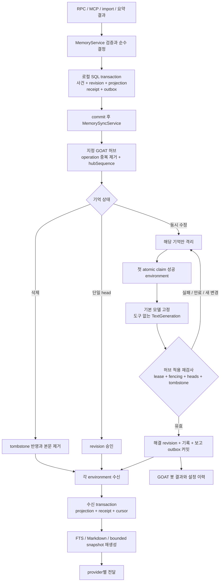

# 001 설계자 설계안 (M1~M18)

- 날짜: 2026-10-13
- 설계자: sol(gpt-6.1-sol) delegated task goat-memory-wp0-architect-r1, read-only
- 처분과 실행 계획: [000_plan.md](000_plan.md)

**SQLite 정본 + 기억별 operation log + 지정 GOAT environment 허브를 권고합니다.** Markdown은 읽기·내보내기용 파생물로 둡니다. 파일 정본과 git remote를 택하면 SQLite 트랜잭션과 git 반영 사이에 이중 커밋 경계가 생기고, 기억별 격리·삭제 우선·분산 lease를 위해 별도 원장을 다시 만들어야 합니다.

현재 checkout의 HEAD와 로컬 `origin/dev`는 모두 `1e2418fafb625604de1eb89250a10d971bcfd0fe`입니다. 지정 입력 문서 전부와 관련 GOAT 소스를 읽었습니다. 파일 수정·커밋·서버 실행·테스트 실행은 하지 않았고, 종료 시 작업 트리도 깨끗했습니다. 아래 내용은 **단계 2 architect 제안**이며, main의 결정별 처분·실행 계획·reflection·독립 A 감사가 남아 있습니다.

formal P 범위는 확정 요구 1~6을 만족하는 설계 제안입니다. 검증은 현재 소스와의 대조까지이며 구현 검증은 미실행입니다. 산출물은 이 응답이고, 종료 조건은 결정·모델·흐름·의존 순서·열린 질문의 반환입니다. 요구 변경이나 사용자 선택이 필요한 항목은 마지막에 구분했습니다.

근거에서 저장소 상대경로는 요청한 GOAT worktree 기준입니다. `인터뷰`, `075`~`120`은 지정한 initiative 문서를 가리킵니다. 외부 사례의 현재 제품 상태나 과거 재현 결과를 이번 실행에서 다시 검증한 것으로 취급하지 않았습니다.

**결정 표**

| ID                          | 결정                                                                                                                                                                                                                                                                                                                           | 근거 path:line                                                                                                                                                                                                                                                                                              | 대안과 트레이드오프                                                                                                                                                                                                               | 남은 가정                                                                                                                                                 |
| --------------------------- | ------------------------------------------------------------------------------------------------------------------------------------------------------------------------------------------------------------------------------------------------------------------------------------------------------------------------------ | ----------------------------------------------------------------------------------------------------------------------------------------------------------------------------------------------------------------------------------------------------------------------------------------------------------- | --------------------------------------------------------------------------------------------------------------------------------------------------------------------------------------------------------------------------------- | --------------------------------------------------------------------------------------------------------------------------------------------------------- |
| **M1 정본·전송**            | **SQLite의 기억 사건·revision이 정본**, 현재 항목은 projection. 같은 `statev2.sqlite`를 사용하고 Markdown·FTS·주입 캐시는 재생성한다. 동기화는 **인증된 HTTP operation API**로 한다. MCP는 사용자·agent 접근 API다.                                                                                                            | `docs/internals/overview.md:53–71`; [120:84–91](/Users/jun/Developer/goat_initiative/research/120_goat_memory_source_terrain.md:84); [110:53–74](/Users/jun/Developer/goat_initiative/research/110_omo_memory_layer.md:53)                                                                                  | 기억 하나당 파일 + git은 사람이 직접 읽고 비교하기 좋다. 그러나 git 병합과 DB outbox의 원자성을 확보할 수 없고, lease·삭제·격리 원장은 별도로 필요하다. SQLite는 수동 파일 편집을 잃는 대신 하나의 커밋 경계를 얻는다.            | Markdown 편집을 GOAT에 자동 역수입하지 않는다. 내보내기 편집본은 명시적 import로만 들어온다.                                                              |
| **M2 서비스 책임**          | `memory/MemoryService`가 읽기·쓰기·잊기·이력·되돌리기와 **순수 결정 → 원자적 사건 반영**을 소유한다. `MemorySyncService`가 허브 수신·송신·cursor·lease를, `MemoryWorker`가 요약·해결·파생물 작업을 담당한다. `server.ts`에서 layer를 한 번 조립한다.                                                                           | `docs/internals/effect-services.md:11–22,40–66,95–103`; `apps/server/src/orchestration-v2/EventSink.ts:149–161`                                                                                                                                                                                             | 기존 thread Orchestrator에 모든 기억 명령을 넣으면 user/project 기억에도 가짜 thread 의존성이 생긴다. **같은 SQL client를 쓰는 작은 memory aggregate**로 event-sourcing 규칙을 지킨다. 범용 분산 workflow 엔진은 추가하지 않는다. | memory 사건 스트림은 thread 사건 스트림과 별개다. thread 종료 연결은 committed 사건을 받는 worker가 담당한다.                                             |
| **M3 식별·범위**            | `memoryId`는 불변 UUID. scope는 `user/project/thread`의 판별 union. 사용자 공유 공간은 허브 발급 `memorySpaceId`로 묶는다. `projectKey`는 `repositoryGroupingKeyOf` 기반이며 **명시 공유 ID가 우선**한다. 원문 locator는 `ScopedThreadRef`.                                                                                    | `packages/contracts/src/environment.ts:283–329`; [인터뷰:93–98](/Users/jun/Developer/goat_initiative/devlog/_plan/261013_memory_interview/000_interview.md:93); [120:76–80](/Users/jun/Developer/goat_initiative/research/120_goat_memory_source_terrain.md:76)                                             | cwd·로컬 `ProjectId`는 기기별로 갈라진다. remote key만 사용하면 alias·remote 변경·case-sensitive hosting을 완전히 해결하지 못한다. 명시 ID와 로컬 checkout 매핑을 함께 둔다.                                                      | 첫 범위는 동일 owner의 environment들이다. 팀원 공유는 추가 ACL 설계가 필요하다.                                                                           |
| **M4 revision·출처**        | revision은 불변 ID와 `parents[]`를 갖는 DAG. 일반 수정은 부모 하나, 해결은 모든 입력 head를 부모로 둔다. `operationId`와 revision ID를 분리한다. 출처는 provider instance/model, environment, thread/source locator, import fingerprint를 보존한다. `fact/inference`와 근거를 분리한다.                                        | [110:20–22,76](/Users/jun/Developer/goat_initiative/research/110_omo_memory_layer.md:20); [120:111–116](/Users/jun/Developer/goat_initiative/research/120_goat_memory_source_terrain.md:111)                                                                                                                | 기기 시각·증가 정수만으로 revision을 정하면 동시 쓰기를 덮어쓴다. DAG는 충돌을 명확히 표현하지만 부모 수신 대기 처리가 필요하다.                                                                                                  | `fact`는 “확인된 진실” 인증이 아니다. 사용자 진술·소스 확인·모델 추론의 evidence origin을 별도로 기록한다.                                                |
| **M5 잊기·보존**            | 같은 ID의 tombstone은 **모든 수정·해결·되돌리기를 이긴다**. 최소 tombstone은 영구 보존한다. 잊기는 검색·주입·파생물·대기 job·동일 출처 재import를 차단한다. 삭제된 기억의 revision/충돌/해결 **본문은 제거 가능하도록 payload를 사건 metadata와 분리**한다.                                                                    | [인터뷰:69–73,96–98](/Users/jun/Developer/goat_initiative/devlog/_plan/261013_memory_interview/000_interview.md:69); [110:41,78](/Users/jun/Developer/goat_initiative/research/110_omo_memory_layer.md:41); [080:13–16,61](/Users/jun/Developer/goat_initiative/research/080_aside_memory_sync_audit.md:13) | 유한 TTL은 오래 오프라인인 기기의 부활을 허용한다. 원본을 무조건 영구 보존하면 ‘잊기’와 충돌한다. 삭제 전에는 되돌리기 원본을 보존하고, 삭제 후에는 내용 없는 감사 metadata만 남긴다.                                             | 명시적 재기억은 새 ID의 새 요청으로 처리한다. 기존 ID 복원은 금지한다. 백업·provider 원문까지 지우는지는 사용자 질문이다.                                 |
| **M6 허브·인증**            | 사용자가 고른 **하나의 GOAT environment**가 공유 log·membership·lease를 소유한다. 각 서버는 자체 sync credential을 `ServerSecretStore`에 보관한다. settings에는 hub environment/endpoint와 secret 이름만 둔다. credential은 공유 공간·송신 environment에 바인딩하고 회전·해제를 지원한다.                                      | `docs/internals/overview.md:3–19`; `apps/server/src/auth/ServerSecretStore.ts:138–172,199–206`; [120:72–86](/Users/jun/Developer/goat_initiative/research/120_goat_memory_source_terrain.md:72)                                                                                                             | git remote는 접근·백업이 익숙하지만 HTTP lease와 별도 권한이 다시 필요하다. 기존 agent MCP session은 run 수명에 종속되어 상시 sync에 부적합하다. hosted web은 허브가 아니다.                                                      | endpoint 접근 방식은 직접 연결·Tailscale·relay/tunnel에 맞춰 선택한다. `ServerSecretStore`는 권한을 제한한 파일 저장이며 암호화 저장이라고 부르지 않는다. |
| **M7 커밋·cursor·오프라인** | 로컬 사건·revision·projection·receipt·outbox를 **한 트랜잭션**에 커밋한다. 송신은 그 뒤 수행한다. 허브는 `operationId` 중복 제거와 monotonic `hubSequence`를 제공한다. 수신 항목 저장·projection·cursor 이동도 한 트랜잭션이다. 허브 오프라인이면 로컬 쓰기는 계속되고 `pendingSync`로 표시한다.                               | `docs/internals/overview.md:58–67`; `apps/server/src/remoteReports/RemoteReportService.ts:198–229`; [120:111–113](/Users/jun/Developer/goat_initiative/research/120_goat_memory_source_terrain.md:111)                                                                                                      | 동기식 허브 ACK를 쓰기 완료 조건으로 삼으면 오프라인 쓰기가 막힌다. 로컬 완료와 공유 완료를 분리하면 가용성을 얻지만 일시적 차이가 생긴다.                                                                                        | 오프라인 기기는 아직 모르는 원격 삭제를 즉시 반영할 수 없다. 재연결 후 수렴이 보장 범위다. 허브 자동 승격은 하지 않는다.                                  |
| **M8 충돌 격리**            | 동일 기억의 비조상 head들이 생기면 `conflictId`와 전체 variants를 저장한다. **그 기억만 검색·주입·정리에서 제외**한다. 독립 기억과 cursor는 계속 진행한다. 누락 부모는 durable pending으로 보관한다.                                                                                                                           | [인터뷰:85–98](/Users/jun/Developer/goat_initiative/devlog/_plan/261013_memory_interview/000_interview.md:85); [080:43–46](/Users/jun/Developer/goat_initiative/research/080_aside_memory_sync_audit.md:43); [090:36–37](/Users/jun/Developer/goat_initiative/research/090_memory_sync_precedents.md:36)    | 마지막 정상본을 계속 주입하면 이미 모순된 사실을 정상으로 보이게 한다. 전체 sync 중단은 확정 요구 6을 위반한다. 항목 격리는 일부 기억의 일시적 부재를 택한다.                                                                     | 서로 다른 ID의 의미 모순은 revision 충돌과 다르다. 정리 작업이 후보를 제안하되 초기 sync가 의미 비교를 강제하지 않는다.                                   |
| **M9 lease·첫 기기**        | 허브의 **첫 atomic claim 성공 environment**가 해결 담당이다. `(memoryId, conflictHeadSet)` claim, 만료, 갱신, memory별 단조 증가 fencing token을 둔다. 적용 시 holder·token·미만료·현재 head set·tombstone을 다시 검사한다.                                                                                                    | [120:114–115](/Users/jun/Developer/goat_initiative/research/120_goat_memory_source_terrain.md:114); [110:33,80](/Users/jun/Developer/goat_initiative/research/110_omo_memory_layer.md:33)                                                                                                                   | 로컬 최초 관찰 시각은 시계 오차와 네트워크 지연 때문에 전 세계 순서를 증명하지 못한다. PID/file lock은 허브 잠금을 대체하지 못한다. claim 순서는 구현·검증 가능하다.                                                              | 초기 제안: lease 120초, 30초마다 갱신, 한 시도 최대 10분. 허브 시각을 사용하며 실측 후 확정한다.                                                          |
| **M10 자동 해결·되돌리기**  | `TextGeneration`에 `resolveMemoryConflict`, `generateMemorySummary`를 추가한다. claim 시 **그 environment의 `defaultModelSelection` 전체를 고정**한다. 모델은 도구 없는 일회성 실행이며, 검증된 결과만 즉시 적용한다. 실패하면 해당 기억만 격리한다. 해결 기록과 결과 revision을 함께 커밋한다. revert는 새 보상 revision이다. | `packages/provider-core/src/server/textGeneration.ts:129–167`; `textGenerationOperations.ts:35–49,62–95`; `apps/server/src/textGeneration/TextGeneration.ts:41–55`; [120:97–101,116](/Users/jun/Developer/goat_initiative/research/120_goat_memory_source_terrain.md:97)                                    | 제목용 `textGenerationModelSelection`이나 다른 provider로 조용히 fallback하면 확정 요구를 바꾼다. 상주 해결 thread는 세션·도구·재개 상태가 불필요하게 늘어난다.                                                                   | 모델 alias가 실제 모델로 해석된 결과도 기록한다. 지원되지 않는 기본 provider는 typed failure이며 다른 provider로 대체하지 않는다.                         |
| **M11 결과 보고**           | 성공·실패·revert 결과는 durable report outbox로 기록한다. **해결 environment의 GOAT 봇**에 결과 한 건, 실패에는 알림 한 건을 보낸다. 상세·이력·되돌리기·sync 상태의 조회면은 Memory 설정이다. 추론 과정·tool call은 보고하지 않는다.                                                                                           | `apps/server/src/channels/ChannelBotTimeline.ts:1–9,31–54`; [120:105–107](/Users/jun/Developer/goat_initiative/research/120_goat_memory_source_terrain.md:105); [인터뷰:97](/Users/jun/Developer/goat_initiative/devlog/_plan/261013_memory_interview/000_interview.md:97)                                  | 모든 기기에 봇 메시지를 복제하면 같은 결과가 여러 번 보인다. 로그만 남기면 조용한 정체를 반복한다. 한곳에서 보고하고 다른 기기는 공유 상태를 조회한다.                                                                            | 보고에는 기억 본문 대신 ID·결과·링크를 둔다. 기존 channel record가 작업 ID 없이 이 결과를 표현하도록 계약을 확인·확장한다.                                |
| **M12 주입 스냅샷·예산**    | 서버가 턴 준비 시 **커밋된 projection의 일관된 스냅샷**을 만든다. user + 현재 project + 현재 thread만 자동 선택한다. 공통 turn input에 `memoryContext`를 추가하고 `appContext`는 재사용하지 않는다. 총량은 wrapper·출처·locator까지 포함해 제한한다.                                                                           | `packages/provider-core/src/server/ProviderAdapter.ts:405–425`; [110:19,30](/Users/jun/Developer/goat_initiative/research/110_omo_memory_layer.md:19); [120:48–55](/Users/jun/Developer/goat_initiative/research/120_goat_memory_source_terrain.md:48)                                                      | 전체 기억 주입은 크기·범위 누수를 만든다. MCP만 제공하면 모델이 검색하지 않을 수 있다. 작은 snapshot과 필요 시 검색을 결합한다.                                                                                                   | 초기 상한은 **6,000 Unicode 문자 및 24KiB UTF-8 중 먼저 도달한 값**이다. token 수는 별도 계측하며 경고를 강제 상한으로 표현하지 않는다.                   |
| **M13 provider 경계**       | 여섯 provider 모두 bounded snapshot 전달을 설계한다. MCP 지원과 snapshot 지원은 별도 capability다. Codex compaction에는 현재 snapshot 복원이 필요하고, OpenCode external server에는 MCP 자동 설정을 하지 않는다.                                                                                                               | [120:39–55](/Users/jun/Developer/goat_initiative/research/120_goat_memory_source_terrain.md:39); `CodexAdapterV2.ts:1749–1775`; `provider-opencode/src/server/v2/adapter.ts:3382–3432`                                                                                                                      | 공통 시작 hook 하나로 해결하면 세션별 설정과 매 턴 전달 차이를 놓친다. provider별 파일에 메모리를 써 넣으면 소유권과 삭제 경계가 깨진다.                                                                                          | 지원표는 아래와 같다. 실제 runtime 증거가 없는 경로는 capability를 먼저 true로 광고하지 않는다.                                                           |
| **M14 MCP·RPC 권한**        | 새 `memory:read`, `memory:write` scope와 `memory` MCP capability를 둔다. 쓰기는 **`writesWithCapability` + 명시 grant 검사**로 선언하고 commit 직전 재검사한다. hub sync는 별도 server principal/`memory:sync` 권한이다. 설정 변경은 `settings:write`.                                                                         | `apps/server/src/mcp/McpToolAccess.ts:136–182,276–289`; `McpInvocationContext.ts:14–21,55–63`; `packages/contracts/src/auth.ts:109–174`; `RpcAuthorization.ts:234–240`                                                                                                                                      | `reads`만으로 scope 검사가 생기지 않는다. `writesEnvironment`는 full-access/default를 요구한다. memory capability 하나만으로 읽기·쓰기를 함께 허용하면 read-only client가 경계를 우회한다.                                        | grants를 MCP 호출 context까지 전달해야 한다. 새 scope를 구형 grant의 legacy parent로 조용히 승격하지 않는다.                                              |
| **M15 client 명령·호환성**  | `packages/client-runtime`에 environment 지정 memory query/command를 둔다. mutation은 `createEnvironmentRpcCommand`, UI는 `permissionAtom`을 사용한다. 계약·서버 scope map·클라이언트 guarded map을 함께 확장한다. 환경 descriptor에 memory protocol capability를 광고한다.                                                     | `packages/client-runtime/src/state/runtime.ts:785–845`; `packages/contracts/src/clientRpcPermissions.ts:15–61`; `docs/internals/overview.md:16–19,23–38`; `AGENTS.md:154`                                                                                                                                   | 웹의 raw RPC 호출은 모바일·권한·재연결 동작을 갈라놓는다. 새 서버라고 가정하면 독립 업그레이드 환경에서 실패한다.                                                                                                                 | 미지원 서버는 UI 기능을 숨기고 typed unavailable을 반환한다. 다른 environment로 fallback하지 않는다.                                                      |
| **M16 thread 요약·원문**    | 원문 소유 environment가 committed 턴 종료를 받아 요약 job을 만든다. 공유하는 것은 **요약·source watermark·`ScopedThreadRef`·필요한 message locator**뿐이다. 원문 조회는 소유 environment로 라우팅한다. 정리 주기는 원문 owner가 실행하며 재시작 sweep으로 누락을 복구한다.                                                     | `docs/internals/overview.md:73–80,123–128`; `ThreadTitleRegenerationService.ts:95–120`; `apps/server/src/mcp/HostThreadsMcpService.ts:44–48,160–175`; [인터뷰:70,79](/Users/jun/Developer/goat_initiative/devlog/_plan/261013_memory_interview/000_interview.md:70)                                         | compaction summary는 provider 내부 대화 유지물이며 공유 기억으로 동일시할 수 없다. transcript 전체 공유는 확정 요구와 다르다.                                                                                                     | 정상 완료 턴을 요약한다. 실패·취소 턴은 확정된 사용자 진술·완료된 결과만 사용하며 미완료 모델 문장을 사실로 저장하지 않는다.                              |
| **M17 가져오기**            | Codex·Claude·omo는 **읽기 전용 단방향 import**다. parser가 허용된 기억 파일에서 항목을 만들고 출처와 source receipt를 기록한다. 같은 원본 재실행은 NOOP, 변경 원본은 기존 memory revision 후보가 된다. tombstone은 재import보다 우선한다.                                                                                      | [075:94–108](/Users/jun/Developer/goat_initiative/research/075_cross_provider_memory_cases.md:94); [100:14–17,34–36](/Users/jun/Developer/goat_initiative/research/100_omo_memory.md:14); [110:37–47](/Users/jun/Developer/goat_initiative/research/110_omo_memory_layer.md:37)                             | provider 메모리에 역으로 쓰면 생성된 상태·형식 변경·삭제 책임을 GOAT가 떠안는다. 본문 해시만 dedup하면 scope·출처가 다른 동일 문장을 잘못 합친다.                                                                                 | provider 자체 메모리 설정은 변경하지 않는다. 지원 형식을 모르면 안전하게 실패하며 자동 경로 추측을 하지 않는다.                                           |
| **M18 비밀정보·허용 목록**  | 추출/import 입력, 모델 출력, mutation commit, sync 송수신, 충돌·해결 기록에 공통 scanner를 적용한다. 공유 payload는 계약의 명시 필드만 serialize한다. 의심 항목은 본문을 저장·전송하지 않고 metadata만 남겨 격리한다.                                                                                                          | `docs/internals/effect-services.md:107–116`; [080:28–36,63–64](/Users/jun/Developer/goat_initiative/research/080_aside_memory_sync_audit.md:28); [110:45](/Users/jun/Developer/goat_initiative/research/110_omo_memory_layer.md:45)                                                                         | 파일 확장자 허용만으로 secret을 막을 수 없다. batch 전체 차단은 무관한 기억도 멈춘다. 개별 operation 차단과 안전한 durable receipt로 격리한다.                                                                                    | scanner는 완벽한 판별기가 아니다. 알려진 credential은 예외 허용하지 않는다. 테스트 가짜 값 예외는 제한된 rule·출처·감사 기록으로 관리한다.                |

**데이터 모델 스케치**

공유 자료와 기기 로컬 실행 자료를 같은 DB에 저장하되, **공유 여부는 테이블 복사가 아니라 operation 계약으로 결정**합니다.

```ts
MemoryScope =
  | { kind: "user" }
  | { kind: "project"; projectKey: ProjectKey }
  | {
      kind: "thread";
      thread: ScopedThreadRef;
      projectKey?: ProjectKey;
    };

ProjectKey =
  | { kind: "repository"; groupingKey: string }
  | { kind: "explicit"; sharedProjectId: string };

MemoryRevision = {
  memorySpaceId;
  memoryId;
  revisionId;
  parents: RevisionId[];
  operationId;
  scope;
  payloadRef;                 // 본문·근거, 삭제 시 제거 가능
  assertionKind: "fact" | "inference";
  provenance: {
    environmentId;
    providerInstanceId?;
    provider?;
    requestedModel?;
    effectiveModel?;
    sourceThread?: ScopedThreadRef;
    sourceEventRange?;
    importSource?: {
      format;
      sourceLocator;          // 원문 environment에 귀속된 locator
      sourceItemKey;
      sourceFingerprint;
    };
  };
  createdAtUtc;               // 관찰 정보, 승자 판정에 사용하지 않음
};

MemoryOperation = {
  protocolVersion;
  operationId;
  memorySpaceId;
  originEnvironmentId;
  memoryId;
  kind: "upsert" | "forget" | "resolve" | "revert";
  expectedHeads: RevisionId[];
  revision?;
  resolution?;
};

MemoryTombstone = {
  memorySpaceId;
  memoryId;
  deleteOperationId;
  deletingEnvironmentId;
  deletedAtUtc;
  suppressedSourceKeys: SourceKey[];
  // 본문 없음. 같은 기억 ID는 재활성화하지 않음.
};

MemoryConflict = {
  conflictId;                 // 기억 ID + 정렬된 head set으로 안정화
  memoryId;
  heads: RevisionId[];
  status: "quarantined" | "resolving" | "failed" | "resolved";
};

ResolutionLease = {
  memoryId;
  conflictId;
  holderEnvironmentId;
  fencingToken;
  expiresAtHubTime;
  attemptId;
  frozenDefaultModelSelection;
};

MemoryResolution = {
  resolutionId;
  memoryId;
  inputRevisionIds: RevisionId[]; // 둘 이상도 처리
  inputPayloadRefs;              // 양쪽 원본, 잊기 전까지 보존
  judgment;                     // 설명 가능한 판단 요약, 내부 추론 아님
  requestedModelSelection;
  effectiveProviderModel;
  resolvingEnvironmentId;
  fencingToken;
  resultRevisionId;
  appliedAtUtc;
  revertsResolutionId?;
};

ThreadMemoryPayload = {
  summary;
  sourceThread: ScopedThreadRef;
  sourceWatermark;             // committed 사건/메시지 범위
  sourceMessageLocators;
  derivedFromMemoryRevisions;
};
```

저장 구조는 다음 정도면 충분합니다.

| 분류      | 저장 내용                                                                         | 동기화                         |
| --------- | --------------------------------------------------------------------------------- | ------------------------------ |
| 기억 정본 | 사건 metadata, revision, payload, 현재 heads, tombstone, conflict, resolution     | 계약에 정의한 기억 사건·내용만 |
| 허브 원장 | operation receipt, `hubSequence`, membership, lease, fencing counter              | 허브 서비스가 소유             |
| 로컬 실행 | outbox, inbox pending, cursor, import receipt, summary/resolve job, report outbox | 원칙적으로 기기 로컬           |
| 파생물    | FTS, 주입 snapshot/cache, Markdown export                                         | 재생성; 공유하지 않음          |

추가 불변식은 다음과 같습니다.

- 같은 `operationId`와 같은 payload는 같은 receipt를 반환합니다. 같은 ID에 다른 payload가 오면 거부합니다.
- 부모가 없는 새 기억 생성과, 부모를 아직 받지 못한 수정은 구분합니다.
- conflict가 열려 있는 기억은 일반 upsert로 해결할 수 없습니다. 추가 수정은 variant로 보존하고 head set을 바꿉니다.
- resolution 적용은 입력 head 전체를 소비합니다. 세 번째 기기의 변경이 도착하면 이전 해결 결과를 그대로 적용하지 않습니다.
- revert는 `expectedHeads == [resultRevisionId]`일 때 한 번에 실행합니다. 후속 수정이 있으면 `revision_changed`를 반환하고 현재본을 보존합니다.
- forget은 resolution 원본·판단·요약에 포함된 해당 내용을 회상 경로에서 제거합니다. 관련 파생 summary도 무효화해 재생성합니다.
- import receipt의 source alias와 항목 fingerprint는 삭제 후에도 억제 기록으로 남습니다. 같은 출처의 재import에 새 ID를 발급해 부활시키지 않습니다.

**실행 흐름**



허브의 `push` 응답은 operation별 `accepted/conflicted/deleted/rejected` receipt를 반환합니다. `pull(afterSequence, limit)`은 고정 high-watermark를 기준으로 페이지를 읽습니다. 충돌·누락 부모·비밀정보 차단은 durable 상태로 저장한 뒤 cursor가 진행하므로 한 항목이 전체 스트림을 붙잡지 않습니다.

lease 갱신 실패 뒤에는 결과를 로컬에서 적용하지 않습니다. 늦게 끝난 모델 응답도 허브 검사를 통과해야 합니다. 새 head 또는 tombstone이 들어오면 기존 lease를 무효화합니다. 실패 시 holder는 lease를 놓고 backoff하며, 다음 claim의 승자는 자기 기본 모델을 새 시도에 고정합니다.

허브 오프라인 동안 자동 해결은 보류합니다. 로컬 커밋된 비충돌 기억은 사용할 수 있지만 `pendingSync`입니다. 마지막 공유 성공 시각·대기 수·격리 수를 따로 보여 주고, 이를 “동기화 완료”로 표시하지 않습니다.

새 기기의 최초 가입은 **허브 스냅샷과 tombstone을 먼저 설치한 뒤** 자체 outbox를 제출합니다. cursor가 보존 구간보다 오래됐으면 같은 bootstrap을 다시 수행합니다. tombstone과 operation dedup의 최소 metadata는 기간 만료로 제거하지 않습니다. 큰 log의 정리는 checkpoint 이후 가능하지만 삭제 지식과 중복 억제 지식은 남아야 합니다.

**provider별 지원 결정**

`주입`, `MCP`, `자동 해결·요약`은 독립 capability입니다. 아래는 구현 목표이며 현재 구현 완료 상태를 뜻하지 않습니다.

| Provider           | snapshot 전달과 갱신                                                                                                                                              | MCP 기억 도구                                                       | `resolveMemoryConflict` / `generateMemorySummary`                    |
| ------------------ | ----------------------------------------------------------------------------------------------------------------------------------------------------------------- | ------------------------------------------------------------------- | -------------------------------------------------------------------- |
| **Codex**          | `additionalContext`의 별도 **untrusted** entry. mode `developer_instructions`에 섞지 않는다. compaction 뒤 `thread/inject_items`로 해당 턴의 snapshot을 복원한다. | 지원                                                                | 초기 지원                                                            |
| **Claude**         | `systemPrompt` append에 데이터 경계를 명시한다. 지속 query의 시작 prompt만으로 다음 턴을 보장하지 말고, 턴별 bounded context 전달을 추가한다.                     | 지원. read-only 도구 목록도 확장                                    | 초기 지원                                                            |
| **Cursor**         | 매 턴 SDK user message의 별도 기억 데이터 블록                                                                                                                    | 지원                                                                | 초기에는 미지원 광고. runner 검증 후 활성화                          |
| **Grok**           | 공통 ACP prompt에 별도 text block                                                                                                                                 | ACP stdio bridge/fallback 경로 지원                                 | 초기에는 미지원 광고. runner 검증 후 활성화                          |
| **OpenCode v1/v2** | v1 `system`, v2 안정된 memory instruction entry를 턴 준비 때 갱신                                                                                                 | GOAT 관리 server는 지원. **external server는 자동 MCP 설정 미지원** | 초기에는 미지원 광고. runner 검증 후 활성화                          |
| **Antigravity**    | 공통 ACP prompt에 별도 text block                                                                                                                                 | ACP bridge 경로 지원                                                | 초기에는 미지원 광고. profile hooks/MCP 제한을 포함해 검증 후 활성화 |

근거는 [120:39–55](/Users/jun/Developer/goat_initiative/research/120_goat_memory_source_terrain.md:39), `ClaudeAdapterV2.ts:1049–1054,1136–1166`, `provider-cursor/src/server/adapter.ts:2179–2185`, `provider-acp/src/server/adapter.ts:6848–6855`입니다. 일회성 생성의 기존 공통 runner는 `textGenerationOperations.ts:35–49,98–103`; Antigravity의 실제 가용성 제한은 `AntigravityTextGeneration.ts:64–91,112–117`에 있습니다.

Codex·Claude 이외의 기본 provider를 쓰는 기기가 claim하면 현재 범위에서는 `unsupported_operation`으로 해당 기억을 격리 유지합니다. 이는 **명시적인 초기 지원 제한**입니다. main이 첫 출시에서 여섯 provider의 자동 해결을 요구한다면 같은 core 단계에서 나머지 runner 검증·구현을 추가해야 합니다.

주입 선택은 현재 범위의 명시적 기억을 우선하고, 관련 항목을 안정된 순서로 채웁니다. 초과 항목은 통째로 제외하며 잘린 문장을 사실로 보내지 않습니다. snapshot은 선택한 revision ID와 projection watermark를 갖습니다. MCP 검색 응답에도 별도의 페이지·크기 제한을 둡니다.

Codex compaction 복원은 같은 active turn의 snapshot을 중복 없이 복원합니다. 그 사이 로컬 삭제가 커밋됐다면 삭제 항목을 제외합니다. 이미 provider에 전달된 과거 컨텍스트를 완전히 회수하는 보장은 별개입니다.

OpenCode external server에는 snapshot 전달만 광고합니다. 기억 도구가 실제 연결되지 않았는데 prompt에 사용 가능하다고 쓰지 않습니다. provider 고유 메모리는 자동으로 끄지 않으며, Codex 자체 생성과 GOAT MCP의 상호작용은 통합 검증 항목으로 남깁니다.

**MCP 도구와 RPC**

| 사용자·agent 기능              | MCP                                           | RPC                         | 권한                                            |
| ------------------------------ | --------------------------------------------- | --------------------------- | ----------------------------------------------- |
| 검색·목록·읽기                 | `memory_search`, `memory_list`, `memory_read` | `memory.search/list/read`   | `memory:read`                                   |
| 변경 이력·해결 결과·상태       | `memory_history`, `memory_sync_status`        | `memory.history/syncStatus` | `memory:read`                                   |
| 기억 저장·수정                 | `memory_upsert`                               | `memory.upsert`             | `memory:write`                                  |
| 잊기                           | `memory_forget`                               | `memory.forget`             | `memory:write`                                  |
| 해결 되돌리기                  | `memory_revert_resolution`                    | `memory.revertResolution`   | `memory:write`                                  |
| 원문 조회                      | `memory_read_source`                          | `memory.readSource`         | 기억 읽기 + 원문 environment의 thread 읽기 권한 |
| provider 기억 가져오기         | agent 도구로 임의 경로를 받지 않음            | `memory.importProvider`     | `memory:write` + 환경 filesystem 읽기 권한      |
| 허브 연결·해제·credential 회전 | 일반 agent 도구에 노출하지 않음               | memory 설정 RPC             | `settings:write`                                |

hub `push/pull/claim/renew/applyResolution/release`는 일반 MCP 도구 목록에 넣지 않습니다. 모델에게 credential·fencing token을 직접 조작하게 하지 않고 server-to-server API로 한정합니다.

`McpToolAccess.reads`는 무변경 선언이므로 handler/service 경계에 실제 `memory:read` 검사가 필요합니다. 쓰기는 `writesWithCapability`의 read-only/live-caller 검사에 memory write grant를 더하고, 잠금 대기 후 다시 검사합니다. 원격 원문 조회가 SSH key를 사용한다면 현재 `readsOrReachesHost`에 해당하는 출발 environment 권한도 필요합니다. 기억을 읽을 수 있다는 이유로 원문 접근을 자동 허용하지 않습니다.

contracts의 scope 생성·발급·직렬화·역직렬화·session context·각 transport 소비까지 이어져야 합니다. 새 mutation은 `CLIENT_GUARDED_RPC_SCOPES`에, 모든 RPC는 서버 `RPC_REQUIRED_SCOPES`에 등록합니다. 권한을 받은 서버가 목적지에서 최종 검사합니다.

**thread 요약·가져오기·비밀정보 경계**

thread 요약 job의 안정 ID는 `(ScopedThreadRef, sourceWatermark, operationVersion)`에서 만듭니다. committed 종료 사건을 받고, streaming 메시지를 제외한 일관된 원문 snapshot을 읽습니다. 요약은 주 thread 종료를 기다리게 하지 않습니다. 모델 실행 뒤 thread 삭제·source watermark·관련 tombstone을 재검사합니다.

초기 정리 정책은 **미요약 committed 변경이 있고, 마지막 정리 후 24시간이 지난 경우**입니다. 재시작 시 미처리 job을 sweep합니다. 턴별 추출과 정기 압축은 별도 job이지만 결과는 같은 `MemoryService`로 들어옵니다. 원문 owner가 실행하므로 각 공유 기기가 같은 transcript를 다시 요약하지 않습니다.

원문 조회는 `ScopedThreadRef.environmentId`를 저장된 연결 경로에 매핑합니다. hostname·SSH alias·절대경로는 ID로 쓰지 않습니다. 대상이 꺼져 있거나 권한이 없으면 요약과 `source_unavailable`을 반환하며, 다른 기기의 같은 thread ID로 대체하지 않습니다.

import 허용 목록은 다음과 같습니다.

- **Codex:** `~/.codex/memories`의 지원하는 Markdown 기억·note 파일. SQLite 내부 상태, lock, 임시 산출물은 가져오지 않습니다. 요약과 backing note를 동시에 별도 사실로 중복 수입하지 않습니다.
- **Claude:** `~/.claude/projects/*/memory`의 지원 Markdown. 경로에서 프로젝트 동일성을 단정하지 않고 repository key 또는 명시 ID에 연결합니다.
- **omo:** 지원하는 `repo`의 **커밋된** 기억 파일. `runtime`, transcript, lock, worktree, job 상태는 제외합니다. 지원 버전과 명시 agent identity를 기록합니다.

source receipt는 `(environment, format, source locator, source item key)`를 정체성으로 사용하고 fingerprint로 변경을 판정합니다. 다른 provider에 복제된 동일 텍스트는 같은 scope 안에서 중복 후보로 묶되 출처는 모두 남깁니다. 파일이 사라졌다는 이유만으로 GOAT forget을 추론하지 않습니다.

검사는 입력을 모델에 보내기 전, 출력·원본 보존 전에 수행합니다. sync 수신도 신뢰하지 않고 재검사합니다. 거부된 operation의 본문은 로그·오류·report에 넣지 않습니다. allowlist에는 기억·출처·revision·삭제·해결 기록 필드만 포함하며 provider credential, local index, raw transcript, 설정 덤프는 포함하지 않습니다.

**구현 단계와 독립 완료 판정**

기존 WP1~WP6은 번호를 유지하면서 책임을 보완하는 편이 좋습니다. 핵심 변경은 **자동 해결·thread 요약을 WP2의 core 책임으로 명시하고**, **WP6을 웹 전용에서 모든 client의 관리·보고면으로 확장**하는 것입니다. scanner와 tombstone 억제는 WP5 import보다 먼저 있어야 합니다.

| 단계            | WP와 주요 대상                                                                                                                                                               | 소비하는 선행 결과                   | 독립 검증 가능한 완료 판정                                                                                                                                                                                                     |
| --------------- | ---------------------------------------------------------------------------------------------------------------------------------------------------------------------------- | ------------------------------------ | ------------------------------------------------------------------------------------------------------------------------------------------------------------------------------------------------------------------------------ |
| **Foundation**  | **WP1 계약·불변식.** 새 `packages/contracts/src/memory.ts`; `auth.ts`, `environment.ts`, `rpc.ts`, `clientRpcPermissions.ts`; provider generation 입출력·capability 계약     | 확정 요구 1~~6, M1~~M18              | 세 scope의 encode/decode round-trip, 금지 조합 거부, 부모·operation ID 검증, 미지원 capability와 구형 client 호환 동작이 focused 계약 테스트로 확인됨                                                                          |
| **Core**        | **WP2 저장소·MemoryService·MemoryWorker.** memory migration, 사건 저장·projection·outbox·scanner, tombstone, conflict, revert, FTS, TextGeneration 두 연산, thread 요약 hook | WP1 계약                             | 재전송 NOOP; commit 전 crash는 아무것도 남기지 않고 commit 후 crash는 intent/outbox가 함께 남음; 삭제가 모든 수정·늦은 job을 이김; 충돌 한 항목만 검색 제외; 실패한 생성은 격리; 요약 job replay가 중복 revision을 만들지 않음 |
| **Core**        | **WP3 허브·동기화·lease.** `MemorySyncService`, HTTP transport, membership, `ServerSecretStore`, settings, bootstrap/cursor                                                  | WP2 원장과 worker                    | 세 environment 모의 시나리오에서 동시 수정→단일 claim→해결 수렴; lease 만료 후 구 holder 적용 거부; 세 번째 수정 도착 시 결과 거부; 다른 기억은 계속 sync; 장기 오프라인의 옛 수정·import가 삭제를 부활시키지 않음             |
| **Integration** | **WP4 MCP·RPC·provider 주입.** memory toolkit, `McpHttpServer`, `RpcAuthorization`, client-runtime 명령, turn input·각 adapter·Codex 복원                                    | WP3 안정된 공유 상태                 | 동일 기억이 여섯 adapter의 실제 전달 입력에 예산 내 도달; user/project/thread 범위 누수 없음; read-only 쓰기 거부와 대기 중 권한 회수 확인; Codex compaction 복원·OpenCode external MCP 미광고 확인                            |
| **Integration** | **WP5 provider import.** Codex/Claude/omo parser·source receipt·scope 매핑                                                                                                   | WP2 scanner/tombstone, WP3 bootstrap | 같은 fixture 두 번 import는 NOOP; 원본 변경은 기존 ID revision; tombstone 이후 동일 원본·복제본 재import 억제; 원본 파일 바이트 불변; secret·미지원 형식·project 미매핑 사례의 명시 실패 확인                                  |
| **Polish**      | **WP6 관리·결과 보고.** Memory 설정, GOAT 봇 report adapter, 웹·desktop·모바일 surface, navigation/search·command palette 연결                                               | WP4 공통 명령, WP5 import 상태       | 실제 client에서 저장→공유→충돌 결과→한 번 되돌리기→잊기 흐름 확인; offline/pending/failed 구분; reconnect 뒤 같은 결과 중복 보고 없음; 다른 environment fallback 없음; 권한 없는 제어가 실행되지 않음                          |

migration은 현재 마지막 `068_RemoteReportRelay` 뒤에 추가하되 구현 시 번호를 재확인합니다. `Migrations.ts`와 `reconcileGoatMigrationIds.ts`의 안정 이름 목록을 함께 갱신해야 합니다. 근거: `apps/server/src/persistence/Migrations.ts:161–169`, `reconcileGoatMigrationIds.ts:9–17`.

검증은 각 단계가 바꾸는 계약·서비스·adapter의 focused 테스트만 사용합니다. crash·lease 만료·늦은 결과는 주입된 실패와 제어 가능한 clock으로 재현하고, worker drain 또는 특정 persisted 사건을 기다립니다. sleep·임의 polling과 repo-wide check는 사용하지 않습니다. 이번 설계에서 위 완료 판정을 **통과했다고 주장하지 않습니다**.

surface 적용 범위도 명확히 해야 합니다.

- 웹은 로컬 호스팅과 hosted web의 원격 environment 연결을 모두 포함합니다.
- desktop은 같은 웹 관리면을 사용하고, native credential 저장 경로를 따로 만들지 않습니다.
- 모바일은 공통 runtime 명령과 별도 설정 진입점·결과·revert/forget 제어가 필요합니다. read-only 화면만으로 완료 처리하지 않습니다.
- Settings·command palette·keybinding이 같은 명령으로 연결됩니다. keybinding 신설 자체는 필수가 아닙니다.
- agent와 scheduled 작업은 같은 service를 사용합니다.
- 연결·해제, import 시작·취소·상태, 자동 해결·revert, 삭제 이력 조회의 역방향 상태를 갖춥니다.

문서는 새 모듈·계약 경계 때문에 `structure/INDEX.md`와 해당 manifest를 갱신합니다. durable 내부 설명은 **SQLite 정본 이유, 삭제와 원본 보존의 경계, lease fencing, 오프라인 수렴 한계**만 남깁니다. 사용자 문서는 허브 연결·기억 범위·잊기·되돌리기 과업을 설명하고, 필드 목록이나 PR 요약은 추가하지 않습니다.

**열린 질문**

사용자에게 확인할 것은 제품 의미·소유권에 관한 세 가지입니다. 이번 단계에서는 질문 목록을 반환하며 답을 기다리기 위해 설계 작업을 중단하지 않았습니다.

| 사용자에게 물을 것                                            | 권고 기본값                                                                                                   | 답에 따라 달라지는 부분                                                      |
| ------------------------------------------------------------- | ------------------------------------------------------------------------------------------------------------- | ---------------------------------------------------------------------------- |
| **어느 GOAT environment를 허브로 지정할 것인가?**             | 상시 켜져 있고 owner가 관리하는 기존 GOAT environment                                                         | 실제 endpoint·credential 발급·가용성·운영 안내                               |
| **‘잊기’에 provider 원문 transcript와 백업까지 포함하는가?**  | GOAT 기억 본문·해결 원본·파생물은 제거. provider 원문은 그대로 두고 GOAT 재추출을 억제. 백업은 별도 보존 정책 | 원문 삭제 권한·백업 purge·복구 절차. provider 읽기 전용 import 요구와의 관계 |
| **첫 출시부터 여섯 기본 provider 모두 자동 해결해야 하는가?** | Codex·Claude 생성 지원으로 시작하되 다른 provider의 미지원 실패를 명시                                        | WP2 runner 구현·검증 범위. 미지원 기본 모델을 가진 기기의 해결 대기          |

설계에서 정하고 실측·감사로 확정할 것은 다음과 같습니다.

| 항목                          | 제안 또는 고정 결정                                                                                                |
| ----------------------------- | ------------------------------------------------------------------------------------------------------------------ |
| “처음 본 기기”                | 첫 hub claim 성공 environment. 전 세계 최초 관찰 시각을 보장하지 않음                                              |
| lease 수치                    | 120초 lease / 30초 갱신 / 시도 최대 10분. 실행 지연·중단 복구 측정 후 조정                                         |
| 재시도                        | 실패 유형별 backoff, lease 최대 수명 도달 시 해제. 같은 기기의 무한 점유 방지                                      |
| tombstone 기간                | 최소 metadata 영구 보존. 큰 log·본문의 보존 정책과 분리                                                            |
| 주입 예산                     | 6,000 문자 및 24KiB UTF-8의 이중 상한. tokenizer별 token 계측 후 조정                                              |
| thread 정리                   | committed 턴별 추출 + 미처리 변경이 있는 24시간 정리. job receipt와 재시작 sweep                                   |
| project 동일성                | 명시 ID 우선, repositoryGroupingKey 기반 기본값, remote 변경 시 기존 key를 자동 재작성하지 않음                    |
| 서로 다른 ID의 의미 중복·잊기 | 출처·동일 항목·동일 내용의 확정 중복은 억제. 임의 paraphrase까지 완전한 semantic forget을 보장한다고 주장하지 않음 |
| 허브 장애·이전                | 자동 split-brain 승격 없음. 초기에는 명시적 이전만 설계하며 hub identity·checkpoint·membership을 함께 이동         |
| 정확성 감사                   | M1~M18별 main 처분 후 실제 실행 계획에 매핑하고 동일 architect reflection, 그 다음 독립 A 감사                     |

Codex 과거 메모리는 탐색 방향에만 사용했습니다. 현행 GOAT 판단은 이번에 읽은 코드에 근거하며, provider 내부 메모리 구현의 과거 설명을 현재 사실로 재사용하지 않았습니다. Aside taxonomy와 kim_wiki 안내도 선택적으로 교차 확인했으며 데이터를 복사하지 않았습니다.

## Audit r1 fixes (rev 4)

Historical architect proposal only: original M7/M8 wording is superseded by
[000 Decisions](000_plan.md#decisions-main-dispositions-of-m1-m18), amended after audit r1 B4.
Approved operations retain ancestry at replicas even with unrelated local unsent heads; quarantine
the merged frontier and preserve tombstone precedence. Rev 4 implementation recipes in 010-060
also close independent WP1 operation enum compatibility, durable automatic claims, explicit
provider thread-read grants, dedicated-only settings, trusted runner envelopes and static coverage.
See [Enforcement inventory](000_plan.md#enforcement-inventory) for limits; this appendix does not
retroactively claim runtime proof or rewrite the historical consultation.
