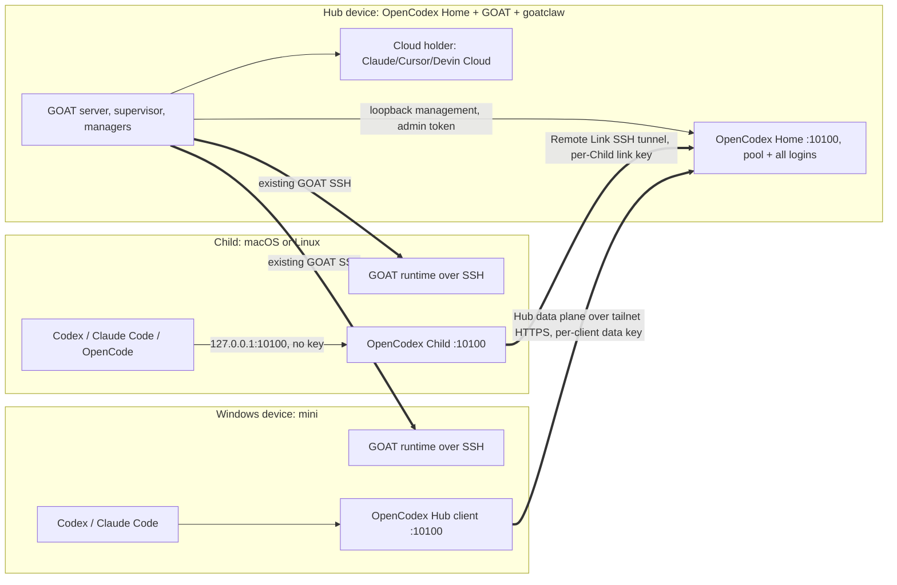
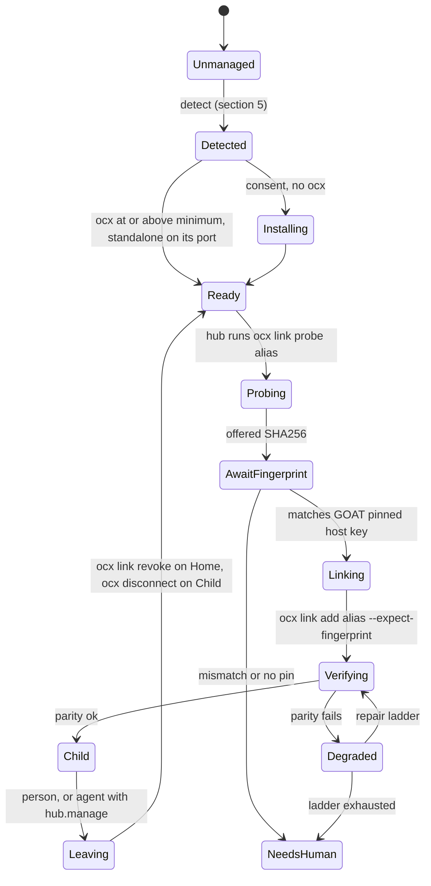

# 000 — goatclaw hub: one configured device runs the fleet

> Written 2026-10-21 · base origin/dev ab18e2baa · OpenCodex dev 845ac6b87 · Codex af91f6ef2c
> Phase P0 (design only). The user authorized the full program (design, implement, merge, release);
> implementation starts after the supervisor approves this document.
> Decision record draft: [ADR-0021](../../../structure/decisions/ADR-0021-goatclaw-hub.md)

## 0. What this is

The user configures one device, the **hub**, and runs the whole fleet from it. The hub holds GOAT plus the
goatclaw supervisor, OpenCodex with the account pool, and every provider sign-in, including the
service-bound ones (Claude Cloud, Cursor Cloud, Devin Cloud). Other devices connect over SSH and hold
no provider sign-ins: their model traffic goes through the hub's OpenCodex, and their cloud launches
are routed to the hub as credential holder.

The design adds as little as it can, because most of the machinery exists:

| Need                                                                                                    | Already exists                                                                                                                                                                                      | Owner     |
| ------------------------------------------------------------------------------------------------------- | --------------------------------------------------------------------------------------------------------------------------------------------------------------------------------------------------- | --------- |
| Route a device's model traffic through one machine with per-device credentials, rotation and revocation | OpenCodex **Remote Link** (Home/Child over SSH, one link key per Child) and **Hub mode** (HTTPS data plane, one data key per client; `ocx hub invite`, `ocx connect`, `ocx connect rotate`, revoke) | OpenCodex |
| Know whether Codex on a machine really goes through OpenCodex                                           | `OpenCodexRoute` + `CodexRouteStatus` (`connected`, `home`, …)                                                                                                                                      | GOAT      |
| Launch cloud agents where the sign-in lives                                                             | `CloudAgentService`, `chooseHolder`, provider × host matrix with `cloud: true`                                                                                                                      | GOAT      |
| Read machines, load and quota across the fleet                                                          | `goat_host_status`, `HostStatusQuota`, #676 host pressure and placement                                                                                                                             | GOAT      |
| Durable desired state, placement, fallback                                                              | ADR-0016/17/18 goals, `Placement`, fallback chains                                                                                                                                                  | GOAT      |
| Reach machines and phones                                                                               | SSH hosts, linked hosts, hub nodes and hub proxy (#655)                                                                                                                                             | GOAT      |

Per the supervisor's correction, **this design builds no new routing or token system.** GOAT drives
OpenCodex's own Remote Link and Hub flows over the SSH connections it already has, observes the result,
and consumes the Home's pool and quota. Supervisor decision **D14** (OpenCodex Hub + Remote Link is GOAT's
default proxy path; OpenCodex Remote Workspace for remote execution, experimental) is the premise. Its
text is not reachable from this host: it is in no local worktree, origin branch, GOAT thread search or
GitHub search, and jun's MacBook Pro did not answer SSH. The D14 found in
`devlog/_plan/261013_remove-t3-internals` is an unrelated dead-code rule. §11 asks for the right path.

Real gaps remain and are what this design adds: one provider-neutral quota model (§3), Child parity
detection and repair (§1.4), Windows devices (§1.5), install/adopt (§5), version alignment (§6), Fleet
status for the Home and its devices (§4), and the goatclaw control layer (§7–8).

## 1. Hub topology and routing

### 1.1 Roles



- **Hub**: one GOAT environment that is also the OpenCodex Home and, when Windows devices exist, an
  OpenCodex Hub (`runtimeRole: "hub"`). OpenCodex already supports a Home running in Hub mode.
- **Child**: a macOS or Linux device joined as an OpenCodex Remote Link Child. Codex keeps
  `http://127.0.0.1:<port>/v1` with no token; the local OpenCodex relays to the Home.
- **Hub client**: a device Remote Link cannot serve (Windows, password-only SSH), joined with
  `ocx connect https://<hub>.ts.net --pairing-code-stdin`. See §1.5.
- **Standalone**: any device not joined. Nothing changes for it.

A person chooses the hub once in Settings (§4). GOAT never elects one. One hub per fleet; a second
is refused while the first is advertised.

### 1.2 Current deployment (observed 2026-10-21)

- Supervisor: macmini-ts and lidge-ts were Remote Link Children on 2026-10-11, labelled "OpenCodex Remote
  Link children" in `~/.ssh/config` on jun's MacBook Pro. Direct Tailscale SSH aliases were used because
  routed aliases hit the Home's 15-second link admission timeout, and noninteractive SSH needed the
  bundled or Desktop `ocx` to win over PATH shims.
- This Mac mini (`juniui-Macmini.local`) agrees: `~/.opencodex/config.json` has `runtimeRole: "client"` on
  port 10100, and `~/.opencodex/backup-before-home-child-20261011-221124` exists. There is no
  `~/.opencodex/link/` directory today, so it is a client by configuration without a live Child sidecar.
  That is exactly the kind of drift the parity check in §1.4 reports.
- The MacBook Pro's `~/.ssh/config` could not be read (SSH to `macbookpro2` timed out). §11 asks for the
  labelled block so H1's fixtures use the real aliases.

### 1.3 How GOAT joins a device

GOAT runs OpenCodex's own commands over its existing SSH session. It never reads, prints or stores a
link key or data key; OpenCodex moves them over SSH itself.



- **Fingerprint.** GOAT already pins SSH host keys for its hosts (ADR-0008, `packages/ssh/src/hostKey.ts`).
  The hub compares OpenCodex's offered fingerprint (`ocx link probe <alias> --json`) with GOAT's pin for the
  same alias and passes it as `--expect-fingerprint`. No pin or a mismatch becomes a decision-inbox item
  (§8.2). Nobody types a token.
- **Alias.** The Home runs SSH from its own `~/.ssh/config`. GOAT uses direct Tailscale aliases and refuses
  an alias whose `ssh -G` shows a ProxyJump chain, which is what hit the 15-second admission window.
- **Commands.** Hub side: `ocx link probe`, `ocx link add`, `ocx link status --json`,
  `ocx link reconnect --link-id`, `ocx link revoke --link-id`, and for Hub clients `ocx hub invite`. Device
  side over GOAT SSH: `ocx --version`, `ocx status --json`, `ocx connect status --json`, and only when
  repairing `ocx sync`, `ocx restart`, `ocx disconnect`. GOAT resolves `ocx` on a device in OpenCodex's
  `remoteOcxArgv` order (Desktop and system before PATH shims).
- **Provider wiring on the device.** Codex needs nothing new: it already targets `127.0.0.1:10100/v1`. GOAT
  sets the device's Codex instance to `modelRoute: "opencodex"` and `verifyEffectiveCodexRoute` proves it.
  Claude Code gets `ANTHROPIC_BASE_URL=http://127.0.0.1:10100` on the device's `claudeAgent` instance only,
  never on `claudeCloud` (its diagnosis reports `forbidden_environment` for that variable). OpenCode gets the
  provider entry OpenCodex's OpenCode guide writes, through OpenCodex's client config export.
- **Scope.** Remote Link keys are per Child and not model-scoped. Hub-mode data keys carry
  `allowedProviders` and `allowedModels`. A device that should reach only some providers joins as a Hub client.

### 1.4 Child parity: detect and repair

OpenCodex #6957 showed that "Connected" is not proof: a Child can relay inference while its Codex settings,
dashboard and CLI still describe the Child, and a Home apply did not restart the Child runtime. Catalog
equality is necessary but not enough. GOAT computes one **parity verdict** per device from evidence it can
read without changing anything:

| Check                | Evidence                                                                                                                                                         | Fails when                                                   |
| -------------------- | ---------------------------------------------------------------------------------------------------------------------------------------------------------------- | ------------------------------------------------------------ |
| P1 role              | `GET 127.0.0.1:<port>/healthz` on the device                                                                                                                     | `service` is not `opencodex`, or `role` is not `client`      |
| P2 link identity     | Child `ocx link status --json` (role `child`, linkId) and Home `ocx link status --json`; for Hub clients `ocx connect status --json` and the client's `apiKeyId` | identity missing on either side, or Home state not connected |
| P3 real request      | one non-billed relayed request on the device's port: `GET /v1/models`                                                                                            | not 200, or catalog digest differs from the Home's           |
| P4 served by Home    | `x-opencodex-served-by` response header (needs OCX-2)                                                                                                            | absent (verdict `unproven`) or names another Home            |
| P5 runtime freshness | device process start (`/healthz` uptime) against the Home's last apply time for that link (needs OCX-6)                                                          | device started before the last apply, the #6957 restart miss |
| P6 Codex settings    | applied Home codex-settings digest in device `ocx status --json` against the Home's settings document                                                            | digests differ                                               |
| P7 client wiring     | `verifyEffectiveCodexRoute` on the device; Claude Code instance env; OpenCode provider entry                                                                     | any provider bypasses the local OpenCodex                    |
| P8 local leak        | device `ocx provider list --json`                                                                                                                                | a local provider is active while linked                      |

Verdicts: `ok` (all pass), `degraded` (P5–P8 fail: traffic works, but something describes the wrong
machine), `broken` (P1–P3 fail), `unproven` (only P4 unavailable). The verdict and failing check ids appear
in the Fleet hub row and in `goat_host_status`.

Repair ladder. Each step re-runs the verdict and stops at the first `ok`:

1. `ocx sync` on the device (P6, P7).
2. `ocx restart` on the device (P5). Only when no turn is running there; otherwise it defers like
   ADR-0019's idle check.
3. `ocx link reconnect --link-id` on the Home (tunnel failures in P2, P3).
4. Re-link (Home `ocx link revoke`, device `ocx disconnect`, join again). This goes through the decision
   inbox because routing is briefly gone.

Cadence: on join, after any OpenCodex update on either side, after a Home settings change GOAT notices,
and every 30 minutes on the existing Scheduler. Tests drive it with TestClock.

### 1.5 Windows plan (mini)

Remote Link refuses Windows (`remoteOcxArgv` exits 125, `remote_platform_unsupported`), and Remote
Workspace refuses Windows commands. Hub mode has Windows service code (`src/service/windows-*`) and
authenticates clients with a per-client data key over HTTPS, so:

1. **Now (H6).** mini joins as a Hub-mode client over the tailnet. The hub enables Hub mode with a data
   listener behind Tailscale Serve, following OpenCodex's documented recipe. GOAT runs `ocx hub invite` on
   the hub and feeds the one-use pairing code to `ocx connect … --pairing-code-stdin` on mini over GOAT SSH;
   the code is never stored.
2. **Gate.** Before calling it done, prove on mini that `ocx connect` works under the Windows service, the
   key lands in the owner-only `service-api-token`, and Codex on mini is served by the hub (P3, P4). What
   fails becomes OCX-5 work, and mini stays standalone with its own logins, shown that way in Fleet.
3. **Later (OCX-5).** Windows Remote Link Child support, if OpenCodex wants it. GOAT treats it as one more
   transport value.

Password-only SSH gets the same answer: a device GOAT reaches only by password joins as a Hub client.

### 1.6 Hub down

OpenCodex already refuses silent fallback: a Child returns a retryable `503` and sends neither key nor
request when its tunnel is not ready, and a joined link waits up to 15 s for the tunnel. GOAT keeps that and
adds a policy:

- If the device has its own sign-in for the provider **and** the person turned on
  `hub.devices[alias].localFallback`, new work moves through the existing **fallback chain** (ADR-0018) to a
  local provider instance (`modelRoute: "default"`) with a thread notice. Running turns stay.
- Otherwise goal work on that device pauses (health condition `HubUnreachable`), people's own threads see
  OpenCodex's 503 as today, and one decision-inbox item goes to the supervisor with options: wait, fail over
  to a named host with a local sign-in, or switch hub.
- Hub health reuses #676: the hub's own `pressure` must stay `ok`. Placement treats the hub as
  `allowGoals: false` by default, so heavy lanes go elsewhere and the hub only routes, orchestrates and holds
  cloud launches.

### 1.7 What cannot be centralized

| Thing                                                                                                                               | Why                                   | Handling                                                                                                                       |
| ----------------------------------------------------------------------------------------------------------------------------------- | ------------------------------------- | ------------------------------------------------------------------------------------------------------------------------------ |
| cua (computer use)                                                                                                                  | per-device screen and TCC permission  | stays per device and belongs to the Cua manager (#665, #667, #681); the hub first run shows its prompt for the hub only (§4.3) |
| Claude Cloud, Cursor Cloud, Devin Cloud                                                                                             | bound to the signed-in vendor account | run on the hub as holder (§2)                                                                                                  |
| providers with no base-URL override (Antigravity, Grok CLI, Cursor CLI, Devin CLI, Pi with its own auth, Muse, ACP registry agents) | cannot be pointed at OpenCodex        | marked "local sign-in required" in the provider × host matrix; placement sends those lanes to the hub, which has the sign-in   |
| browser, desktop app and local file work                                                                                            | needs that machine                    | unchanged (#663)                                                                                                               |

## 2. Cloud and service-bound providers through the hub

The holder model already does the routing. The hub changes one default and adds one gate:

- `hub.cloudHolder: "hub"` makes the hub the preferred holder in `chooseHolder`, through the explicit
  preference that already exists. A `goat_cloud_launch` from any device goes to the hub through the existing
  routed launch, and the run is registered there.
- Fleet lists cloud runs under the hub row with the originating device and thread.
- **Billing.** An agent's cloud launch needs the `cloud.launch` capability (§8.1; only in the `owner`
  profile) **and** either a person's explicit request in the originating thread or an approved decision item.
  Boat keeps its reconfirmed `settings:write` gate and #663's rule.
- Holder down: the existing `unreachable` failure. No automatic switch to another holder, because that is a
  different paid account.

## 3. One provider-neutral quota model

### 3.1 The gap

- GOAT has `ServerProviderUsageWindow` (`id`, `kind: session | weekly | monthly | other`, `usedPercent`,
  `resetsAt`, `windowDurationMins`) and a pluggable `UsageLimitSources` whose only kind is `cliproxy`.
- OpenCodex holds far more per account: Codex pool `StoredAccountQuota` (5h, weekly, monthly, custom
  windows, credits, reset credits) and `ProviderQuota` for Anthropic (5h, weekly, per-family windows with
  `scope: "model"`), Kiro credits, USD credits, Antigravity groups, Cursor, xAI, Kimi, Command Code and
  Devin. GOAT sees none of it; its only view is the active account's app-server rate-limit notification.
- "Codex shows one weekly window": GOAT's `codexRateLimitsToWindows` handles both positions, so the
  missing 5h window comes from what arrives over the OpenCodex route. OpenCodex's `src/routing/quota.ts`
  records a header parser that once filed 5h readings as weekly. Q0 reproduces this with a recorded frame
  before anyone fixes it.
- OpenCode reads only the OpenCode Go console key; everything else reports `unsupported`.

### 3.2 The model

One schema, produced by OpenCodex and consumed by GOAT.

```ts
// packages/contracts/src/quotaPool.ts (new); wire id "ocx.quota-pool/1"
type QuotaWindowKind = "burst_5h" | "daily" | "weekly" | "monthly" | "credits" | "custom";
type QuotaSource = "measured" | "header" | "estimated"; // probe body | response headers | derived

interface QuotaWindow {
  id: string; // stable per provider: "5h", "weekly", "custom:<label>", "family:opus"
  kind: QuotaWindowKind;
  label: string;
  usedPercent?: number; // 0..100
  used?: number;
  limit?: number;
  unit?: "requests" | "tokens" | "credits" | "usd";
  resetsAt?: string; // ISO
  windowSeconds?: number;
  scopeModel?: string; // only when the producer proved it (OpenCodex scope: "model")
  source: QuotaSource;
  observedAt: string;
  exhausted?: boolean; // producer's verdict, including refusal evidence
}

interface QuotaAccount {
  provider: string; // OpenCodex provider name: "openai", "anthropic", "cursor", ...
  driver?: string; // GOAT ProviderDriverKind when one maps
  accountRef: string; // stable hash; never an email or token
  label?: string; // masked label from OpenCodex's projection
  plan?: string;
  state: "available" | "exhausted" | "paused" | "reauth" | "unknown";
  windows: QuotaWindow[];
  failure?: string; // OpenCodex QuotaFailureCode
}

interface QuotaPool {
  schema: "ocx.quota-pool/1";
  producer: { version: string; role: "standalone" | "hub" | "client"; homeId: string };
  generatedAt: string;
  providers: Array<{
    provider: string;
    accounts: QuotaAccount[];
    pooled: { windows: QuotaWindow[]; headroom?: number; nextResetAt?: string };
  }>;
}
```

Rules: an absent window is unknown, never 0% (OpenCodex's rule). `pooled` is OpenCodex's own pool math
(`codexPoolQuotaEvidence` and its Anthropic counterpart); GOAT never re-derives it. A model-scoped window
never gates another model.

### 3.3 Producer: OpenCodex (brief OCX-1)

`GET /api/quota-pool` on the management API: a passive read assembled from caches that already exist (Codex
pool quota, provider account quota, Claude CLI usage admission), with no probe and no token refresh. Add it to
`LINK_MANAGEMENT_READ_PATHS` so a Child returns the Home's pool read-only, and to the Hub-client relay.
`?refresh=1` stays Home-local and admin-only. Breaking changes ship as `/2` while `/1` is still served for one
minor series.

### 3.4 Consumer: GOAT

- `UsageLimitSourceSnapshot.kind` becomes `Schema.Literals(["cliproxy", "opencodex"])`. Older clients drop
  the element through `ForwardCompatibleArray`.
- New `apps/server/src/usage/opencodexQuotaPool.ts` reads `/api/quota-pool` from the local OpenCodex: on the
  hub over loopback management with the admin token in `~/.opencodex/admin-api-token`; on a Child through its
  read-only relay. It maps to the new contract and to the existing window for older surfaces: `burst_5h` to
  `session`, `weekly` and `monthly` unchanged, the rest to `other`. `ServerProviderUsageWindow` gains optional
  `quotaKind`, `source` and `scopeModel` keys that old decoders ignore.
- `HostStatusMetrics` gains optional `quotaPool`. `goat_host_status`, `goat_scheduler_status`,
  `choosePlacement` and Fleet read it. Placement's "busiest window counts" rule runs over every window of the
  account, or over `pooled` when OpenCodex picks the account.
- Codex, Claude and OpenCode instances that route through OpenCodex show the pool windows of the provider they
  reach, labelled "via OpenCodex Home <name>", instead of one account's app-server reading.

## 4. GUI and agent surfaces

### 4.1 GUI

Web and desktop get the full surface; mobile gets read-only views plus the decision inbox.

- **Settings → Hub** (searchable, command palette entry):
  - "This machine is the hub" switch, with a preview of what it changes; cloud holder default.
  - Devices table: alias, transport (Remote Link Child, Hub client, standalone), parity verdict and failing
    checks, OpenCodex version verdict, last verified, and actions Join, Verify, Repair, Leave. Join and Leave
    need `settings:write`; Verify needs `orchestration:read`.
  - Per device: "use this device's own sign-in when the hub is down".
  - A link to the Home's OpenCodex dashboard for accounts and keys. GOAT never shows a key.
- **Fleet → hub row**: the Home and each device with transport, parity verdict, tunnel state from
  `ocx link status`, version verdict and pressure (#676). Cloud runs sit under the hub.
- **Fleet → Pool**: per provider, every account's windows (5h, weekly, monthly, credits, model-scoped), pooled
  headroom, next reset, and a source badge (measured, header, estimated).
- **Decision inbox** (§8.2).

### 4.2 Agent tools (registry entries, ADR-0007 naming)

| Tool                                                              | Effect      | Needs                                                                |
| ----------------------------------------------------------------- | ----------- | -------------------------------------------------------------------- |
| `goat_hub_status`                                                 | read        | Home, devices, transports, parity, versions                          |
| `goat_quota_pool`                                                 | read        | the §3 pool, optional provider filter                                |
| `goat_hub_device_verify`                                          | read        | runs parity checks, no repair                                        |
| `goat_hub_device_repair`                                          | write       | ladder steps 1–3; `hub.manage`                                       |
| `goat_hub_device_join`, `goat_hub_device_leave`                   | write       | `hub.manage` plus an approved decision unless the profile is `owner` |
| `goat_decision_list`, `goat_decision_get`, `goat_decision_answer` | read, write | answering needs the profile the item names                           |
| `goat_permission_profile_get`                                     | read        | the caller's effective profile                                       |

Choosing a model by remaining window stays in `goat_host_status` with `placement` (#676), now scored against
the pool. Agents never pick an OpenCodex account: OpenCodex's pool selector owns accounts; GOAT picks provider,
model and host.

### 4.3 First run

Three separate prompts on the hub's desktop app, each shown once: **OpenCodex** (detect, adopt or install,
§5), **goatclaw** (enable the supervisor, pick a default profile, sign in to providers on the hub) and
**Computer use** (owned by the Cua manager, wording unchanged). They share #681's mechanism: its
`computerUsePrompt` (pending, enabled, later) becomes one key of a small `firstRunPrompts` client-setting
record. "Later" is remembered per prompt, and each has a Settings entry. The only thing shared with the Cua
manager is that record's shape; the toggles stay separate.

### 4.4 Settings ownership

`hub.*` lives in the hub's server settings: `hub.enabled`, `hub.cloudHolder`,
`hub.devices[alias].localFallback`, `hub.parityIntervalMs`. Devices store nothing new; their state is
OpenCodex's own files. Writes use `createEnvironmentRpcCommand` with new `CLIENT_GUARDED_RPC_SCOPES` entries
(`settings:write` for join, leave and enable; `orchestration:read` for status and verify).

## 5. Installing when OpenCodex already exists

Detection, read-only, locally or over SSH:

1. Running service: `GET 127.0.0.1:10100/healthz` (`service`, `role`, `version`), then the port configured in
   `~/.opencodex/config.json` or under `OPENCODEX_HOME`.
2. Binaries in OpenCodex's order: `~/.opencodex-desktop/bin/ocx`, `/Applications/OpenCodex.app/Contents/MacOS/ocx`,
   `/usr/bin/ocx`, then PATH with Bun, local and Homebrew directories; each must answer `--version`.
3. Installer ownership (bun, npm, pnpm, mise, source) from OpenCodex's own `install-detection.mjs` verdict,
   read through `ocx status --json`.
4. Service unit: `ocx service status --json` (launchd, systemd, Windows task).
5. Link and Hub state: `ocx link status --json`, `ocx connect status --json`.

| Mode                                               | When                                       | GOAT may                                                                                   |
| -------------------------------------------------- | ------------------------------------------ | ------------------------------------------------------------------------------------------ |
| **adopted** (default whenever an install is found) | the user's install exists                  | read; run link, connect, sync and status commands with consent; advise updates             |
| **managed**                                        | nothing found and the person chose Install | install with OpenCodex's documented installer (npm global or Desktop) and update it per §6 |
| side by side                                       | never by default                           | tests only, with a separate `OPENCODEX_HOME` and port; not offered in the UI               |

GOAT never writes `~/.opencodex`, Codex `config.toml` or any account store directly. Every change is an
`ocx` command or management API call that OpenCodex validates and backs up. Joining leaves the device's own
providers in place, labelled local and inactive, as OpenCodex already does.

Existing logins on a device stay. Moving accounts into the Home pool is optional and belongs to OpenCodex
(OCX-4): export and import over the link with per-account consent on the Home. Credentials never pass
through GOAT.

## 6. Update alignment

- **Compatibility is a verdict, as in ADR-0019.** OpenCodex already serves protocol numbers
  (`REMOTE_HUB_PROTOCOL`, `minimumClientProtocol`, `protocolVersion`, Remote Workspace RPC v2, connection-bound
  relay auth). OCX-3 fills `features` on `/readyz`. GOAT keeps one table, `packages/shared/src/opencodexCompat.ts`,
  with the minimum version and required features per GOAT capability. Per device: `compatible`, `degraded` (a
  feature missing, for example no pool, so the app-server windows show) or `incompatible` (below Remote Link
  2.66.0, or a relay-auth mismatch).
- **Who updates whom.** Managed installs move through GOAT's runtime update path under ADR-0019's rules: own
  channel only, staged bucket, idle-only activation, health check after restart (`/healthz` version and role,
  then P3), 10-minute probation, rollback to the previous pinned version, and no automatic retry of a
  rolled-back target. Adopted installs get an advisory notice and an Update button that runs `ocx update` only
  when the person clicks it.
- **Order.** Connection-bound relay auth needs Home and Child updated together. GOAT updates a linked pair in one
  idle window, Home first and then each Child, re-running parity after each. If any member is busy, the pair waits.
- **Lessons from 10/21.** The `fix/ssh-runtime-update-handling` branch is not on origin, so I could not read it.
  The stated lessons are encoded directly: a compatible adopted OpenCodex is never replaced, and a managed one moves
  only when its own channel's target is eligible under ADR-0019, never because GOAT itself updated or a nightly
  appeared.

## 7. goatclaw orchestration model

A lane runs one of two ways:

- **(a) GOAT dispatch** (`delegate_task`, `goat_thread_launch`, `goat_ssh_thread_launch`): any provider, model and
  host; its own worktree; durable, visible in Fleet, and it outlives its parent.
- **(b) Provider-native subagents** (Codex `spawn_agent` v2, Claude Code Task): same provider and machine, the
  parent's sandbox and history, cheapest to start.

| The lane needs                                                      | Choose                                                                         |
| ------------------------------------------------------------------- | ------------------------------------------------------------------------------ |
| a provider or model the parent's provider lacks                     | (a)                                                                            |
| another host (load, platform, sign-in)                              | (a) with `goat_ssh_thread_launch`                                              |
| its own worktree, branch or PR                                      | (a) with `isolation: "worktree"`                                               |
| to outlive the parent, or to be steered by a person                 | (a)                                                                            |
| quick research, reading or review in the same checkout and provider | (b)                                                                            |
| many short parallel probes sharing the parent's context             | (b): a Codex v2 fork with `preserve_fork_prefix`, which keeps the prompt cache |

Codex multi-agent v2 at af91f6ef2c offers `spawn_agent` v2 (`fork_mode: FullHistory`; model overrides when
`expose_spawn_agent_model_overrides`), `preserve_fork_prefix` (default true), `max_concurrent_threads_per_session`,
`subagent_thread_environments` and `runtime_agent_instances` (both under development and off by default), and a
remote message board (`message_board_remote` with a URL and bearer env var). goatclaw sets
`max_concurrent_threads_per_session` from the profile and leaves under-development features off until Codex marks
them beta; O3 enables `subagent_thread_environments` then.

**Lane types.** `LaneKind` in contracts: `research`, `implement`, `review`, `verify`, `merge`, `sweep`. A lane
carries `profile`, `host`, provider and model, `mode: "dispatch" | "native"`, `parent` and `reportTo`.

**One policy for both.** A profile (§8.1) sets the runtime-mode ceiling GOAT already enforces for (a), and the
provider settings for (b): Codex `multi_agent_v2.max_concurrent_threads_per_session`, Claude Code max turns and
allowed tools. GOAT already sees native subagents (the Codex adapter maps collab tool calls and child threads;
Claude Task arrives as tool calls). O2 shows them in Fleet under their parent with `mode: native` and counts them
against the profile's `maxLanes`.

**Reports.** Each lane ends with `goat_thread_report_result` (a) or its native result (b), which the parent folds
into its own report. Managers report to the supervisor with `goat_origin_report`. Questions become decision items.

## 8. goatclaw core

### 8.1 Permission profiles

Named and stored on the server; every launch path reads them. A profile only narrows what the caller already
holds (ADR-0016: no new authority).

```ts
interface PermissionProfile {
  id: string; // built-ins: observer, worker, manager, merge-manager, owner
  runtimeModeCeiling: RuntimeMode;
  capabilities: Array<
    | "threads.launch"
    | "threads.remote"
    | "worktree.create"
    | "pr.open"
    | "pr.merge"
    | "hub.manage"
    | "cloud.launch"
    | "boat.start"
    | "settings.write"
    | "goals.apply"
  >;
  hosts?: string[]; // allowlist; absent means every connected host
  maxLanes: number; // running lanes, native subagents included
  maxTurns?: number;
  maxWallClockMs?: number;
}
```

Built-ins: `observer` (read only); `worker` (launch, worktree, open PRs, 3 lanes); `manager` (adds remote
launch and goals, 6 lanes); `merge-manager` (manager plus `pr.merge`, which squashes only green, mergeable PRs
with no changes requested); `owner` (everything). `cloud.launch` and `boat.start` are only in `owner`. Checked at
claim time and again on every action, as ADR-0016 does.

### 8.2 Decision inbox

A durable table on the hub, `decision_items`: `id`, `from` (thread, host), `title`, `context`, `options` (id,
label, consequence), `recommended`, `requiredProfile`, `expiresAt`, `status` (open, answered, expired, withdrawn),
`answer`, `answeredBy`. It is answered from GUI, mobile, or an agent with `requiredProfile`. Pending GOAT
questions (`goat_pending_request_*`) appear as items too, so a person sees one inbox. An answer becomes a message
to the asking thread. Silence never approves: expiry withdraws the item.

### 8.3 Role templates

Launch presets of prompt preamble, profile and report protocol:

- **supervisor**: reads, plans and asks; holds `owner` but delegates writes.
- **domain manager**: `manager`; owns one goal.
- **merge manager**: `merge-manager`; one PR at a time, green CI, no changes requested; stops on a dev CI failure.
- **issue sweeper**: `worker`; triage and small fixes.

The report protocol is the same for all: `progress` at milestones, `completed` or `failed` with a short factual
summary, and `needs_input` through the decision inbox.

### 8.4 GOAT Bot

With goatclaw on, GOAT Bot fronts the supervisor. It stays read-only by instruction (#660) and places lanes per
#663; authority lives in the managers it launches under their profiles. Turning goatclaw off returns the bot to
front-desk mode and stops new manager launches; running managers finish. goatclaw is opt-in at first run (§4.3)
with the profile caps above.

## 9. Security and privacy

- **No credentials on non-hub devices** is OpenCodex's existing guarantee. A Child holds a link key inside
  OpenCodex and strips caller credentials; a Hub client holds one data key in an owner-only file. GOAT adds no
  token and never reads, logs or relays either key. Rotation and revocation stay OpenCodex's
  (`ocx connect rotate`, `ocx link revoke`, Home dashboard API keys); GOAT's buttons run those commands.
- **The management relay stays authenticated and read-only by default.** GOAT reads the Home through a Child's
  passive relay, and talks to the Home's management API only on the hub, over loopback, with the admin token. The
  only relay addition GOAT asks for is the quota pool read (OCX-1).
- **Local trust.** Any program on a Child that reaches `127.0.0.1:10100` uses the Home. That is OpenCodex's
  documented model, and it becomes fleet-wide, so the Settings preview says so.
- **Audit log.** One append-only `audit_events` table on the hub covering join, leave, repair, rotate, revoke,
  cloud launch, merge, profile change and decision answers: time, actor, profile, action, target, outcome,
  decision id. No secrets. Readable through `goat_hub_status` and Settings.
- **Provider terms, flagged and not decided.** Pooling personal subscriptions across devices may conflict with a
  provider's terms. The Hub settings preview says so and the person decides. The brief says Claude is mostly
  allowed to be routed; this design does not verify that.

## 10. Work packages

Q0 and H1 come first because they gather evidence. Contracts come next, then services, then UI. Every GOAT test
is deterministic: `it.effect` with TestClock, recorded OpenCodex JSON fixtures, no sleeps and no live OpenCodex.

| WP  | Title                                                                                        | Depends on  | Host       | Branch                          | Size | Tests                                         |
| --- | -------------------------------------------------------------------------------------------- | ----------- | ---------- | ------------------------------- | ---- | --------------------------------------------- |
| Q0  | Reproduce "Codex shows one weekly window" through a Child and record frames                  | —           | macmini    | `investigate/codex-5h-window`   | S    | fixture-driven `codexUsageLimits` test        |
| H1  | `opencodexCompat` and read-only device inventory (§5 detection, §1.2 facts)                  | —           | lidge      | `feat/opencodex-inventory`      | M    | parsers over recorded `ocx --json` output     |
| Q1  | `quotaPool` contract, optional window keys, `opencodex` source kind                          | —           | mac-studio | `feat/quota-pool-contract`      | S    | schema round trip, old-decoder compatibility  |
| Q2  | `opencodexQuotaPool` source, host-status `quotaPool`, placement over the pool                | Q1, OCX-1   | mac-studio | `feat/quota-pool-consumer`      | M    | mapping and placement scoring                 |
| D1  | Permission profiles: contract, settings, claim-time checks                                   | —           | macmini    | `feat/permission-profiles`      | M    | authorization tests                           |
| H2  | Parity verifier service and `goat_hub_device_verify`                                         | H1          | lidge      | `feat/hub-parity`               | M    | verdict table from fixtures                   |
| H3  | Join, leave and repair through `ocx` over GOAT SSH, fingerprint from GOAT pins, audit events | H2, D1      | lidge      | `feat/hub-join`                 | L    | state machine with a fake `ocx` runner        |
| D2  | Decision inbox: table, service, MCP tools, web and mobile list                               | D1          | mac-studio | `feat/decision-inbox`           | L    | service tests, one browser test               |
| H4  | Hub settings, RPC scopes, Settings → Hub, Fleet hub row and pool view                        | H2, Q2      | macmini    | `feat/hub-settings-ui`          | L    | browser tests for verdicts and reverse states |
| H5  | Hub-down policy: `HubUnreachable`, fallback hop, decision item                               | H2, D2      | mac-studio | `feat/hub-down-policy`          | M    | TestClock reconcile tests                     |
| H6  | Windows Hub-mode client for mini and its verification gate                                   | H3          | mini       | `feat/hub-windows-client`       | M    | Windows fixture tests; live gate on mini      |
| C1  | Hub as default cloud holder and `cloud.launch` gate                                          | D1          | macmini    | `feat/hub-cloud-holder`         | S    | `chooseHolder` tests                          |
| O1  | Lane kinds and the dispatch-or-native rule in orchestration instructions                     | D1          | lidge      | `feat/goatclaw-lanes`           | S    | instruction tests, size limits                |
| O2  | Native subagents in Fleet, counted against `maxLanes`                                        | O1          | mac-studio | `feat/fleet-native-subagents`   | M    | adapter replay fixtures (`subagent_v2_*`)     |
| O3  | Codex v2 settings from profiles                                                              | O1          | mac-studio | `feat/codex-v2-profile-caps`    | S    | config argument tests                         |
| D3  | Role templates, report protocol, GOAT Bot supervisor mode                                    | D1, D2      | lidge      | `feat/goatclaw-roles`           | M    | prompt and registry tests                     |
| F1  | First-run prompt record shared with #681 (OpenCodex, goatclaw prompts)                       | #681 merged | macmini    | `feat/hub-first-run`            | M    | browser tests                                 |
| U1  | Managed OpenCodex update through the runtime update path, pair ordering                      | H1, H2      | mac-studio | `feat/opencodex-managed-update` | M    | launcher trial tests with a fake installer    |

jun's MacBook Pro gets no packages and cursor2 is skipped. Merging follows the dependency column, one PR at a
time, squash, green goat-ci. Batches for the nightly: (1) Q1, D1, H1, Q0; (2) Q2, H2, H3, D2, C1, O1;
(3) H4, H5, H6, O2, O3, D3; (4) F1, U1. After each batch merges, the supervisor is told so the merge manager can
publish through the nightly channel.

### OpenCodex package briefs (for the OpenCodex manager on mac-studio)

- **OCX-1 `GET /api/quota-pool`.** A passive read assembling §3.2 from existing caches (Codex pool
  `StoredAccountQuota`, per-account `ProviderQuota`, Claude CLI usage admission, Kiro and USD credits, Antigravity
  groups). No probe, refresh or token refresh. Add it to `LINK_MANAGEMENT_READ_PATHS` and the Hub-client relay.
  `accountRef` is a stable hash, never an email. Tests: the passive-read guard in the style of
  `tests/server/link-management-relay.test.ts`, a shape snapshot, absent-not-zero.
- **OCX-2 served-by header.** Relayed and Hub-served responses carry `x-opencodex-served-by` with the Home's stable
  instance id (not a hostname), so GOAT can prove P4 without reading logs.
- **OCX-3 `/readyz` features.** Fill `features` with `quota-pool/1`, `link-management-relay`, `served-by-header` and
  the relay-auth version, so peers decide compatibility without parsing versions.
- **OCX-4 Child-to-Home account move.** Optional, per-account consent on the Home dashboard, over the link and never
  through another program. The Child keeps its copy until the person removes it.
- **OCX-5 Windows.** First confirm Hub-mode clients on Windows (service plus `ocx connect`) and fix what H6's gate
  finds. Then, if wanted, a Windows Remote Link Child.
- **OCX-6 parity on apply.** Close what remains of #6957: after a Home apply, restart the Child runtime and record
  the apply time so a peer can compare it with the Child's start (P5); expose the applied codex-settings digest in
  `ocx status --json` (P6).
- **OCX-7 header parser.** If Q0 confirms it, stop filing 5h readings as weekly on the routed path.

## 11. Decisions for the supervisor

| ID  | Question                      | Options                                                                                                                                                  | Recommendation                                                            |
| --- | ----------------------------- | -------------------------------------------------------------------------------------------------------------------------------------------------------- | ------------------------------------------------------------------------- |
| DH1 | Which device is the hub       | macmini (always on, macOS, light today); mac-studio (also CI runner and OpenCodex manager); jun's MacBook Pro (Home on 10/11, but overloaded and sleeps) | **macmini**, with goal lanes kept off it (`allowGoals: false`)            |
| DH2 | mini's transport              | Hub-mode client over tailnet HTTPS now; wait for a Windows Remote Link Child (OCX-5)                                                                     | **Hub-mode client now**, behind H6's gate                                 |
| DH3 | Default when the hub is down  | pause plus decision item; local fallback where a local sign-in exists                                                                                    | **pause plus decision item**, local fallback opt-in per device            |
| DH4 | D14's location                | —                                                                                                                                                        | please send the path so this design links it                              |
| DH5 | MacBook Pro ssh config labels | —                                                                                                                                                        | please paste the "OpenCodex Remote Link children" block for H1's fixtures |

## 12. Rollout

Everything sits behind `hub.enabled` and `goatclaw.enabled`, both false by default. With both off no new timer runs
and nothing changes, except the read-only inventory (H1), which runs only while Settings → Hub is open. Mixed
versions: older GOAT hosts show `degraded` in the hub table, and older OpenCodex installs show the app-server windows
they show today.
