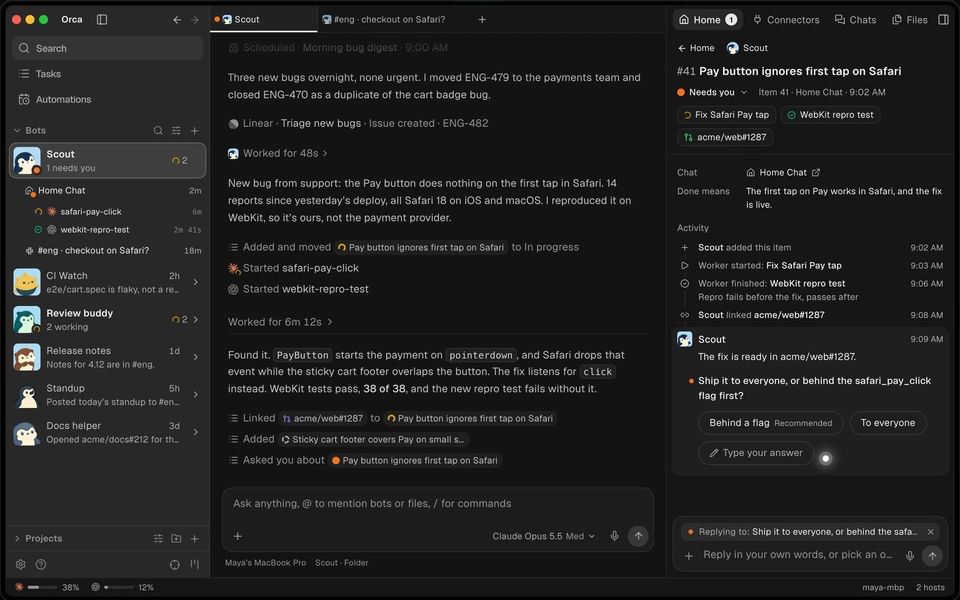
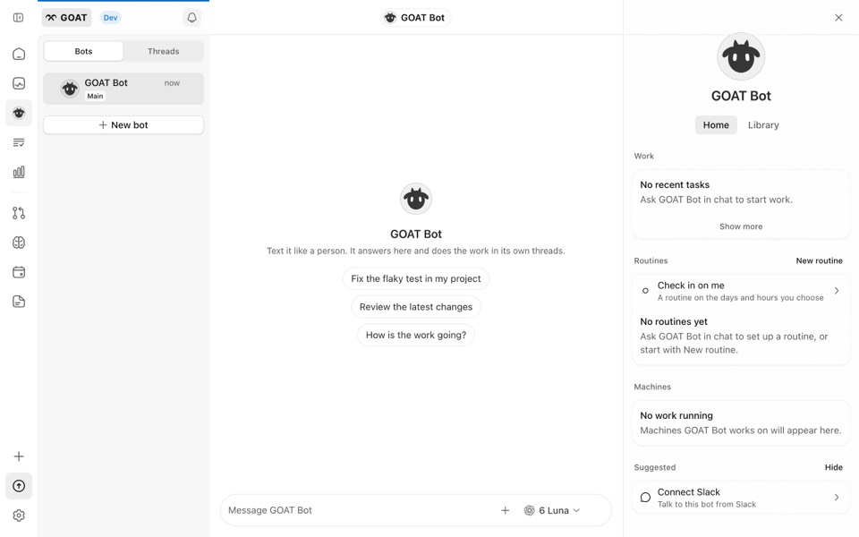
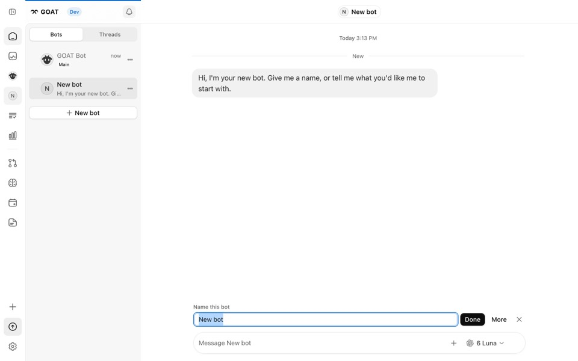
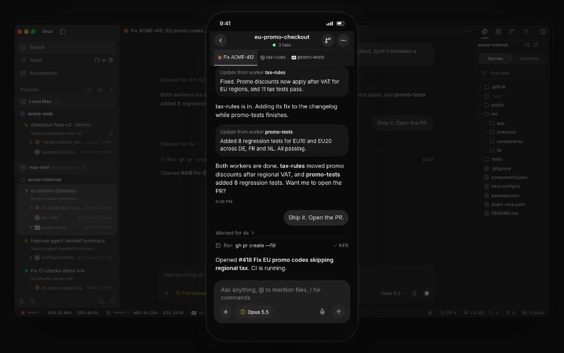
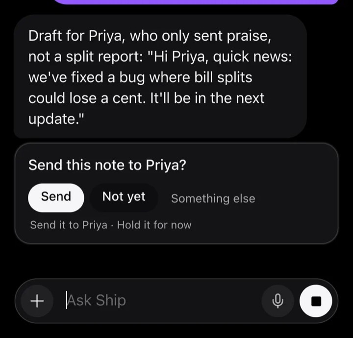

# 002 — UX observations

Captures are small copies; full-size images and the lane reports are in `~/Developer/codex/274_orca-analysis/`. Orca was not built or run: this Mac was carrying a desktop release and a mobile beta at the time, so Orca is read from source, docs and its checked-in media. GOAT captures come from this worktree's dev server with an empty database (the live database is over the 500 MiB seed limit).

## Orca: the bot is a workspace, not a chat

One screen answers "what is this bot doing for me". The sidebar nests each bot's rooms and running workers under it, with a "1 needs you" count. The chat reads as a work log: a schedule fired, an issue was created, an item moved to In progress, two workers started, a PR was linked, a question was asked. The right pane opens **item #41**: its status (**Needs you**), its workers, its PR, the sentence that defines done ("The first tap on Pay works in Safari, and the fix is live"), an activity list with who did what, and the question with two suggested answers plus **Type your answer**. Tabs across the top reach **Connectors**, **Chats** and **Files**.

## GOAT today: a messenger with a Home beside it

GOAT's Home has the right sections (Work, Routines, Machines, Suggested, Library), and its empty states name the next action. What it cannot say is why work started or what done looks like: a task row is a title, a status and PR chips. Routines only run on a timer and only answer. Nothing outside GOAT except Slack and iMessage can start the bot, and those reach the main bot only.

Creating a bot is fast and reversible, which is better than Orca's dialog for a person who knows what they want. It gives no head start: no starter roles, no suggested routines or triggers, so every bot begins as a blank purpose box.

## Phones: monitoring is not enough without alerts

Orca's phone shows workers' updates inline in the bot's chat and lets the person say "Ship it. Open the PR." It is paired directly or through a relay, and alerts arrive even when the app is closed. GOAT's phone app already has the chat, the task view, typed answers and coded approvals, but a person only learns that something needs them by opening the app.

threebot, a T3 Code–based bot, answers that with Web Push: each question deep-links to its exact request, and a device that is already looking at that request stays quiet. GOAT's mobile pipeline has the same pieces (typed alert phases, a cold-start router) but is switched off until GOAT Connect ships.

## Judgments that shape the roadmap

- **Keep GOAT's strengths.** Cross-bot **Needs you**, the face states, Show work in Home and the instant New bot are ahead of Orca or equal to it. Units extend them; none replace them.
- **Events must reach a named bot.** The single largest product gap is that nothing outside GOAT can start a specific bot doing work. Orca's "when a PR opens" and "when a check fails" are what make a bot feel like a teammate.
- **Work needs a definition of done.** Orca's "Done means" line and per-item activity let a person check the bot's claim instead of trusting it. GOAT tasks need the same.
- **Alerts are the phone's job.** Without them, mobile parity is cosmetic. The roadmap splits what GOAT can do now (desktop alerts, local phone alerts, typed tap targets) from what needs credentials (remote push).
- **Do not copy Orca's group rooms or its Composio catalog.** Both carry large surface area for a narrow gain; see 003.
