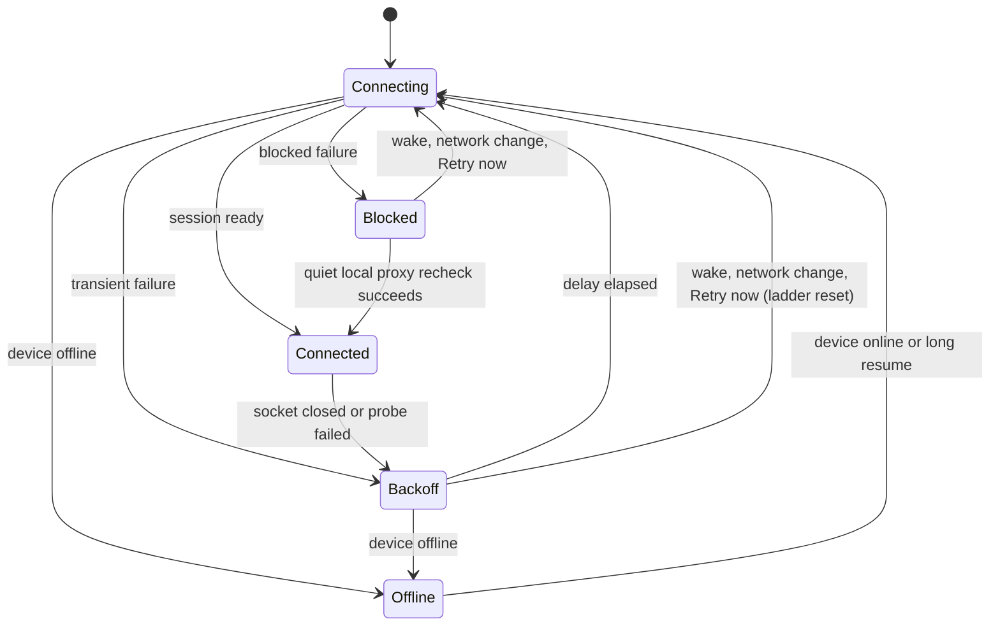

# SSH reconnect

A desktop SSH connection fails for reasons that need opposite responses. A
laptop asleep in a bag needs patience and silence. A rejected key, a changed
host key, or a runtime that refuses this app needs a person, and retrying on a
timer only repeats the same error. This page records how GOAT tells them apart
and how it presents each case. The retry loop itself is the shared
[connection runtime](connection-runtime.md); SSH adds classification and
presentation on top of it, not a second loop.

[SSH hardening references](ssh-hardening-references.md) compares this design
with cmux, herdr, and Codex and holds the backlog for the next changes.

## States

The [supervisor](../../packages/client-runtime/src/connection/supervisor.ts)
owns one state per environment. SSH connections use the same phases as every
other target. The presentation layer splits `reconnecting` by the last
failure's reason, so the host that is simply away reads differently from the
host that is broken.

| What the user sees                           | Supervisor phase         | Last failure                | Automatic retry                                       |
| -------------------------------------------- | ------------------------ | --------------------------- | ----------------------------------------------------- |
| Connected                                    | `connected`              | none                        | —                                                     |
| Reconnecting, retrying in 30s                | `connecting` / `backoff` | transient, host reached     | backoff                                               |
| Unreachable, retrying in 4m                  | `connecting` / `backoff` | `host-unreachable`          | backoff, quiet                                        |
| Offline                                      | `offline`                | any                         | when this device is online                            |
| Connection failed: login rejected            | `blocked`                | `authentication`            | on wake, network change, or Retry                     |
| Connection failed: local proxy unavailable   | `blocked`                | local proxy `configuration` | every 60 s quietly, or on wake, network change, Retry |
| Connection failed: host key, runtime refusal | `blocked`                | other `configuration`       | on wake, network change, or Retry                     |
| Client not supported                         | `blocked`                | `unsupported`               | never; marked unsupported until updated               |

Codex's exec-server keeps the same three-way split
([`ConnectionStatus`](https://github.com/openai/codex/blob/816fa702ec66a4c81b204701a03371a1ac3511e6/codex-rs/exec-server/src/client.rs#L309): connected,
recovering, failed). Its app-server reports a disconnected environment without
promising the failure is terminal
([`EnvironmentStatusKind`](https://github.com/openai/codex/blob/816fa702ec66a4c81b204701a03371a1ac3511e6/codex-rs/app-server-protocol/src/protocol/v2/environment.rs#L126)).
GOAT follows that rule: no SSH state other than `unsupported` gives up.

## Classifying a failure

The desktop bridge carries only an error message across IPC, so
[`sshPreparationFailure`](../../packages/client-runtime/src/connection/sshFailure.ts)
reads the sentences `@goat/ssh` writes. A change to those sentences in
`packages/ssh/src/command.ts` or the launch script in
`packages/ssh/src/tunnel.ts` must keep the classifier's patterns matching; the
classifier's tests use the real strings. Both runtime status and reconnect
supervision use the browser-safe [shared failure rules](../../packages/shared/src/sshFailure.ts)
for proxy diagnoses and reachability. Status checks retain both the normalized
SSH message and raw stderr as evidence; selecting one public diagnostic line
must not discard the connection failure's meaning. The exact neutral supersession sentence
(`SSH preparation superseded by a newer connection intent.`), its typed tag, and the legacy
exact `SSH connection was cancelled.` are ownership outcomes rather than authentication blocks.
Real password or setup prompt dismissal, expiry, and window closure still block for input.

- **Unreachable.** ssh exited before it reached the host: connect timeout, no
  route, refused, could not resolve, a banner timeout, or a proxy that closes
  without a more specific diagnostic. `UNKNOWN port 65535` is OpenSSH's proxy
  endpoint placeholder, not a remote port. A slow ProxyCommand or an unresolved
  remote Tailscale name also retries quietly. `describeSshConnectionFailure`
  rewrites connect and banner timeouts as "Cannot reach <alias> over SSH (...)";
  the tunnel step passes ssh's own stderr, which the classifier also reads.
  Generic cloudflared "Not Found", missing-route/peer, or Tailscale keychain
  errors do not establish a broken local executable. With a proxy closure they
  remain unreachable. This is the normal state of a closed laptop or a dropped
  VPN, so it is `host-unreachable`.
- **Local proxy unavailable.** An explicit local Tailscale daemon failure,
  stopped or logged-out client, missing approval, or missing ProxyCommand
  executable is `configuration`. The supervisor re-checks this local-proxy
  subset every 60 s and keeps the blocked display during the attempt, until
  the session is ready. Starting the local app, signing in, obtaining approval,
  or fixing the executable path outside GOAT can then recover without a click.
  Wake, network change, and Retry still skip the wait. Other configuration and
  authentication blocks have no timer. The message names the fix and this
  machine, rather than blaming the remote host. These
  diagnostics take precedence over the generic closure that OpenSSH prints
  afterward. `tailscale nc` writes stopped/login status to stdout, so SSH reads
  it as banner text: commands and tunnel startup retain only those known status
  lines from DEBUG1. Missing executables require a real spawn or shell execution
  diagnostic, not arbitrary "not found" text. The public diagnostic prefers the
  local proxy cause over a subsequent generic closure. Shell execution errors
  require that closure, so a remote profile warning cannot hide a later runtime
  diagnosis. Direct Tailscale status sentences get the same human fix in runtime
  status and reconnect supervision.

  Commands use `LogLevel=DEBUG1` rather than `-v`, so GOAT does not request
  verbose logging from ProxyJump's child SSH. Lower levels omit the required
  auth milestones and Tailscale banner; `LogVerbose` source/function overrides
  vary by OpenSSH version. The diagnostic stream removes SSH debug output,
  authentication/transfer summaries, version and terminal notices, and login
  URLs while retaining remote stderr, including an unterminated fragment before
  a failed read. Tunnel diagnostics keep their bounded tail.

- **Login rejected.** `Permission denied (publickey…)`, a rejected key-only
  login, and a cancelled password prompt are `authentication`. An explicit
  rejection from any SSH hop takes precedence over a later generic proxy closure
  in both runtime status and reconnect supervision. A locked
  ssh-agent after wake can also stall authentication. An authentication timeout
  is `authentication`, with an instruction to unlock the key or agent. Blocked
  states still retry on wake and network change.
- **Host key.** A changed, unknown under strict checking, or unverifiable host
  key is `configuration`. The fix is to forget the host and review the new
  fingerprint; GOAT never replaces a pinned key automatically.
- **Runtime refusal.** A remote runtime that does not speak this app's protocol
  and cannot be replaced, including a newer one, is `configuration`. A newer
  runtime that speaks it is attached and shown ready. It is deliberately not
  `unsupported`: that reason switches the environment off in the registry, and
  updating the app or stopping the remote server must bring it back without
  the user finding a disabled switch.
- **Timeout stage.** OpenSSH's connect/banner timeout is `host-unreachable`.
  The command deadline uses DEBUG1's authentication-service and authenticated
  milestones (including a reused control connection) to distinguish an auth
  stall from a remote command stall; a TCP connection alone does not prove
  authentication began. A jump host's login does not authenticate the final
  target. A proxy stays pending until the target's own authentication starts;
  jump authentication messages are ignored while it is pending. This also works
  when the jump's user configuration enables VERBOSE login messages without
  DEBUG1 forwarding details.
  Timeout headlines take precedence over incidental stderr warnings in public
  diagnostics and runtime status. After login, command, runtime install/download,
  launch, and pairing deadlines name their operation and remain `remote-unavailable`.
  Local HTTPS/gh archive download deadlines also remain runtime failures, never
  SSH login or host reachability failures. A ready tunnel whose backend does not
  answer remains a runtime failure, except the explicit high-latency readiness
  diagnostic, which is `network`.
- **Everything else** is a transient `remote-unavailable` failure of a host
  that answered: a server that did not start, a tunnel nothing answered on, a
  slow network.

Only ssh's own connection failure counts as unreachable. A tunnel that opened
but whose server never answered means the host is awake and GOAT on it is
broken, which deserves the louder state.

## Backoff

`retryDelayMs` doubles a ceiling from 2 s to 5 minutes and picks a point in
its upper half, so clients that lost the same host do not reconnect together.
The ladder resets once a connection stays up for 30 s, and the published
attempt number returns to 1 at that boundary. Codex's exec-server uses
the same shape with a 30 s cap and a 120 s stability window
([`reconnect_backoff.rs`](https://github.com/openai/codex/blob/816fa702ec66a4c81b204701a03371a1ac3511e6/codex-rs/exec-server/src/remote/reconnect_backoff.rs#L6)).
GOAT's cap is longer because an SSH attempt spawns a process and can wait 10 s
for `ConnectTimeout`, and a sleeping laptop can stay away for hours. The long
cap never delays a return: every signal that conditions changed skips the wait.

Ordinary setup starts with a 15 s per-route budget. Each environment's supervisor keeps
its last five successful ordinary setup durations in memory using the Effect Clock. The budget
is 1.5 times the largest sample, bounded to 15–45 s, with existing route-count accounting.
An unanswered SSH route keeps its 15 s allowance; a jump host's answer does not qualify as the
final host. Each route reaching `synchronizing` still adds 75 s for its snapshot.

Once the final SSH host answers and an active checking, installation or starting phase arrives,
the manager's original total 15-minute preparation ceiling governs that segment. It includes
lock wait and runtime acquisition and cannot be renewed by progress, Retry or another window
joining. The manager interrupts expired work; the supervisor counts that timeout once without
the immediate free slow-setup retry. Terminal progress ends this allowance immediately, and
ordinary opening then gets its own setup budget followed by the existing snapshot allowance.
Installation duration is excluded from ordinary adaptive samples. Older bridges keep ordinary
setup behavior, but repeated native ensures still join the same bounded preparation.

A first consecutive ordinary setup timeout after the host answers retries immediately without
counting a failure. A second consecutive slow timeout, a silent host, and a stalled snapshot keep
normal failure counting. Successful establishment ends the slow-timeout streak.

A long resume (`application-active-reconnect`) resets the ladder and opens a
30 s window measured with the Effect Clock's monotonic time. Failed attempts
in that window retry after a flat 2 s, including the published `retryAt`, and do not advance
the failure count. The first failure at or after the window ends uses the
ladder's first step (1–2 s); subsequent failures escalate normally. Ordinary
foreground and short-resume probes do not open this window. A successful
connection or an explicit disconnect clears it; published `retryAt` values
still use wall time.

## Resuming

These signals skip a pending retry delay. Retry now cancels an establishing
attempt, and a long resume replaces an attempt that began before the resume:
its socket may have died during suspension even before readiness. Each signal
targets the attempt present when it is queued, so a replacement absorbs queued
duplicates targeting its predecessor. A later Retry can still replace that
attempt if it stalls. Ordinary foreground and network-change signals leave
establishment running. Desktop suspend cancels an in-flight establishment and
any pending retry timer without counting a failure. No new attempt starts
until a foreground/resume signal, Connect, Retry, or an online network change
arrives. A cancelled establishment is shown as offline with no active stage
or retry timer. A long resume still runs one replacement if the network reports
offline while recovering, including when it ends the suspend wait.
An already connected session is left for the wake's probe or replacement.
All but the return to online reset the retry ladder:

- The app returns to the foreground (`application-active`).
- The device moves to another network (`network-changed`), the likely moment a
  host behind a VPN or on home Wi-Fi becomes reachable again.
- The desktop wakes from sleep. A long suspension replaces the session outright
  and checks SSH forwards over HTTP. A failed check closes and reaps the local
  forward after a 2 s window (up to 10 s for a slow link), plus up to 2 s to
  force termination. This avoids waiting for ssh's roughly 45 s keepalive window.
- The device comes back online from `offline`.
- **Retry now** or **Reconnect**.

A connected session receiving one of these is probed, not replaced, so a
healthy tunnel survives a spurious offline report. A long sleep is the
exception: it replaces the session at once, because the OS may have killed the
socket without reporting it. A replacement already establishing on long resume
also tolerates offline reports while the network recovers.

The connected RPC session also checks liveness: pings run every 5 s with a
15 s silence budget, so a hanging forward is detected within roughly 15–20 s
of the last received frame. A deadline tick more than 2 s late means the web
page or mobile app may have been frozen: it restarts the silence budget so
queued replies can arrive before the resumed session is judged unresponsive.
HTTP checks run on reuse and resume; they are not a second periodic heartbeat.

A reconnect keeps the saved bearer token while the host behind the forward is
the same environment and answers the token as signed in with the scopes a
fresh pairing would grant. Every pairing adds a session on the host, so
minting one per reconnect only fills its client list. A runtime older than
this app's standard scopes grants the same narrower set to every pairing; the
secure credential storage records what a pairing granted for that token, server instance/version,
SSH target and the current standard scopes. Reuse requires matching evidence even across
windows and launches. A server restart, changed target, revoked token or insufficient grant
requires renewal. Within one connection invocation, renewal validates the just-prepared native
attachment and issues a fresh caller-only pairing credential without preparing or installing again.
The credential is exchanged once; it is never cached or shared between callers. Descriptor
identity checks still precede bearer use and token exchange
([`prepareDesktopSshEnvironment`](../../apps/web/src/connection/platform.ts)).

The server closes an RPC `/ws` connection after 120 s without inbound transport
traffic, across local, SSH, relay, and tunnel connections. The budget tolerates
minute-aligned heartbeat throttling in hidden browser tabs. All shipped RPC
clients use the 5 s ping interval, including during long-running streams;
server output alone does not keep an abandoned connection alive. Control
frames and message fragments also reset the budget. The server destroys the
TCP socket rather than waiting for an unreachable peer's close handshake.

On POSIX hosts, each local forward runs in a dedicated supervised process
group. A pipe held by the owning GOAT process fences its lifetime: EOF kills
that group even when the owner crashes or receives SIGKILL, and removes that
forward's askpass directory. `ssh -N` itself ignores stdin EOF, so a separate
reader owns this check. Ordinary scope teardown allows 2 s for SIGTERM before
SIGKILL and waits for the child to exit before reusing its local port. Windows
uses the spawner's scoped process-tree termination; the POSIX owner-death fence
does not cover Windows owner crashes. No startup scan kills existing forwards.

## Notifications

GOAT sends no notification when a connection drops or returns, and SSH keeps it
that way: the user closed that laptop and does not need to hear about it.
Agent dispatch to an SSH host is a server-side path with its own failure,
`host_unavailable` (see
[remote dispatch](../../structure/launch-and-remote-dispatch.md)); it does not
use this client state.
[Self-healing](agentic-k8s.md#self-healing) builds on that server path: it ignores failures
across this machine's sleep and waits out a reconnect before it moves any work.

## What each surface shows

- **Connections and Fleet** (one shared section): an unreachable host's status
  reads a muted "Unreachable". Reconnecting after the host answered stays in
  the error tone. The full reason is in the status tooltip.
- **Thread view**: the banner above the composer names the host and the
  countdown. For an unreachable host it uses the default tone and says the host
  may be asleep or off the network, without the raw ssh error; otherwise it is a
  warning with the reason. It offers **Retry now** while retrying and
  **Reconnect** when blocked. It waits 2 s before appearing so a brief blip shows
  nothing.
- **Sidebar and provider settings**: an unreachable host's dot is the idle gray,
  with no ping. A continuous animation for a host that is away for hours costs
  GPU time and says nothing.

Codex's app follows the same idea in its remote connection badge: each failure
names one action (Reconnect, Sign in, Update, Restart), and a chat on an
unavailable host reads "Remote host unavailable" with a link to manage the
connection rather than an error.

## In-flight work

Turns run on the remote GOAT server, so a client disconnect does not stop
them. While disconnected, cached threads stay readable, the composer is
disabled, and actions that need the host ask the user to reconnect first. Durable
subscriptions follow the replacement session and replay from their cursor.
Mutations are never replayed automatically; their retry rules belong to the
operation. Codex's exec-server holds process sessions for 30 s on the server
and retries recovery for 25 s on the client
([`client_recovery.rs`](https://github.com/openai/codex/blob/816fa702ec66a4c81b204701a03371a1ac3511e6/codex-rs/exec-server/src/client_recovery.rs#L63)); GOAT does
not need that window because nothing the client owns dies with the socket.
