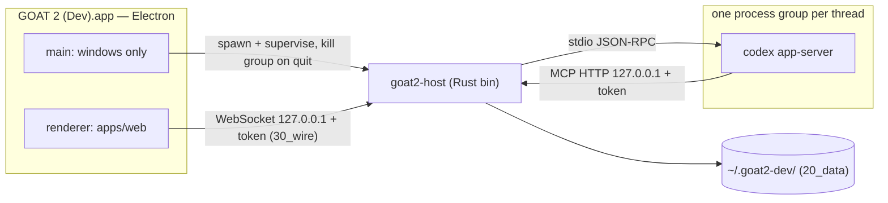

# 10 Processes

| Process | Started by | Lives | Notes |
|---|---|---|---|
| Electron main | user | until quit | no thread work; no IPC data path for threads |
| renderer | main | per window | talks to the host directly over WebSocket |
| `goat2-host` | main | until app quit | quitting the app ends the work; writes `host.json` (pid, port, generation); on start: cleans leftover groups from `host.json`, settles runs, regenerates index epoch |
| `codex app-server` | host | per thread; stopped after 10 min idle | own process group, `nice -n 10` for agent commands, memory limit per group |

| Build | App | Bundle id | Data dir | Host port |
|---|---|---|---|---|
| Dev (Part 1) | `/Applications/GOAT 2 (Dev).app` | `si.goat.goat2.dev` | `~/.goat2-dev` | set by lane G, not 3773/3774 (GOAT v1) |
| Release (later) | `GOAT 2.app` | `si.goat.goat2` | `~/.goat2` | later |

GOAT v1 Nightly is a separate app with its own data (`~/.goat/desktop-nightly`); nothing is shared.
