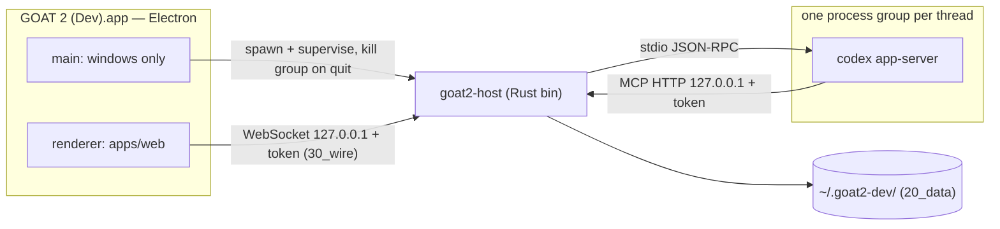

# 10 Processes

| Process | Started by | Lives | Notes |
|---|---|---|---|
| Electron main | user | until quit | no thread work; no IPC data path for threads |
| renderer | main | per window | talks to the host directly over WebSocket |
| `goat2-host` | main | until app quit | quitting the app ends the work; own process group; exits when stdin closes; writes `host.json` (pid, port, generation) and bumps `<dataDir>/generation` on every start; on start: kills a leftover host group from `host.json` (never attaches), settles runs, regenerates index epoch |
| `codex app-server` | host | per thread; stopped after 10 min idle | own process group, `nice -n 10` for agent commands, memory limit per group: lane B gives `group_rss_bytes()` + `kill_group()`, host (lane E) samples every 10 s, 8 GiB default, warns at 80 %, over → kill that group only, run `failed` (`memory_limit`), never resent |

| Build | App | Bundle id | Data dir | Host port |
|---|---|---|---|---|
| Dev (Part 1) | `/Applications/GOAT 2 (Dev).app` | `si.goat.goat2.dev` | `~/.goat2-dev` | 3873 (GOAT v1 uses 3773/3774) |
| Release (later) | `GOAT 2.app` | `si.goat.goat2` | `~/.goat2` | later |

GOAT v1 Nightly is a separate app with its own data (`~/.goat/desktop-nightly`); nothing is shared.

## Host launch contract (lanes E + G, owner 2026-11-28)
- Shell starts `goat2-host` with env only: `GOAT2_DATA_DIR`, `GOAT2_HOST_PORT` (0 = pick free), `GOAT2_HOST_TOKEN`
  (random per app launch; if absent the host generates one and writes it to `host.json`, mode 0600). CLI flags
  are aliases for manual runs only.
- Ready: one JSON line on stdout `{wsUrl, mcpUrl, port, generation}` and `GET /health` = 200.
- One 127.0.0.1 server: `/ws` (UI token), `/mcp` (per-thread tokens), `/health`.
- Quit: SIGTERM to the host group, SIGKILL after 5 s. Crash: kill leftover group, restart with v1 backoff
  (jittered 1–30 s, 5 restarts per 10 min then pause; v1 `DesktopBackendRecoveryPolicy.ts`).
- UI gets `{wsUrl, token}` from preload `window.goat2Host` and connects directly.

## Window and build stamp (lane G, owner 2026-11-28)
- `titleBarStyle: hiddenInset`, macOS buttons at x16 y13 (v1 `DesktopWindowAppearance.ts`), top bar 40px drawn by the UI as
  `-webkit-app-region: drag` (controls `no-drag`), traffic-light area x16..~84 left empty in the desktop build.
- Preload `window.goat2Host = {wsUrl, token, build: {commit, branch, builtAt}}`; Dev builds show the stamp in the top bar.
- `scripts/build-dev-app.sh` installs only from branch `goat2` and refuses unless `pnpm -r typecheck` and `cargo test --workspace --locked` pass.
- Renderer origin: custom scheme `goat2-dev://app` (v1 naming pattern, never v1's `goat` / `goat-dev`); `goat2-dev://app/...` links open in the Dev app (single instance + open-url, lifted from v1).
- A host that exits 0 before its ready line / `/health` is not restarted ("host not running"); ready-then-exit or non-zero exit restarts with v1 backoff.

- Part 2 (planned, P2-S): Cursor, OpenCode, Muse threads run one `apps/engine-helper` Node process per thread (own process group, nice +10), so a helper/SDK crash ends only that thread. Pi/OmO run one `--mode rpc` process per thread driven from Rust. Same shape as one Codex app-server per thread.
