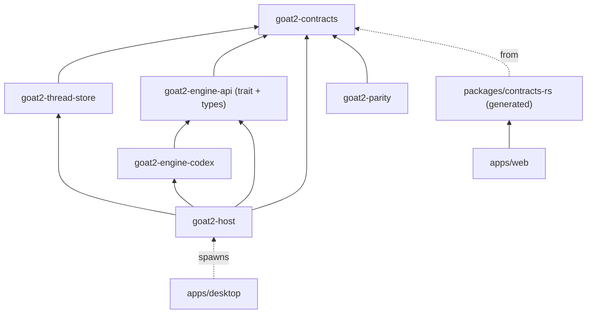

# 40 Dependencies

- Only `goat2-host` combines crates. Store and drivers never depend on each other or on the host.
- Engines plug in through `goat2-engine-api` (`EngineFactory` / `EngineSession` / `EngineEvent`, owned by lane E); every driver (Codex now, Claude/ACP in Part 2) implements it.
- `apps/web` reaches the host only through `packages/contracts-rs` types over WebSocket; no Node
  server, no Electron IPC for thread data.
- `apps/desktop` knows the host only as a binary path + env (data dir, port, token).
- Root `Cargo.toml`: no `[patch]`. Keep trees small; `libc` only under `cfg(unix)`.
- One shared build cache (kache) for every worktree.
