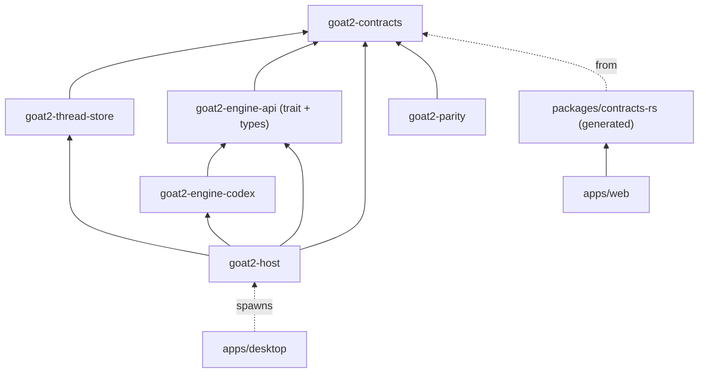

# 40 Dependencies

- Only `goat2-host` combines crates. Store and drivers never depend on each other or on the host.
- Engines plug in through `goat2-engine-api` (`EngineFactory` / `EngineSession` / `EngineEvent`, owned by lane E); every driver (Codex now, Claude/ACP in Part 2) implements it.
- `apps/web` reaches the host only through `packages/contracts-rs` types over WebSocket; no Node
  server, no Electron IPC for thread data.
- `apps/desktop` knows the host only as a binary path + env (data dir, port, token).
- Root `Cargo.toml`: no `[patch]`. Keep trees small; `libc` only under `cfg(unix)`.
- One shared build cache (kache) for every worktree.

- Part 2 (planned): `goat2-engine-sdk` -> `goat2-engine-api`, `goat2-contracts`; `goat2-host` -> `goat2-engine-sdk` (via the factory registry). Drivers never depend on `goat2-host`.
- Part 2 (planned): `goat2-engine-acp` -> `goat2-engine-api`, `goat2-contracts`; it spawns `goat2-acp-mcp-bridge` as a separate binary (found beside the running exe or `$GOAT2_ACP_MCP_BRIDGE`), not a crate dependency. `goat2-acp-mcp-bridge` depends on no goat2-* crate.
- `goat2-engine-codex` -> `url` 2 (WHATWG URL parsing with UTS46/IDNA, same as v1 `new URL`) for OpenAI-route classification; owner decision 2026-11-29 instead of a hand parser.
